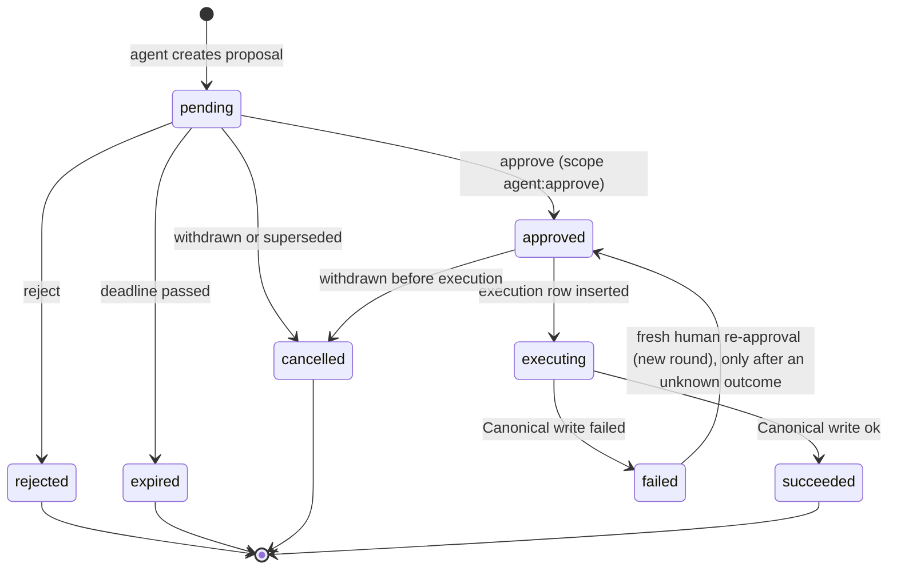

# ERP Brain - `brain_db` Design Specification

## Part 2 of 4 - Complete Table Specifications

Every table below is specified with the 17 required items, every column with type, nullability, default, key and description, every constraint and index, and an illustrative record. The column lists are generated from the same definition as `ddl/*.sql` and `models.py` (the definition and generator are in `tools/schema_gen/`). After handoff the team may keep generating or maintain the DDL and models by hand (OD-24); either way, if this document and the DDL disagree, one of them is wrong and CI should say which.

**Standard facts that apply to every table** (not repeated per table):

- `tenant_id UUID NOT NULL`, no default (D-34). Always set explicitly from the verified tenant context. Every table also has `FORCE ROW LEVEL SECURITY` with policy `pol_tenant_isolation` (N-02, migration 0007): a transaction without `app.tenant_id` sees no rows and cannot write.
- Grain (N-05): sales, features, forecasts, risk and recommendations are per organization (`tenant_id`) and product; no table has a branch or location key.
- All instants are `TIMESTAMPTZ` UTC; business dates are `DATE` in the tenant timezone.
- Example values are illustrative only. `...` in an id means "a UUID".
- Privileges: `brain_app` (brain-api) has the grants listed per table; `brain_worker` (brain-worker, D-45) has the worker grants listed per table; `brain_readonly` has `SELECT` everywhere; `brain_retention` has `SELECT, DELETE` only on tables marked purgeable; `brain_provisioner` (provisioning command, N-01) has `SELECT, INSERT, UPDATE` on `tenant_registry` and `SELECT, INSERT` on `rule_config` only. RLS applies to all of them.

---

## A. Ingestion, Normalised Data and Features

### A.1 Which ingestion tables are needed?

The source asks for event ingestion with de-duplication plus a scheduled `updated_since` backfill (G§3.9). The MVP keeps only the polling half (D-23): there are no events, and the Brain polls Canonical daily totals on a short fixed interval. Because every polled row is an absolute total, the upsert itself is the idempotency mechanism and no de-duplication ledger is needed.

| Table | Verdict | Reason |
|---|---|---|
| ~~`processed_event`~~ | **Removed (D-23)** | Existed only to de-duplicate Redis Stream deliveries. Absolute upserts of polled totals are idempotent by construction |
| `sync_checkpoint` | **Mandatory** | The poll watermark and the intelligence-window watermark need a persisted cursor; without it every poll is a full read |
| `ingest_failure` | **Mandatory (lightweight)** | A poll that keeps failing must be visible (pipeline status, alert) instead of silently leaving stale data |
| `canonical_cache` | **Mandatory** | Named in the source |
| `sales_fact` | **Mandatory** | Named in the source |
| `sales_day_coverage` | **Mandatory for correctness (RC-04)** | Separates a true zero day from a missing day |
| `calendar_day` | **Mandatory** | Holiday, Ramadan and flu-season features need a reproducible store; Ramadan moves every year |
| *Per-sale-line table* | **Unnecessary** | Would duplicate ERP data. Corrections are handled by absolute recompute from Canonical, and the line-level anomaly rule is dropped because daily totals carry no line detail |
| *Raw event payload store* | **Unnecessary** | A re-poll or backfill from Canonical recovers any failed read; storing payloads adds PII risk and size |
| *Recompute-request queue* | **Unnecessary** | Change detection on `sales_fact.updated_at` plus the nightly full recompute covers invalidation |

**Separation of concerns:** `sync_checkpoint` = where the poll got to; `canonical_cache` = canonical payload cache; `sales_fact` = daily totals copied from Canonical; `feature_daily` = derived. No payload is stored in two of these.

### A.2 `sales_fact` write semantics (RC-05, revised by D-25)

| Path | When | Operation | Guard |
|---|---|---|---|
| Poll (every `sales_poll_interval_seconds`, default 300 s) | Rows whose ERP `updated_at` > `high_watermark - poll_overlap_seconds` | Absolute upsert of `units_sold`, `units_returned`, `net_units`, `day_status`, `is_complete`; `source_mode='poll'`; insert `sales_day_coverage(open)` if missing | `WHERE EXCLUDED.source_updated_at >= sales_fact.source_updated_at`; watermark saved only after the last page |
| Reconcile (nightly, at `end_of_day_run_local_time`) | Last `reconcile_lookback_days` by date range, **without** `updated_since` | Same absolute upsert, `source_mode='reconcile'`; mark each closed day `complete`, or `gap` when the ERP says it is incomplete | Idempotent by construction |
| Backfill (manual) | Any date range | Same, `source_mode='backfill'` | Idempotent |

Nothing is ever incremented. A sale at 23:59 that is edited at 00:01 is handled correctly: the edit advances the row's `updated_at`, the next poll returns the new absolute total, and the upsert replaces the old one.

### A.3 Feature design (answers to the feature requirements)

**One table or several?** One is sufficient for the MVP. All feature columns share one grain (tenant, product, day), one producer, one lifecycle (fully rebuildable) and the same consumers. Splitting would add joins on the hot path (`get_features`) and a coordination problem between tables with no benefit. Split only if a different grain appears (hourly, per category) or a feature has a different refresh cycle. No feature registry: `feature_set_version` plus `FEATURE_COLUMNS` in code is enough.

**Columns and types:** see `feat.feature_daily` below (30 columns). Inputs are listed in `MODEL_INPUT_COLUMNS` (20, ordered); labels in `LABEL_COLUMNS` (`y_units`, `y_status`, `is_outlier`).

**Row semantics:** the row for day *d* describes the prediction of demand on *d* using only information from days before *d* plus calendar data that is known in advance. Example from the source: AMOX on 2026-09-24 has `lag_1 = 22` meaning sales on 2026-09-23.

**Missing observations:**

| Situation | `y_status` | Lag/rolling features |
|---|---|---|
| Day verified complete, a `sales_fact` row exists | `observed` | Use the value |
| Day verified complete, no row | `zero_filled` (`y_units = 0`) | Use 0 |
| Day not complete (outage, not yet reconciled, `gap`) | `missing` | Excluded from windows; a lag pointing at it is `NULL` |
| Current business day | `open` | Not used as a lag until the day is complete |
| After today | `future` | Only the next-day row is persisted |

Rolling features use only complete days and are `NULL` unless the window has enough observations (`n_obs_7 >= 5`, 14-day `>= 10`, `n_obs_28 >= 21`). `n_obs_7/28` are stored so a model or a quality check can see how complete the window was. Forward-filling short gaps (`max_gap_days_ffill`) is a *training-time* decision made by the forecasting code; the table never stores an imputed value as observed, and a forecast that relied on it records `quality_flags = {gap_filled}`.

**Invalidation after corrections:** a feature row is stale when any `sales_fact` row in its window has `updated_at > inputs_max_updated_at`. The incremental job selects `sales_fact` rows changed since its watermark (`sync_checkpoint.resource = 'feature_incremental'`, with a `feature_overlap_minutes` safety lag) and recomputes feature rows for that product from the changed date through `date + 28` days. The nightly full recompute rewrites everything and is the safety net for any missed invalidation. A change to `calendar_day` or to `feature_set_version` triggers a targeted or full recompute.

**Stable typed vector:** `FeatureVector` (Pydantic, `extra="forbid"`) is the only thing the engines see; `model_inputs()` returns values in the fixed `MODEL_INPUT_COLUMNS` order; booleans become 0/1; unknowns stay `NULL` (LightGBM handles missing). A model records `feature_set_version`; inference raises `FeatureNotAvailable` on a mismatch rather than predicting from the wrong layout.

**Training/inference consistency:** both read the same table through the same `FeatureStore`, and the multi-step future rows that are not persisted are built in memory by the *same pure function* that the nightly job uses (recursive forecasting appends the prediction as a pseudo-observation). There is no second implementation of any feature.

**Leakage prevention:**

1. Windows are trailing and exclude the current day.
2. The label side (`y_*`, `is_outlier`) is physically separate from `MODEL_INPUT_COLUMNS`; an import-time assertion fails if they overlap. `is_outlier` is computed from the same-day label, so it is never an input.
3. Training uses time-based splits and rolling-origin backtests; `get_training_frame` returns only `observed`/`zero_filled` rows and nothing at or after the cutoff.
4. Winsorisation bounds are computed from the training window only, at training time.
5. Calendar features contain only facts known in advance.
6. Known, accepted caveat: features are recomputed from the *corrected* history, so a backtest sees data as finally corrected, not as it looked at the time (documented; revisit if corrections are frequent).

---

### A.4 Table specifications

#### `ingest.sync_checkpoint` - SyncCheckpoint

**Scope:** MVP &nbsp;|&nbsp; **Durability tier:** O - operational state &nbsp;|&nbsp; **Class:** `SyncCheckpoint`

| # | Item | Specification |
|---|---|---|
| 1 | Table / schema | `sync_checkpoint` in schema `ingest` |
| 2 | Purpose & ownership | Watermark per (tenant, resource) for the short-interval sales poll (`updated_since`), the nightly reconcile and the intraday intelligence window. One row per resource. This table is the poll checkpoint (D-25). |
| 3 | Writers / readers | **Writes:** Sales poller, nightly reconcile and intelligence window (single writer per resource, guarded by `pg_try_advisory_xact_lock(hashtext(tenant\|\|resource))`). **Reads:** Same jobs; ops dashboard (`GET /brain/pipeline/status`). |
| 4 | Primary key | `pk_sync_checkpoint` (tenant_id, resource) |
| 5 | Foreign keys | None (external references only) |
| 6 | Unique constraints | None beyond the PK |
| 7 | Check constraints | 3 (listed below) |
| 8 | Indexes | None beyond PK/unique constraints |
| 9 | Tenant isolation | `tenant_id` NOT NULL with no default on every row; every query, update and delete is `WHERE tenant_id = :tenant_id` taken from the verified tenant context. Constraints and FKs include `tenant_id`. Multi-tenancy is a core requirement (D-34). Second wall (N-02, migration 0007): `FORCE ROW LEVEL SECURITY` with policy `pol_tenant_isolation` (`tenant_id = public.brain_current_tenant()`, the transaction-local `app.tenant_id`); without a tenant context the table reads as empty and rejects writes. |
| 10 | Timestamp semantics | All UTC TIMESTAMPTZ. `high_watermark` is the ERP server clock (from the SalesPage), never the Brain clock. |
| 11 | JSONB usage | No JSONB columns. |
| 12 | Access patterns | Point read/update by primary key once per job run. |
| 13 | Mutability | Mutable (upsert). |
| 14 | Retention / deletion | Permanent (a handful of rows per tenant). |
| 15 | Recovery / backfill | Reset by deleting the row: the next poll reads everything from `poll_history_start_date` (absolute upsert, so it is safe). |
| 16 | Migration notes | Seeded lazily by jobs (INSERT ... ON CONFLICT). No FKs. |
| - | Triggers | `trg_sync_checkpoint_set_updated_at` |
| - | App privileges | brain_app: SIU; brain_worker: SIU; retention role DELETE: no |

**Columns**

| Column | PostgreSQL type | Nullable | Default | PK/FK/Unique | Description |
|---|---|---|---|---|---|
| `tenant_id` | `UUID` | no |  | PK | Tenant UUID = ERP organization id (external reference owned by ERP Identity; not a FK). Always set explicitly from the verified tenant context (JWT for API calls, the job's tenant for worker runs). No column default (decision D-34): a missing tenant fails the insert instead of landing in a default tenant. |
| `resource` | `TEXT` | no |  | PK | Logical job: sales_poll \| sales_reconcile \| intel_window \| feature_nightly_full. |
| `high_watermark` | `TIMESTAMPTZ` | yes |  |  | sales_poll: the SalesPage `high_watermark` of the last poll whose pages were ALL read (never advanced mid-poll); the next poll sends `updated_since = high_watermark - poll_overlap_seconds`. intel_window: max(sales_fact.updated_at) already processed. |
| `cursor` | `TEXT` | yes |  |  | Opaque pagination cursor for an in-progress paged read. |
| `last_status` | `TEXT` | no | `'idle'` |  | idle \| running \| succeeded \| failed. |
| `last_started_at` | `TIMESTAMPTZ` | yes |  |  | Start of the most recent run. |
| `last_finished_at` | `TIMESTAMPTZ` | yes |  |  | End of the most recent run. |
| `last_error_code` | `TEXT` | yes |  |  | Short error code of the most recent failure. |
| `consecutive_failures` | `INTEGER` | no | `0` |  | Reset to 0 on success; drives alerting. |
| `created_at` | `TIMESTAMPTZ` | no | `now()` |  | Row creation time (UTC). |
| `updated_at` | `TIMESTAMPTZ` | no | `now()` |  | Last modification time (UTC); maintained by trigger. |

**Check constraints**

- `ck_sync_checkpoint__resource_format`: `resource ~ '^[a-z][a-z0-9_]*$'`
- `ck_sync_checkpoint__last_status`: `last_status IN ('idle','running','succeeded','failed')`
- `ck_sync_checkpoint__failures_nonneg`: `consecutive_failures >= 0`

**Indexes - rationale**

- (only the PK / unique-constraint indexes)

**Example record** (illustrative values only)

```json
{
  "tenant_id": "00000000-0000-0000-0000-000000000001",
  "resource": "sales_poll",
  "high_watermark": "2026-10-17T10:20:00Z",
  "last_status": "succeeded",
  "last_started_at": "2026-10-17T10:20:00Z",
  "last_finished_at": "2026-10-17T10:20:01Z",
  "consecutive_failures": 0
}
```

#### `ingest.ingest_failure` - IngestFailure

**Scope:** MVP &nbsp;|&nbsp; **Durability tier:** O - operational state &nbsp;|&nbsp; **Class:** `IngestFailure`

| # | Item | Specification |
|---|---|---|
| 1 | Table / schema | `ingest_failure` in schema `ingest` |
| 2 | Purpose & ownership | Record of a Canonical poll or read the Brain could not process after bounded retries. One open row per (resource, error_code); repeats bump `attempts`. Recovery is the next successful poll or the nightly reconcile, never payload replay. |
| 3 | Writers / readers | **Writes:** Sales poller / canonical client (Ibrahim, D-02). **Reads:** Ops dashboard; pipeline status endpoint; nightly reconcile (decides which days to mark `gap`). |
| 4 | Primary key | `pk_ingest_failure` (id) |
| 5 | Foreign keys | None (external references only) |
| 6 | Unique constraints | <br>`uq_ingest_failure__open_resource_code` (tenant_id, resource, error_code) WHERE status = 'open' |
| 7 | Check constraints | 9 (listed below) |
| 8 | Indexes | `ix_ingest_failure__tenant_status_failed` (tenant_id, status, last_failed_at) |
| 9 | Tenant isolation | `tenant_id` NOT NULL with no default on every row; every query, update and delete is `WHERE tenant_id = :tenant_id` taken from the verified tenant context. Constraints and FKs include `tenant_id`. Multi-tenancy is a core requirement (D-34). Second wall (N-02, migration 0007): `FORCE ROW LEVEL SECURITY` with policy `pol_tenant_isolation` (`tenant_id = public.brain_current_tenant()`, the transaction-local `app.tenant_id`); without a tenant context the table reads as empty and rejects writes. |
| 10 | Timestamp semantics | UTC TIMESTAMPTZ. |
| 11 | JSONB usage | `payload_excerpt`: object, allow-listed keys, validated by Pydantic `PayloadExcerpt` (contracts_jsonb.py); size-bounded by the writer. |
| 12 | Access patterns | Upsert on failure (`ON CONFLICT (tenant_id, resource, error_code) WHERE status = 'open' DO UPDATE SET attempts = attempts + 1`); list open failures by tenant. |
| 13 | Mutability | Mutable only through attempts/status/resolution fields. |
| 14 | Retention / deletion | Resolved/ignored rows 90 days; open rows kept until resolved. |
| 15 | Recovery / backfill | The next successful poll resolves the row (`resolution='repolled'`); days still unreadable at the nightly reconcile are marked `gap`. |
| 16 | Migration notes | Additive. Partial unique index prevents duplicate open failures. |
| - | Triggers | `trg_ingest_failure_set_updated_at` |
| - | App privileges | brain_app: SIU; brain_worker: SIU; retention role DELETE: yes |

**Columns**

| Column | PostgreSQL type | Nullable | Default | PK/FK/Unique | Description |
|---|---|---|---|---|---|
| `id` | `UUID` | no | `gen_random_uuid()` | PK | Internal Brain surrogate key. |
| `tenant_id` | `UUID` | no |  |  | Tenant UUID = ERP organization id (external reference owned by ERP Identity; not a FK). Always set explicitly from the verified tenant context (JWT for API calls, the job's tenant for worker runs). No column default (decision D-34): a missing tenant fails the insert instead of landing in a default tenant. |
| `failure_kind` | `TEXT` | no |  |  | schema_validation \| canonical_read_failed \| normalization_error \| other. |
| `resource` | `TEXT` | no |  |  | Job that failed, e.g. sales_poll, sales_reconcile, inventory_read. |
| `error_code` | `TEXT` | no |  |  | Stable machine-readable error code. |
| `error_message` | `TEXT` | yes |  |  | Sanitised message (<= 500 chars). Never contains customer data. |
| `payload_excerpt` | `JSONB` | yes |  |  | Allow-listed keys only (schema, version, product_ids, business_dates, http_status). No customer fields. |
| `attempts` | `INTEGER` | no | `1` |  | Failed attempts folded into this open row. |
| `status` | `TEXT` | no | `'open'` |  | open \| resolved \| ignored. |
| `first_failed_at` | `TIMESTAMPTZ` | no | `now()` |  | First failure time. |
| `last_failed_at` | `TIMESTAMPTZ` | no | `now()` |  | Most recent failure time. |
| `resolved_at` | `TIMESTAMPTZ` | yes |  |  | When closed. |
| `resolved_by` | `TEXT` | yes |  |  | Actor id (JWT sub) or job name that closed it. |
| `resolution` | `TEXT` | yes |  |  | repolled \| fixed \| ignored_invalid. |
| `trace_id` | `CHAR(32)` | yes |  |  | W3C trace-id (32 lowercase hex) linking the work to the originating request/job. |
| `created_at` | `TIMESTAMPTZ` | no | `now()` |  | Row creation time (UTC). |
| `updated_at` | `TIMESTAMPTZ` | no | `now()` |  | Last modification time (UTC); maintained by trigger. |

**Check constraints**

- `ck_ingest_failure__kind`: `failure_kind IN ('schema_validation','canonical_read_failed','normalization_error','other')`
- `ck_ingest_failure__resource_format`: `resource ~ '^[a-z][a-z0-9_]*$'`
- `ck_ingest_failure__status`: `status IN ('open','resolved','ignored')`
- `ck_ingest_failure__attempts`: `attempts >= 1`
- `ck_ingest_failure__message_len`: `error_message IS NULL OR char_length(error_message) <= 500`
- `ck_ingest_failure__resolution`: `resolution IS NULL OR resolution IN ('repolled','fixed','ignored_invalid')`
- `ck_ingest_failure__resolved_consistency`: `(status = 'open' AND resolved_at IS NULL) OR (status <> 'open' AND resolved_at IS NOT NULL)`
- `ck_ingest_failure__payload_excerpt_type`: `payload_excerpt IS NULL OR jsonb_typeof(payload_excerpt) = 'object'`
- `ck_ingest_failure__trace_id_format`: `trace_id IS NULL OR trace_id ~ '^[0-9a-f]{32}$'`

**Indexes - rationale**

- `uq_ingest_failure__open_resource_code` - At most one open failure per job and error code, so a poll failing every few minutes bumps `attempts` instead of inserting hundreds of rows.
- `ix_ingest_failure__tenant_status_failed` - Ops queue of open failures, newest last.

**Example record** (illustrative values only)

```json
{
  "id": "0a7e...-uuid",
  "tenant_id": "00000000-0000-0000-0000-000000000001",
  "failure_kind": "canonical_read_failed",
  "resource": "sales_poll",
  "error_code": "DEPENDENCY_UNAVAILABLE",
  "attempts": 3,
  "status": "open",
  "payload_excerpt": {
    "http_status": 503
  }
}
```

#### `ingest.canonical_cache` - CanonicalCache

**Scope:** MVP &nbsp;|&nbsp; **Durability tier:** R - rebuildable &nbsp;|&nbsp; **Class:** `CanonicalCache`

| # | Item | Specification |
|---|---|---|
| 1 | Table / schema | `canonical_cache` in schema `ingest` |
| 2 | Purpose & ownership | Local durable cache of validated Canonical JSON (Product, InventoryItem, Supplier, optionally PurchaseOrder) with `synced_at`. NOT a source of truth: it avoids repeated Canonical reads and holds supplier lead times and product attributes needed by the engines. |
| 3 | Writers / readers | **Writes:** Canonical client (Ibrahim, D-02). Product, inventory and supplier are read on demand by the intelligence window when the cached copy is older than its freshness threshold. **Reads:** Risk engine (supplier lead time, product attrs), recommendation engine, tools via services (never free SQL). |
| 4 | Primary key | `pk_canonical_cache` (id) |
| 5 | Foreign keys | None (external references only) |
| 6 | Unique constraints | `uq_canonical_cache__tenant_entity` (tenant_id, entity_type, entity_id) |
| 7 | Check constraints | 4 (listed below) |
| 8 | Indexes | `ix_canonical_cache__tenant_type_synced` (tenant_id, entity_type, synced_at) |
| 9 | Tenant isolation | `tenant_id` NOT NULL with no default on every row; every query, update and delete is `WHERE tenant_id = :tenant_id` taken from the verified tenant context. Constraints and FKs include `tenant_id`. Multi-tenancy is a core requirement (D-34). Second wall (N-02, migration 0007): `FORCE ROW LEVEL SECURITY` with policy `pol_tenant_isolation` (`tenant_id = public.brain_current_tenant()`, the transaction-local `app.tenant_id`); without a tenant context the table reads as empty and rejects writes. |
| 10 | Timestamp semantics | `synced_at` = Brain fetch time; `source_updated_at` = ERP clock. UTC. |
| 11 | JSONB usage | `payload`: validated against the Canonical JSON Schema / Pydantic model generated from `/contracts/canonical` before insert. Free-text fields (e.g. product names) are untrusted content and must never be inserted into prompts as instructions. |
| 12 | Access patterns | Point lookup by (tenant_id, entity_type, entity_id); staleness scan by synced_at. |
| 13 | Mutability | Mutable (upsert). Inventory entries are advisory: decisions that depend on stock re-read Canonical when `synced_at` is older than the freshness threshold in `rule_config(platform)`. |
| 14 | Retention / deletion | Evict entries not refreshed for 30 days. |
| 15 | Recovery / backfill | Fully rebuildable by Canonical reads. |
| 16 | Migration notes | Additive. If Canonical bumps `version`, both versions can coexist; `schema_version` records which one the row holds. |
| - | Triggers | `trg_canonical_cache_set_updated_at` |
| - | App privileges | brain_app: SIUD; brain_worker: SIU; retention role DELETE: yes |

**Columns**

| Column | PostgreSQL type | Nullable | Default | PK/FK/Unique | Description |
|---|---|---|---|---|---|
| `id` | `UUID` | no | `gen_random_uuid()` | PK | Internal Brain surrogate key. |
| `tenant_id` | `UUID` | no |  |  | Tenant UUID = ERP organization id (external reference owned by ERP Identity; not a FK). Always set explicitly from the verified tenant context (JWT for API calls, the job's tenant for worker runs). No column default (decision D-34): a missing tenant fails the insert instead of landing in a default tenant. |
| `entity_type` | `TEXT` | no |  |  | product \| inventory_item \| supplier \| purchase_order. |
| `entity_id` | `TEXT` | no |  |  | Canonical identifier. product/supplier: UUID string. inventory_item: '<product_id>\|<location_id>'. |
| `schema_name` | `TEXT` | no |  |  | Canonical schema name, e.g. 'canonical.InventoryItem'. |
| `schema_version` | `TEXT` | no |  |  | Canonical schema `version`, e.g. '1.0'. |
| `payload` | `JSONB` | no |  |  | Validated canonical payload exactly as received (after Pydantic validation). |
| `payload_sha256` | `CHAR(64)` | no |  |  | SHA-256 of the canonical-serialised payload; cheap change detection (e.g. supplier lead time changed). |
| `source_updated_at` | `TIMESTAMPTZ` | yes |  |  | ERP `updated_at` carried by the payload. Older payloads never overwrite newer ones. |
| `synced_at` | `TIMESTAMPTZ` | no | `now()` |  | When the Brain last fetched/confirmed this payload (UTC). |
| `created_at` | `TIMESTAMPTZ` | no | `now()` |  | Row creation time (UTC). |
| `updated_at` | `TIMESTAMPTZ` | no | `now()` |  | Last modification time (UTC); maintained by trigger. |

**Check constraints**

- `ck_canonical_cache__entity_type`: `entity_type IN ('product','inventory_item','supplier','purchase_order')`
- `ck_canonical_cache__entity_id_len`: `char_length(entity_id) BETWEEN 1 AND 200`
- `ck_canonical_cache__payload_type`: `jsonb_typeof(payload) = 'object'`
- `ck_canonical_cache__payload_sha256_format`: `payload_sha256 ~ '^[0-9a-f]{64}$'`

**Indexes - rationale**

- `ix_canonical_cache__tenant_type_synced` - Staleness sweeps and 'refresh everything older than X'.

**Example record** (illustrative values only)

```json
{
  "tenant_id": "00000000-0000-0000-0000-000000000001",
  "entity_type": "inventory_item",
  "entity_id": "b3f1c2a0-5d1e-4c7a-9a10-000000000001|main-store",
  "schema_name": "canonical.InventoryItem",
  "schema_version": "1.0",
  "payload": {
    "available_quantity": 40,
    "reorder_point": 50
  },
  "synced_at": "2026-09-24T10:16:42Z"
}
```

#### `ingest.sales_fact` - SalesFact

**Scope:** MVP &nbsp;|&nbsp; **Durability tier:** R - rebuildable &nbsp;|&nbsp; **Class:** `SalesFact`

| # | Item | Specification |
|---|---|---|
| 1 | Table / schema | `sales_fact` in schema `ingest` |
| 2 | Purpose & ownership | Daily sales per product (product x business day), copied from the polled Canonical `DailySalesTotal`. The only persisted sales data in the Brain; aggregate, not per-sale-line. Every write is an absolute upsert keyed (tenant, product, date) that keeps the newest ERP `updated_at` (D-25), so re-reading a row is always harmless. |
| 3 | Writers / readers | **Writes:** Sales poller (every `sales_poll_interval_seconds`), nightly reconcile, manual backfill - Ibrahim (D-02). **Reads:** Feature pipeline, anomaly engine, BI (`get_sales_history` summaries), evaluation (actuals). |
| 4 | Primary key | `pk_sales_fact` (id) |
| 5 | Foreign keys | None (external references only) |
| 6 | Unique constraints | `uq_sales_fact__tenant_product_date` (tenant_id, product_id, sales_date) |
| 7 | Check constraints | 5 (listed below) |
| 8 | Indexes | `ix_sales_fact__tenant_sales_date` (tenant_id, sales_date)<br>`ix_sales_fact__tenant_updated_at` (tenant_id, updated_at) |
| 9 | Tenant isolation | `tenant_id` NOT NULL with no default on every row; every query, update and delete is `WHERE tenant_id = :tenant_id` taken from the verified tenant context. Constraints and FKs include `tenant_id`. Multi-tenancy is a core requirement (D-34). Second wall (N-02, migration 0007): `FORCE ROW LEVEL SECURITY` with policy `pol_tenant_isolation` (`tenant_id = public.brain_current_tenant()`, the transaction-local `app.tenant_id`); without a tenant context the table reads as empty and rejects writes. |
| 10 | Timestamp semantics | `sales_date` is a DATE in the tenant business timezone; all other timestamps UTC. `updated_at` (Brain clock) is the change-detection key for downstream jobs; `source_updated_at` (ERP clock) is only the stale-overwrite guard. |
| 11 | JSONB usage | No JSONB columns. |
| 12 | Access patterns | Upsert by (tenant_id, product_id, sales_date) `... DO UPDATE ... WHERE EXCLUDED.source_updated_at >= sales_fact.source_updated_at`; range scans by date; per-product history scans via the unique index. |
| 13 | Mutability | Mutable. Always absolute (never incremented), so duplicates, overlaps and out-of-order pages are harmless. |
| 14 | Retention / deletion | Keep >= 3 years (seasonality needs full years). Rebuildable, so no archive. |
| 15 | Recovery / backfill | Rebuild with a Canonical backfill over any date range; set `source_mode='backfill'`, then mark days complete in `sales_day_coverage`. |
| 16 | Migration notes | Additive columns only. Grain is organization-level (N-05): one row per (tenant, product, business date) for the whole organization; branch-level forecasting is deferred. A product x location split would add `location_id` and change the unique key - a breaking migration. |
| - | Triggers | `trg_sales_fact_set_updated_at` |
| - | App privileges | brain_app: SIU; brain_worker: SIU; retention role DELETE: no |

**Columns**

| Column | PostgreSQL type | Nullable | Default | PK/FK/Unique | Description |
|---|---|---|---|---|---|
| `id` | `UUID` | no | `gen_random_uuid()` | PK | Internal Brain surrogate key. |
| `tenant_id` | `UUID` | no |  |  | Tenant UUID = ERP organization id (external reference owned by ERP Identity; not a FK). Always set explicitly from the verified tenant context (JWT for API calls, the job's tenant for worker runs). No column default (decision D-34): a missing tenant fails the insert instead of landing in a default tenant. |
| `product_id` | `UUID` | no |  |  | Canonical product id (external reference; see OD-02). |
| `sales_date` | `DATE` | no |  |  | Canonical `business_date`, computed by the ERP in the tenant timezone (D-04, OD-03). |
| `units_sold` | `NUMERIC(14,3)` | no | `0` |  | Gross units sold that day (Canonical `units_sold`). |
| `units_returned` | `NUMERIC(14,3)` | no | `0` |  | Units returned that day (Canonical `units_returned`). |
| `net_units` | `NUMERIC(14,3)` | no | `0` |  | units_sold - units_returned (Canonical `net_units`). Demand = net units (D-06). May be negative only if returns exceed sales that day; the feature label clamps it at 0. |
| `day_status` | `TEXT` | no |  |  | Canonical `day_status`: open (the ERP day is still running) \| closed. |
| `is_complete` | `BOOLEAN` | no | `true` |  | Canonical `complete`. false = the ERP cannot vouch for this total; the day is excluded from training (D-06). |
| `source_updated_at` | `TIMESTAMPTZ` | no |  |  | Canonical `updated_at` (ERP clock). The upsert only replaces the row when the incoming value is >= this one. |
| `source_mode` | `TEXT` | no | `'poll'` |  | poll (short-interval incremental poll) \| reconcile (nightly re-read of the last N days) \| backfill (manual range). |
| `polled_at` | `TIMESTAMPTZ` | no | `now()` |  | When the Brain last read this row from Canonical (UTC). |
| `created_at` | `TIMESTAMPTZ` | no | `now()` |  | Row creation time (UTC). |
| `updated_at` | `TIMESTAMPTZ` | no | `now()` |  | Last modification time (UTC); maintained by trigger. |

**Check constraints**

- `ck_sales_fact__units_nonneg`: `units_sold >= 0`
- `ck_sales_fact__returned_nonneg`: `units_returned >= 0`
- `ck_sales_fact__net_consistency`: `net_units = units_sold - units_returned`
- `ck_sales_fact__day_status`: `day_status IN ('open','closed')`
- `ck_sales_fact__source_mode`: `source_mode IN ('poll','reconcile','backfill')`

**Indexes - rationale**

- `ix_sales_fact__tenant_sales_date` - Date-range scans: nightly reconcile, BI top-N, per-day batch scoring.
- `ix_sales_fact__tenant_updated_at` - Change detection: which products changed since the intelligence-window watermark (the 'dirty' set) and the incremental feature job.

**Example record** (illustrative values only)

```json
{
  "tenant_id": "00000000-0000-0000-0000-000000000001",
  "product_id": "b3f1c2a0-5d1e-4c7a-9a10-000000000001",
  "sales_date": "2026-10-16",
  "units_sold": 26,
  "units_returned": 2,
  "net_units": 24,
  "day_status": "closed",
  "is_complete": true,
  "source_updated_at": "2026-10-16T22:05:00Z",
  "source_mode": "reconcile",
  "polled_at": "2026-10-17T00:02:00Z"
}
```

#### `ingest.sales_day_coverage` - SalesDayCoverage

**Scope:** MVP &nbsp;|&nbsp; **Durability tier:** O - operational state &nbsp;|&nbsp; **Class:** `SalesDayCoverage`

| # | Item | Specification |
|---|---|---|
| 1 | Table / schema | `sales_day_coverage` in schema `ingest` |
| 2 | Purpose & ownership | Per tenant-day statement of whether Brain sales data for that day is authoritative. Lets the feature job distinguish a TRUE zero-sales day from a MISSING day (source rule: never treat missing days as zero silently). |
| 3 | Writers / readers | **Writes:** Sales poller (inserts `open`), nightly reconcile and backfill (set `complete` or `gap`) - Ibrahim (D-02). **Reads:** Feature pipeline (zero vs missing), forecasting validation, ops. |
| 4 | Primary key | `pk_sales_day_coverage` (tenant_id, business_date) |
| 5 | Foreign keys | None (external references only) |
| 6 | Unique constraints | None beyond the PK |
| 7 | Check constraints | 5 (listed below) |
| 8 | Indexes | `ix_sales_day_coverage__tenant_status_date` (tenant_id, status, business_date) |
| 9 | Tenant isolation | `tenant_id` NOT NULL with no default on every row; every query, update and delete is `WHERE tenant_id = :tenant_id` taken from the verified tenant context. Constraints and FKs include `tenant_id`. Multi-tenancy is a core requirement (D-34). Second wall (N-02, migration 0007): `FORCE ROW LEVEL SECURITY` with policy `pol_tenant_isolation` (`tenant_id = public.brain_current_tenant()`, the transaction-local `app.tenant_id`); without a tenant context the table reads as empty and rejects writes. |
| 10 | Timestamp semantics | DATE in tenant business timezone; other columns UTC. |
| 11 | JSONB usage | No JSONB columns. |
| 12 | Access patterns | Range read by date for a tenant; upsert per day. |
| 13 | Mutability | Mutable: open -> complete, or open -> gap -> complete after a later reconcile/backfill. |
| 14 | Retention / deletion | Permanent (one row per tenant-day, about 365 per year). |
| 15 | Recovery / backfill | Rebuildable by re-running reconcile for the date range. |
| 16 | Migration notes | Additive; tiny table. |
| - | Triggers | `trg_sales_day_coverage_set_updated_at` |
| - | App privileges | brain_app: SIU; brain_worker: SIU; retention role DELETE: no |

**Columns**

| Column | PostgreSQL type | Nullable | Default | PK/FK/Unique | Description |
|---|---|---|---|---|---|
| `tenant_id` | `UUID` | no |  | PK | Tenant UUID = ERP organization id (external reference owned by ERP Identity; not a FK). Always set explicitly from the verified tenant context (JWT for API calls, the job's tenant for worker runs). No column default (decision D-34): a missing tenant fails the insert instead of landing in a default tenant. |
| `business_date` | `DATE` | no |  | PK | Business date (tenant timezone). |
| `status` | `TEXT` | no | `'open'` |  | open (ERP day still running) \| complete (closed, fully read, ERP vouches for it) \| gap (known hole: excluded from training). |
| `verified_via` | `TEXT` | yes |  |  | reconcile \| backfill. Required when complete. |
| `verified_at` | `TIMESTAMPTZ` | yes |  |  | When the day was verified against Canonical. |
| `gap_reason` | `TEXT` | yes |  |  | erp_incomplete \| canonical_unavailable \| validation_failures \| unknown. Required when gap. |
| `created_at` | `TIMESTAMPTZ` | no | `now()` |  | Row creation time (UTC). |
| `updated_at` | `TIMESTAMPTZ` | no | `now()` |  | Last modification time (UTC); maintained by trigger. |

**Check constraints**

- `ck_sales_day_coverage__status`: `status IN ('open','complete','gap')`
- `ck_sales_day_coverage__verified_via`: `verified_via IS NULL OR verified_via IN ('reconcile','backfill')`
- `ck_sales_day_coverage__gap_reason`: `gap_reason IS NULL OR gap_reason IN ('erp_incomplete','canonical_unavailable','validation_failures','unknown')`
- `ck_sales_day_coverage__complete_verified`: `status <> 'complete' OR (verified_at IS NOT NULL AND verified_via IS NOT NULL)`
- `ck_sales_day_coverage__gap_reason_required`: `status <> 'gap' OR gap_reason IS NOT NULL`

**Indexes - rationale**

- `ix_sales_day_coverage__tenant_status_date` - Find open/gap days to reconcile.

**Example record** (illustrative values only)

```json
{
  "tenant_id": "00000000-0000-0000-0000-000000000001",
  "business_date": "2026-10-16",
  "status": "complete",
  "verified_via": "reconcile",
  "verified_at": "2026-10-17T00:02:00Z"
}
```

#### `feat.calendar_day` - CalendarDay

**Scope:** MVP &nbsp;|&nbsp; **Durability tier:** R - rebuildable &nbsp;|&nbsp; **Class:** `CalendarDay`

| # | Item | Specification |
|---|---|---|
| 1 | Table / schema | `calendar_day` in schema `feat` |
| 2 | Purpose & ownership | Known-in-advance calendar attributes (holiday, Ramadan, flu season) per tenant calendar. Source of the calendar features copied into `feature_daily`. |
| 3 | Writers / readers | **Writes:** Calendar seed script (Ibrahim, D-02); manual overrides by admin script. **Reads:** Feature pipeline. |
| 4 | Primary key | `pk_calendar_day` (tenant_id, calendar_date) |
| 5 | Foreign keys | None (external references only) |
| 6 | Unique constraints | None beyond the PK |
| 7 | Check constraints | 2 (listed below) |
| 8 | Indexes | None beyond PK/unique constraints |
| 9 | Tenant isolation | `tenant_id` NOT NULL with no default on every row; every query, update and delete is `WHERE tenant_id = :tenant_id` taken from the verified tenant context. Constraints and FKs include `tenant_id`. Multi-tenancy is a core requirement (D-34). Second wall (N-02, migration 0007): `FORCE ROW LEVEL SECURITY` with policy `pol_tenant_isolation` (`tenant_id = public.brain_current_tenant()`, the transaction-local `app.tenant_id`); without a tenant context the table reads as empty and rejects writes. Calendars are per tenant because country/holidays differ. |
| 10 | Timestamp semantics | DATE only plus UTC audit timestamps. |
| 11 | JSONB usage | No JSONB columns. |
| 12 | Access patterns | Range read by date for a tenant. |
| 13 | Mutability | Mutable but rarely. A change triggers a feature recompute for the affected dates. |
| 14 | Retention / deletion | Permanent. |
| 15 | Recovery / backfill | Reseed with the seed script (source library chosen in OD-14). |
| 16 | Migration notes | Seed years 2020-2030 in the seed step, not in the schema migration. |
| - | Triggers | `trg_calendar_day_set_updated_at` |
| - | App privileges | brain_app: SIU; brain_worker: S; retention role DELETE: no |

**Columns**

| Column | PostgreSQL type | Nullable | Default | PK/FK/Unique | Description |
|---|---|---|---|---|---|
| `tenant_id` | `UUID` | no |  | PK | Tenant UUID = ERP organization id (external reference owned by ERP Identity; not a FK). Always set explicitly from the verified tenant context (JWT for API calls, the job's tenant for worker runs). No column default (decision D-34): a missing tenant fails the insert instead of landing in a default tenant. |
| `calendar_date` | `DATE` | no |  | PK | Calendar date in the tenant business timezone. |
| `is_holiday` | `BOOLEAN` | no | `false` |  | Official holiday. |
| `holiday_name` | `TEXT` | yes |  |  | Holiday label, when is_holiday. |
| `is_ramadan` | `BOOLEAN` | no | `false` |  | Within Ramadan. |
| `is_flu_season` | `BOOLEAN` | no | `false` |  | Within the configured cold/flu season window. |
| `source` | `TEXT` | no | `'seed'` |  | seed (generated by seed script) \| manual (curated override). |
| `created_at` | `TIMESTAMPTZ` | no | `now()` |  | Row creation time (UTC). |
| `updated_at` | `TIMESTAMPTZ` | no | `now()` |  | Last modification time (UTC); maintained by trigger. |

**Check constraints**

- `ck_calendar_day__holiday_name`: `holiday_name IS NULL OR is_holiday`
- `ck_calendar_day__source`: `source IN ('seed','manual')`

**Indexes - rationale**

- (only the PK / unique-constraint indexes)

**Example record** (illustrative values only)

```json
{
  "tenant_id": "00000000-0000-0000-0000-000000000001",
  "calendar_date": "2026-09-24",
  "is_holiday": false,
  "is_ramadan": false,
  "is_flu_season": false,
  "source": "seed"
}
```

#### `feat.feature_daily` - FeatureDaily

**Scope:** MVP &nbsp;|&nbsp; **Durability tier:** R - rebuildable &nbsp;|&nbsp; **Class:** `FeatureDaily`

| # | Item | Specification |
|---|---|---|
| 1 | Table / schema | `feature_daily` in schema `feat` |
| 2 | Purpose & ownership | One wide, typed feature row per (tenant, product, day). Single table serving training, backtesting, anomaly scoring and inference through `FeatureStore.get_features(product_id, date)`. Feature row for day d uses information from days < d only plus known-in-advance calendar data. |
| 3 | Writers / readers | **Writes:** Feature pipeline (incremental for products whose sales_fact rows changed since the last poll; nightly full) - Abdelrahman. Review of feature usefulness: Ibrahim. **Reads:** Forecasting (training, backtest, inference), anomaly engine, risk (rarely) - through `FeatureStore` only. |
| 4 | Primary key | `pk_feature_daily` (tenant_id, product_id, feature_date) |
| 5 | Foreign keys | None (external references only) |
| 6 | Unique constraints | None beyond the PK |
| 7 | Check constraints | 13 (listed below) |
| 8 | Indexes | `ix_feature_daily__tenant_date` (tenant_id, feature_date) |
| 9 | Tenant isolation | `tenant_id` NOT NULL with no default on every row; every query, update and delete is `WHERE tenant_id = :tenant_id` taken from the verified tenant context. Constraints and FKs include `tenant_id`. Multi-tenancy is a core requirement (D-34). Second wall (N-02, migration 0007): `FORCE ROW LEVEL SECURITY` with policy `pol_tenant_isolation` (`tenant_id = public.brain_current_tenant()`, the transaction-local `app.tenant_id`); without a tenant context the table reads as empty and rejects writes. |
| 10 | Timestamp semantics | `feature_date` DATE (business tz). `computed_at` UTC. No `updated_at`: the row is replaced by upsert and `computed_at` is its version clock. |
| 11 | JSONB usage | No JSONB columns. |
| 12 | Access patterns | Point read (tenant, product, date) for get_features; range read per product for training; per-date scan across products. |
| 13 | Mutability | Replaced by upsert on recompute. Persisted rows exist for dates <= current business date + 1; multi-step future features are built in memory by the same pure function. |
| 14 | Retention / deletion | 30 months of rows (covers a 24-month training window plus margin). |
| 15 | Recovery / backfill | Fully rebuildable from sales_fact + sales_day_coverage + calendar_day (nightly full recompute is the safety net for any missed invalidation). |
| 16 | Migration notes | Wide-table additive columns + bump `feature_set_version` + full recompute. Never repurpose a column. Dropping a column only after every validated model that used it is retired. |
| - | Triggers | none |
| - | App privileges | brain_app: SIU; brain_worker: SIU; retention role DELETE: yes |

**Columns**

| Column | PostgreSQL type | Nullable | Default | PK/FK/Unique | Description |
|---|---|---|---|---|---|
| `tenant_id` | `UUID` | no |  | PK | Tenant UUID = ERP organization id (external reference owned by ERP Identity; not a FK). Always set explicitly from the verified tenant context (JWT for API calls, the job's tenant for worker runs). No column default (decision D-34): a missing tenant fails the insert instead of landing in a default tenant. |
| `product_id` | `UUID` | no |  | PK | Canonical product id (external reference). |
| `feature_date` | `DATE` | no |  | PK | Day the features describe/predict (business date). |
| `feature_set_version` | `SMALLINT` | no |  |  | Version of the feature definition that produced the row. Models record the version they were trained on; inference refuses a mismatch. |
| `y_units` | `NUMERIC(14,3)` | yes |  |  | LABEL: realised demand on feature_date = GREATEST(sales_fact.net_units, 0). NULL unless y_status is observed or zero_filled. Never a model input. |
| `y_status` | `TEXT` | no |  |  | observed (sales_fact row on a complete day) \| zero_filled (no row on a complete day = true zero) \| missing (day not complete) \| open (current day) \| future. |
| `is_outlier` | `BOOLEAN` | no | `false` |  | Outlier flag (marked, never deleted; training winsorises, anomaly detector still sees it). |
| `history_days` | `INTEGER` | no | `0` |  | Count of complete days (observed or zero_filled) before feature_date since the product's first sale. Drives cold-start routing. |
| `n_obs_7` | `SMALLINT` | no |  |  | Complete days inside the trailing 7-day window (0..7). |
| `n_obs_28` | `SMALLINT` | no |  |  | Complete days inside the trailing 28-day window (0..28). |
| `lag_1` | `NUMERIC(14,3)` | yes |  |  | Units on feature_date - 1; NULL if that day is not complete. |
| `lag_7` | `NUMERIC(14,3)` | yes |  |  | Units on feature_date - 7. |
| `lag_14` | `NUMERIC(14,3)` | yes |  |  | Units on feature_date - 14. |
| `lag_28` | `NUMERIC(14,3)` | yes |  |  | Units on feature_date - 28. |
| `roll_mean_7` | `NUMERIC(14,4)` | yes |  |  | Trailing 7-day mean over complete days; NULL if n_obs_7 < 5. |
| `roll_mean_14` | `NUMERIC(14,4)` | yes |  |  | Trailing 14-day mean; NULL if fewer than 10 complete days. |
| `roll_mean_28` | `NUMERIC(14,4)` | yes |  |  | Trailing 28-day mean; NULL if n_obs_28 < 21. |
| `roll_std_7` | `NUMERIC(14,4)` | yes |  |  | Trailing 7-day sample std dev. |
| `roll_std_28` | `NUMERIC(14,4)` | yes |  |  | Trailing 28-day sample std dev. |
| `dow` | `SMALLINT` | no |  |  | Day of week, Monday=0 .. Sunday=6. |
| `month` | `SMALLINT` | no |  |  | Month 1..12. |
| `day_of_month` | `SMALLINT` | no |  |  | 1..31. |
| `week_of_year` | `SMALLINT` | no |  |  | ISO week 1..53. |
| `is_holiday` | `BOOLEAN` | no | `false` |  | Copied from calendar_day. |
| `is_ramadan` | `BOOLEAN` | no | `false` |  | Copied from calendar_day. |
| `is_flu_season` | `BOOLEAN` | no | `false` |  | Copied from calendar_day. |
| `is_promotion` | `BOOLEAN` | yes |  |  | NULL = unknown. The Canonical contract has no promotion data in the MVP, so this is always NULL (documented limitation, guide section 7.8). |
| `computed_at` | `TIMESTAMPTZ` | no | `now()` |  | When this row was (re)computed (UTC). |
| `compute_mode` | `TEXT` | no |  |  | incremental \| nightly_full \| backfill. |
| `inputs_max_updated_at` | `TIMESTAMPTZ` | yes |  |  | max(sales_fact.updated_at) over the rows used. Row is stale if any input row is newer. |

**Check constraints**

- `ck_feature_daily__version`: `feature_set_version > 0`
- `ck_feature_daily__y_status`: `y_status IN ('observed','zero_filled','missing','open','future')`
- `ck_feature_daily__y_consistency`: `(y_status IN ('observed','zero_filled')) = (y_units IS NOT NULL)`
- `ck_feature_daily__zero_filled`: `y_status <> 'zero_filled' OR y_units = 0`
- `ck_feature_daily__y_nonneg`: `y_units IS NULL OR y_units >= 0`
- `ck_feature_daily__history_nonneg`: `history_days >= 0`
- `ck_feature_daily__n_obs_7`: `n_obs_7 BETWEEN 0 AND 7`
- `ck_feature_daily__n_obs_28`: `n_obs_28 BETWEEN 0 AND 28`
- `ck_feature_daily__dow`: `dow BETWEEN 0 AND 6`
- `ck_feature_daily__month`: `month BETWEEN 1 AND 12`
- `ck_feature_daily__dom`: `day_of_month BETWEEN 1 AND 31`
- `ck_feature_daily__woy`: `week_of_year BETWEEN 1 AND 53`
- `ck_feature_daily__compute_mode`: `compute_mode IN ('incremental','nightly_full','backfill')`

**Indexes - rationale**

- `ix_feature_daily__tenant_date` - Per-day batch scoring (anomaly sweep, nightly inference for all products).

**Example record** (illustrative values only)

```json
{
  "tenant_id": "00000000-0000-0000-0000-000000000001",
  "product_id": "b3f1c2a0-5d1e-4c7a-9a10-000000000001",
  "feature_date": "2026-09-24",
  "feature_set_version": 1,
  "y_units": 22,
  "y_status": "observed",
  "history_days": 112,
  "n_obs_7": 7,
  "n_obs_28": 28,
  "lag_1": 22,
  "lag_7": 25,
  "roll_mean_7": 23.4,
  "dow": 3,
  "month": 9,
  "is_holiday": false,
  "is_promotion": null,
  "compute_mode": "nightly_full"
}
```


---

## B. Forecasting, Anomaly, Risk, Recommendation (schema `intel`)

### B.1 Forecast keys: is `(tenant_id, product_id, model_version)` enough?

No. The guide gives it as a design reference (G§14.2); it identifies *which model for which product* but not *which generation*. The same model version produces a new forecast every night and on demand, and each generation covers many target dates. The design therefore uses:

| Level | Identity | Why |
|---|---|---|
| Generation (`forecast`) | `id`; business uniqueness `(tenant_id, product_id, model_id, job_run_id)` | `model_id` is the exact model row (its `model_version` label is unique per tenant). `job_run_id` makes a retried nightly job idempotent while an on-demand request gets a new id |
| Origin | `origin_date` (last observed day) and `generated_at` | Evaluate accuracy by lead time; reproduce what was known when |
| Point (`forecast_point`) | `(forecast_id, target_date)` | One value per forecast day |

`horizon_days` is an attribute, not a key. Forecasts are never overwritten (append-only trigger), so a model can be evaluated against actuals and audited.

### B.2 Artifact vs training run vs forecast

| Concept | Table | Lifetime |
|---|---|---|
| Job execution | `training_run` | One nightly (end-of-day) or on-demand run; counts and config |
| Model artifact identity and status | `model_registry` | Created `candidate`; promoted to `validated`; later `degraded`/`retired`; losers `rejected` |
| Method without artifact (baselines, cold start) | `model_registry` with `artifact_path NULL` and `product_id NULL` (shared) | Registered once per tenant and version |
| Output | `forecast` + `forecast_point` | Append-only |
| Quality over time | `model_evaluation` | Append-only |

**Serving rule:** inference reads the latest `validated` model for the product (partial index `ix_model_registry__serving`); if none, it falls back to the shared validated method for the product's history length (cold start, `forecast_confidence = low`). A `degraded` model is skipped, which is the rollback the guide asks for ("go back to a good version", G§3.28).

**Latest forecast lookup** (Part 3 has the SQL): newest `forecast` for the product whose model is currently eligible.

### B.3 Anomaly deduplication

An anomalous product-day is re-detected as the day's total grows (open day), on nightly reruns and after corrections. Uncontrolled inserts are prevented by a natural key:

`UNIQUE (tenant_id, product_id, observation_date, anomaly_type, detection_method)`

Re-detection **upserts**: it updates `observed_value`, `expected_value`, `zscore`, `score`, `severity`, `reasons`, `rule_version`, `last_detected_at` and increments `detection_count`; `first_detected_at` never changes; a human-reviewed `status` is never reset. If a correction makes the observation normal, the row becomes `retracted` instead of being deleted.

**Not every anomaly is an incident.** `open` means "unreviewed statistical signal". Only a person moving it to `confirmed` makes it an incident; `dismissed` marks a false positive. Reviewed rows double as labels for precision/recall evaluation (G§8.4). The review endpoint is SHOULD (OD-15); the columns are present now because adding them later is cheap but not free.

### B.4 Risk assessment refresh

`risk_assessment` rows are versions, not a single mutable row, because a recommendation and an approved purchase order must keep pointing at the calculation they were based on.

| Trigger | Action |
|---|---|
| New `forecast` for the product | Recalculate |
| `InventoryUpdated` / `StockThresholdReached` event | Re-read inventory from Canonical (live), then recalculate |
| Supplier changed (cached supplier payload hash differs after backfill) | Recalculate products of that supplier |
| Anomaly created, escalated or retracted for the product | Recalculate |
| Active `rule_config` version changed | Nightly full re-evaluation |

**Recalculation outcome:** if the result is materially unchanged (same severity and risk type, same forecast, rule config and anomaly, supplier lead time unchanged, `days_of_cover` moved less than 10 percent), only `last_confirmed_at` is updated. Otherwise a new row is inserted, the old row gets `superseded_at`/`superseded_by_id`, and the partial unique index `uq_risk_assessment__current` guarantees a single current row. Inventory is **never copied as truth**: `input_available_quantity` and `inventory_as_of` are a snapshot of the input used, and the engine re-reads Canonical when `canonical_cache.synced_at` is older than the freshness threshold.

### B.5 Recommendation and Insight

`recommendation` is a structured suggestion tied to one risk assessment. Creating a new active one for the same product and type supersedes the previous one in the same transaction. A recommendation is never an ERP transaction; whether it was acted on is derived from `agent.action_proposal.recommendation_id` and `agent.action_execution`, not stored twice. `Insight` and `Alert` are views (RC-03): `v_insight_current` returns the current risk with its active recommendation (`insight_id = risk_assessment.id`), `v_alert_open` returns open anomaly signals and current medium/high risks.

---

### B.6 Table specifications

#### `intel.rule_config` - RuleConfig

**Scope:** MVP &nbsp;|&nbsp; **Durability tier:** H - history-bearing derived &nbsp;|&nbsp; **Class:** `RuleConfig`

| # | Item | Specification |
|---|---|---|
| 1 | Table / schema | `rule_config` in schema `intel` |
| 2 | Purpose & ownership | Immutable, versioned parameter sets for the deterministic engines (anomaly thresholds, risk margins, safety stock, forecast selection rules, platform settings such as business timezone and cache freshness). Every assessment/recommendation points at the exact version it used. |
| 3 | Writers / readers | **Writes:** Migrations (seed) and an admin script reviewed by the AI Lead (Ibrahim). No UI in MVP. The provisioning command (brain_provisioner, N-01) may INSERT a new tenant's first rule sets; how they are chosen is N-08. **Reads:** Anomaly, risk, recommendation, forecasting, ingestion (platform settings). |
| 4 | Primary key | `pk_rule_config` (id) |
| 5 | Foreign keys | None (external references only) |
| 6 | Unique constraints | `uq_rule_config__tenant_id_id` (tenant_id, id)<br>`uq_rule_config__tenant_set_version` (tenant_id, rule_set, version)<br>`uq_rule_config__tenant_set_label` (tenant_id, rule_set, version_label)<br>`uq_rule_config__one_active_per_set` (tenant_id, rule_set) WHERE is_active |
| 7 | Check constraints | 3 (listed below) |
| 8 | Indexes | None beyond PK/unique constraints |
| 9 | Tenant isolation | `tenant_id` NOT NULL with no default on every row; every query, update and delete is `WHERE tenant_id = :tenant_id` taken from the verified tenant context. Constraints and FKs include `tenant_id`. Multi-tenancy is a core requirement (D-34). Second wall (N-02, migration 0007): `FORCE ROW LEVEL SECURITY` with policy `pol_tenant_isolation` (`tenant_id = public.brain_current_tenant()`, the transaction-local `app.tenant_id`); without a tenant context the table reads as empty and rejects writes. |
| 10 | Timestamp semantics | `effective_from` UTC; audit timestamps UTC. |
| 11 | JSONB usage | `params`: object; schema per rule_set in `contracts_jsonb.py` (`RiskRuleParams`, `AnomalyRuleParams`, ...). Unknown keys rejected. |
| 12 | Access patterns | Read the active row per (tenant, rule_set) at job start; point lookup by id for provenance. |
| 13 | Mutability | Params are immutable (trigger). Only `is_active` flips. Changing a threshold = INSERT new version, then flip active. |
| 14 | Retention / deletion | Permanent (referenced by results). |
| 15 | Recovery / backfill | Seeded by migration 0005; versions added later are source-controlled in the admin script. |
| 16 | Migration notes | Seed rows are data migrations in 0005; never edit a seeded row. |
| - | Triggers | `trg_rule_config_set_updated_at`, `trg_rule_config_guard_update` |
| - | App privileges | brain_app: SIU; brain_worker: S; retention role DELETE: no |

**Columns**

| Column | PostgreSQL type | Nullable | Default | PK/FK/Unique | Description |
|---|---|---|---|---|---|
| `id` | `UUID` | no | `gen_random_uuid()` | PK | Internal Brain surrogate key. |
| `tenant_id` | `UUID` | no |  |  | Tenant UUID = ERP organization id (external reference owned by ERP Identity; not a FK). Always set explicitly from the verified tenant context (JWT for API calls, the job's tenant for worker runs). No column default (decision D-34): a missing tenant fails the insert instead of landing in a default tenant. |
| `rule_set` | `TEXT` | no |  |  | platform \| anomaly \| risk \| recommendation \| forecast. |
| `version` | `INTEGER` | no |  |  | Monotonic integer per (tenant, rule_set). |
| `version_label` | `TEXT` | no |  |  | Human label copied into `rule_version` columns, e.g. 'risk-rules@1.0.0'. |
| `params` | `JSONB` | no |  |  | Parameter object validated by the Pydantic model for the rule_set. Immutable after insert. |
| `is_active` | `BOOLEAN` | no | `false` |  | Exactly one active row per (tenant, rule_set). |
| `effective_from` | `TIMESTAMPTZ` | no | `now()` |  | When this version became/becomes effective. |
| `created_by` | `TEXT` | no | `'migration'` |  | Actor (JWT sub), 'migration' for seeds, or script name. |
| `created_at` | `TIMESTAMPTZ` | no | `now()` |  | Row creation time (UTC). |
| `updated_at` | `TIMESTAMPTZ` | no | `now()` |  | Last modification time (UTC); maintained by trigger. |

**Check constraints**

- `ck_rule_config__rule_set`: `rule_set IN ('platform','anomaly','risk','recommendation','forecast')`
- `ck_rule_config__version_pos`: `version > 0`
- `ck_rule_config__params_type`: `jsonb_typeof(params) = 'object'`

**Indexes - rationale**

- `uq_rule_config__one_active_per_set` - Guarantees a single active version per rule set.

**Example record** (illustrative values only)

```json
{
  "tenant_id": "00000000-0000-0000-0000-000000000001",
  "rule_set": "risk",
  "version": 1,
  "version_label": "risk-rules@1.0.0",
  "params": {
    "margin_days": 2,
    "bound_policy": "median",
    "upgrade_on_high_anomaly": true
  },
  "is_active": true,
  "created_by": "migration"
}
```

#### `intel.training_run` - TrainingRun

**Scope:** MVP &nbsp;|&nbsp; **Durability tier:** H - history-bearing derived &nbsp;|&nbsp; **Class:** `TrainingRun`

| # | Item | Specification |
|---|---|---|
| 1 | Table / schema | `training_run` in schema `intel` |
| 2 | Purpose & ownership | One execution of a training job (nightly end-of-day retrain, D-26; or on-demand). Groups the candidate models it produced and records counts, configuration and outcome. |
| 3 | Writers / readers | **Writes:** Forecasting training job (Ibrahim). **Reads:** Ops, evaluation, model registry joins. |
| 4 | Primary key | `pk_training_run` (id) |
| 5 | Foreign keys | `fk_training_run__rule_config`: (tenant_id, rule_config_id) &rarr; `intel.rule_config` (tenant_id, id) ON DELETE RESTRICT |
| 6 | Unique constraints | `uq_training_run__tenant_id_id` (tenant_id, id) |
| 7 | Check constraints | 8 (listed below) |
| 8 | Indexes | `ix_training_run__tenant_started` (tenant_id, started_at) |
| 9 | Tenant isolation | `tenant_id` NOT NULL with no default on every row; every query, update and delete is `WHERE tenant_id = :tenant_id` taken from the verified tenant context. Constraints and FKs include `tenant_id`. Multi-tenancy is a core requirement (D-34). Second wall (N-02, migration 0007): `FORCE ROW LEVEL SECURITY` with policy `pol_tenant_isolation` (`tenant_id = public.brain_current_tenant()`, the transaction-local `app.tenant_id`); without a tenant context the table reads as empty and rejects writes. |
| 10 | Timestamp semantics | UTC TIMESTAMPTZ. |
| 11 | JSONB usage | `config_snapshot`: object, Pydantic `TrainingConfigSnapshot`. |
| 12 | Access patterns | Insert at start, update at end; list recent runs. |
| 13 | Mutability | Mutable until finished; identity/config fields immutable (guard trigger). |
| 14 | Retention / deletion | 13 months. |
| 15 | Recovery / backfill | Not rebuildable, but low value; models carry their own metrics. |
| 16 | Migration notes | Depends on rule_config. |
| - | Triggers | `trg_training_run_set_updated_at`, `trg_training_run_guard_update` |
| - | App privileges | brain_app: SIU; brain_worker: SIU; retention role DELETE: yes |

**Columns**

| Column | PostgreSQL type | Nullable | Default | PK/FK/Unique | Description |
|---|---|---|---|---|---|
| `id` | `UUID` | no | `gen_random_uuid()` | PK | Internal Brain surrogate key. |
| `tenant_id` | `UUID` | no |  |  | Tenant UUID = ERP organization id (external reference owned by ERP Identity; not a FK). Always set explicitly from the verified tenant context (JWT for API calls, the job's tenant for worker runs). No column default (decision D-34): a missing tenant fails the insert instead of landing in a default tenant. |
| `purpose` | `TEXT` | no | `'forecast'` |  | forecast \| anomaly. |
| `trigger` | `TEXT` | no |  |  | nightly \| on_demand \| manual. Nightly = the 02:00 end-of-day run (D-26); there is no weekly retrain. |
| `status` | `TEXT` | no | `'running'` |  | running \| succeeded \| partial \| failed. |
| `started_at` | `TIMESTAMPTZ` | no | `now()` |  | Job start (UTC). |
| `finished_at` | `TIMESTAMPTZ` | yes |  |  | Job end (UTC). |
| `products_requested` | `INTEGER` | no | `0` |  | SKUs selected for training. |
| `products_trained` | `INTEGER` | no | `0` |  | SKUs with a registered winner. |
| `products_skipped` | `INTEGER` | no | `0` |  | SKUs skipped (insufficient history / gaps). |
| `products_failed` | `INTEGER` | no | `0` |  | SKUs that errored. |
| `feature_set_version` | `SMALLINT` | yes |  |  | Feature definition version used. |
| `rule_config_id` | `UUID` | yes |  | FK&rarr;rule_config | rule_config(forecast) version used for selection rules. |
| `code_version` | `TEXT` | yes |  |  | Git SHA of the training code. |
| `config_snapshot` | `JSONB` | no | `'{}'::jsonb` |  | Candidates, backtest window, min-history thresholds actually applied. |
| `error_summary` | `TEXT` | yes |  |  | Short failure summary (<= 1000 chars). |
| `trace_id` | `CHAR(32)` | yes |  |  | W3C trace-id (32 lowercase hex) linking the work to the originating request/job. |
| `created_at` | `TIMESTAMPTZ` | no | `now()` |  | Row creation time (UTC). |
| `updated_at` | `TIMESTAMPTZ` | no | `now()` |  | Last modification time (UTC); maintained by trigger. |

**Check constraints**

- `ck_training_run__purpose`: `purpose IN ('forecast','anomaly')`
- `ck_training_run__trigger`: `trigger IN ('nightly','on_demand','manual')`
- `ck_training_run__status`: `status IN ('running','succeeded','partial','failed')`
- `ck_training_run__finished_consistency`: `(status = 'running') = (finished_at IS NULL)`
- `ck_training_run__counts`: `products_requested >= 0 AND products_trained >= 0 AND products_skipped >= 0 AND products_failed >= 0`
- `ck_training_run__error_len`: `error_summary IS NULL OR char_length(error_summary) <= 1000`
- `ck_training_run__config_snapshot_type`: `jsonb_typeof(config_snapshot) = 'object'`
- `ck_training_run__trace_id_format`: `trace_id IS NULL OR trace_id ~ '^[0-9a-f]{32}$'`

**Indexes - rationale**

- `ix_training_run__tenant_started` - Recent runs / health view.

**Example record** (illustrative values only)

```json
{
  "tenant_id": "00000000-0000-0000-0000-000000000001",
  "purpose": "forecast",
  "trigger": "nightly",
  "status": "succeeded",
  "started_at": "2026-09-25T01:00:00Z",
  "finished_at": "2026-09-25T01:07:41Z",
  "products_requested": 212,
  "products_trained": 187,
  "products_skipped": 25,
  "products_failed": 0,
  "feature_set_version": 1,
  "code_version": "a1b2c3d"
}
```

#### `intel.model_registry` - ModelRegistry

**Scope:** MVP &nbsp;|&nbsp; **Durability tier:** H - history-bearing derived &nbsp;|&nbsp; **Class:** `ModelRegistry`

| # | Item | Specification |
|---|---|---|
| 1 | Table / schema | `model_registry` in schema `intel` |
| 2 | Purpose & ownership | Registry of trained or fitted models/methods. A row is either SHARED (scope=shared, product_id NULL: one artifact fitted across many products of the tenant, e.g. the global LightGBM) or PRODUCT (scope=product, product_id set: the model a product is served by, with that product's own backtest WAPE). A product row either points at a shared row through `shared_model_id` (it uses the shared artifact and has no artifact of its own, so it does NOT mean a separately trained model) or carries its own artifact (a product-specific model, allowed only when it beats the shared one) or is an artifact-less method such as seasonal_naive (D-31). Inference reads the latest `validated` product row. |
| 3 | Writers / readers | **Writes:** Forecasting/anomaly training (Ibrahim). **Reads:** Forecast inference, anomaly engine, evaluation, risk (via forecast), ops. |
| 4 | Primary key | `pk_model_registry` (id) |
| 5 | Foreign keys | `fk_model_registry__training_run`: (tenant_id, training_run_id) &rarr; `intel.training_run` (tenant_id, id) ON DELETE RESTRICT<br>`fk_model_registry__shared_model`: (tenant_id, shared_model_id) &rarr; `intel.model_registry` (tenant_id, id) ON DELETE RESTRICT - self reference: product row -> shared artifact row |
| 6 | Unique constraints | `uq_model_registry__tenant_id_id` (tenant_id, id)<br>`uq_model_registry__tenant_model_version` (tenant_id, model_version) |
| 7 | Check constraints | 17 (listed below) |
| 8 | Indexes | `ix_model_registry__serving` (tenant_id, product_id, purpose, validated_at) WHERE status = 'validated'<br>`ix_model_registry__tenant_run` (tenant_id, training_run_id)<br>`ix_model_registry__tenant_shared` (tenant_id, shared_model_id) WHERE shared_model_id IS NOT NULL |
| 9 | Tenant isolation | `tenant_id` NOT NULL with no default on every row; every query, update and delete is `WHERE tenant_id = :tenant_id` taken from the verified tenant context. Constraints and FKs include `tenant_id`. Multi-tenancy is a core requirement (D-34). Second wall (N-02, migration 0007): `FORCE ROW LEVEL SECURITY` with policy `pol_tenant_isolation` (`tenant_id = public.brain_current_tenant()`, the transaction-local `app.tenant_id`); without a tenant context the table reads as empty and rejects writes. Artifacts are owned by one tenant: the path starts with the tenant id and a shared artifact is shared only across products of the SAME tenant (composite FK on tenant_id), never across tenants (D-31, D-34). |
| 10 | Timestamp semantics | UTC TIMESTAMPTZ; `train_data_*` are business DATEs. |
| 11 | JSONB usage | `hyperparameters`, `metrics`: objects; Pydantic `ModelMetrics` / family-specific params. Decision metrics (WAPE) are real columns, not JSONB. |
| 12 | Access patterns | Serving lookup by (tenant, product, purpose) where status='validated' ordered by validated_at desc; fall back to product_id IS NULL shared methods. |
| 13 | Mutability | Identity, lineage, metrics and artifact identity are immutable (guard trigger). Status transitions and artifact clean-up fields are mutable. |
| 14 | Retention / deletion | Rejected candidates 90 days (if unreferenced); validated/retired/degraded kept while any forecast references them (FK RESTRICT) then 24 months. |
| 15 | Recovery / backfill | Artifacts are rebuildable by retraining; registry rows are history and are backed up with the `intel` schema. |
| 16 | Migration notes | Depends on training_run. Artifact files live on the models volume; the volume is backed up with the `intel` schema (Ali). |
| - | Triggers | `trg_model_registry_set_updated_at`, `trg_model_registry_guard_update` |
| - | App privileges | brain_app: SIU; brain_worker: SIU; retention role DELETE: yes |

**Columns**

| Column | PostgreSQL type | Nullable | Default | PK/FK/Unique | Description |
|---|---|---|---|---|---|
| `id` | `UUID` | no | `gen_random_uuid()` | PK | Internal Brain surrogate key. |
| `tenant_id` | `UUID` | no |  |  | Tenant UUID = ERP organization id (external reference owned by ERP Identity; not a FK). Always set explicitly from the verified tenant context (JWT for API calls, the job's tenant for worker runs). No column default (decision D-34): a missing tenant fails the insert instead of landing in a default tenant. |
| `product_id` | `UUID` | yes |  |  | Canonical product id for scope=product rows; NULL for scope=shared rows. |
| `scope` | `TEXT` | no |  |  | shared \| product (D-31). shared = fitted across products; product = the model selection for one product. |
| `shared_model_id` | `UUID` | yes |  | FK&rarr;model_registry | scope=product rows that use a shared artifact: the shared row. NULL when the product row has its own artifact or uses an artifact-less method. |
| `purpose` | `TEXT` | no | `'forecast'` |  | forecast \| anomaly. |
| `model_family` | `TEXT` | no |  |  | naive \| seasonal_naive \| moving_average \| category_mean \| lightgbm \| zscore_residual \| isolation_forest. MVP forecasting uses seasonal_naive and lightgbm only (D-20, D-32). |
| `model_version` | `TEXT` | no |  |  | Unique label per tenant, e.g. 'lgbm-amox-v3' (the `model_version` of the source key). |
| `status` | `TEXT` | no | `'candidate'` |  | candidate \| validated \| degraded \| retired \| rejected. |
| `training_run_id` | `UUID` | no |  | FK&rarr;training_run | Run that produced the row. |
| `feature_set_version` | `SMALLINT` | yes |  |  | Feature definition version; NULL for methods that do not use features. |
| `trained_at` | `TIMESTAMPTZ` | no |  |  | Training/fit completion (UTC). |
| `train_data_start` | `DATE` | yes |  |  | First day of training data (leakage audit). |
| `train_data_end` | `DATE` | yes |  |  | Last day of training data. |
| `hyperparameters` | `JSONB` | no | `'{}'::jsonb` |  | Hyperparameters / fitted parameters. |
| `backtest_wape` | `NUMERIC(8,5)` | yes |  |  | WAPE on the rolling-origin backtest (fraction, 0.14 = 14%). |
| `baseline_wape` | `NUMERIC(8,5)` | yes |  |  | WAPE of the best baseline on the same folds (winner must beat it). |
| `metrics` | `JSONB` | no | `'{}'::jsonb` |  | Other backtest metrics snapshot (mape, bias, n_folds, backtest_weeks). |
| `artifact_path` | `TEXT` | yes |  |  | Path RELATIVE to the models volume root; NULL for methods without an artifact. |
| `artifact_format` | `TEXT` | yes |  |  | lightgbm_txt \| json. Executable formats (pickle, joblib) are not allowed (OD-13, D-33). |
| `artifact_sha256` | `CHAR(64)` | yes |  |  | Checksum verified before load. |
| `artifact_size_bytes` | `BIGINT` | yes |  |  | File size. |
| `code_version` | `TEXT` | yes |  |  | Git SHA of the training code. |
| `validated_at` | `TIMESTAMPTZ` | yes |  |  | When promoted to validated. |
| `degraded_at` | `TIMESTAMPTZ` | yes |  |  | When flagged degraded (post-deployment WAPE jump). |
| `retired_at` | `TIMESTAMPTZ` | yes |  |  | When superseded/retired. |
| `status_reason` | `TEXT` | yes |  |  | Why the status last changed (<= 500 chars). |
| `created_at` | `TIMESTAMPTZ` | no | `now()` |  | Row creation time (UTC). |
| `updated_at` | `TIMESTAMPTZ` | no | `now()` |  | Last modification time (UTC); maintained by trigger. |

**Check constraints**

- `ck_model_registry__purpose`: `purpose IN ('forecast','anomaly')`
- `ck_model_registry__family`: `model_family IN ('naive','seasonal_naive','moving_average','category_mean','lightgbm','zscore_residual','isolation_forest')`
- `ck_model_registry__scope`: `scope IN ('shared','product') AND (scope = 'shared') = (product_id IS NULL)`
- `ck_model_registry__shared_ref`: `shared_model_id IS NULL OR (scope = 'product' AND artifact_path IS NULL AND shared_model_id <> id)`
- `ck_model_registry__status`: `status IN ('candidate','validated','degraded','retired','rejected')`
- `ck_model_registry__train_window`: `(train_data_start IS NULL) = (train_data_end IS NULL) AND (train_data_start IS NULL OR train_data_start <= train_data_end)`
- `ck_model_registry__wape_nonneg`: `(backtest_wape IS NULL OR backtest_wape >= 0) AND (baseline_wape IS NULL OR baseline_wape >= 0)`
- `ck_model_registry__artifact_pair`: `(artifact_path IS NULL) = (artifact_sha256 IS NULL)`
- `ck_model_registry__artifact_path_relative`: `artifact_path IS NULL OR (artifact_path !~ '^(/|[A-Za-z]:)' AND artifact_path !~ '[.][.]')`
- `ck_model_registry__artifact_format`: `artifact_format IS NULL OR artifact_format IN ('lightgbm_txt','json')`
- `ck_model_registry__validated_has_ts`: `status <> 'validated' OR validated_at IS NOT NULL`
- `ck_model_registry__trained_family_artifact`: `status <> 'validated' OR model_family NOT IN ('lightgbm','isolation_forest') OR artifact_path IS NOT NULL OR shared_model_id IS NOT NULL`
- `ck_model_registry__category_mean_scope`: `model_family <> 'category_mean' OR product_id IS NULL`
- `ck_model_registry__reason_len`: `status_reason IS NULL OR char_length(status_reason) <= 500`
- `ck_model_registry__hyperparameters_type`: `jsonb_typeof(hyperparameters) = 'object'`
- `ck_model_registry__metrics_type`: `jsonb_typeof(metrics) = 'object'`
- `ck_model_registry__artifact_sha256_format`: `artifact_sha256 IS NULL OR artifact_sha256 ~ '^[0-9a-f]{64}$'`

**Indexes - rationale**

- `ix_model_registry__serving` - Latest-validated lookup for a product (and, with product_id NULL, for shared methods).
- `ix_model_registry__tenant_run` - Models of a run; FK support.
- `ix_model_registry__tenant_shared` - Product rows served by one shared artifact; FK support.

**Example record** (illustrative values only)

```json
{
  "tenant_id": "00000000-0000-0000-0000-000000000001",
  "product_id": "b3f1c2a0-5d1e-4c7a-9a10-000000000001",
  "scope": "product",
  "shared_model_id": "9b1e0000-0000-4000-8000-0000000000aa",
  "purpose": "forecast",
  "model_family": "lightgbm",
  "model_version": "lgbm-global-2026-09-22/amox",
  "status": "validated",
  "feature_set_version": 1,
  "trained_at": "2026-09-22T01:05:12Z",
  "train_data_start": "2026-04-01",
  "train_data_end": "2026-09-21",
  "backtest_wape": 0.14,
  "baseline_wape": 0.19,
  "validated_at": "2026-09-22T01:05:40Z",
  "status_reason": "uses the shared global LightGBM (row 9b1e...aa, artifact tenants/<tenant>/models/lgbm-global-2026-09-22.txt); beat seasonal_naive on this product's backtest"
}
```

#### `intel.model_evaluation` - ModelEvaluation

**Scope:** MVP &nbsp;|&nbsp; **Durability tier:** H - history-bearing derived &nbsp;|&nbsp; **Class:** `ModelEvaluation`

| # | Item | Specification |
|---|---|---|
| 1 | Table / schema | `model_evaluation` in schema `intel` |
| 2 | Purpose & ownership | Append-only evaluation results over time (backtests, weekly post-deployment predicted-vs-actual, golden-set precision/recall). Supports degradation detection and model comparison without overwriting history. |
| 3 | Writers / readers | **Writes:** Evaluation harness / weekly evaluation job (Ibrahim, tooling help from Mahmoud). **Reads:** Forecast validation, degradation check, CI reports. |
| 4 | Primary key | `pk_model_evaluation` (id) |
| 5 | Foreign keys | `fk_model_evaluation__model_registry`: (tenant_id, model_id) &rarr; `intel.model_registry` (tenant_id, id) ON DELETE CASCADE |
| 6 | Unique constraints | `uq_model_evaluation__window_metric` (tenant_id, model_id, evaluation_type, metric_name, window_start, window_end) |
| 7 | Check constraints | 5 (listed below) |
| 8 | Indexes | `ix_model_evaluation__model_evaluated` (tenant_id, model_id, evaluated_at) |
| 9 | Tenant isolation | `tenant_id` NOT NULL with no default on every row; every query, update and delete is `WHERE tenant_id = :tenant_id` taken from the verified tenant context. Constraints and FKs include `tenant_id`. Multi-tenancy is a core requirement (D-34). Second wall (N-02, migration 0007): `FORCE ROW LEVEL SECURITY` with policy `pol_tenant_isolation` (`tenant_id = public.brain_current_tenant()`, the transaction-local `app.tenant_id`); without a tenant context the table reads as empty and rejects writes. |
| 10 | Timestamp semantics | Windows are business DATEs; `evaluated_at` UTC. |
| 11 | JSONB usage | `details`: object, Pydantic `EvaluationDetails`. |
| 12 | Access patterns | Insert-only; read history per model. |
| 13 | Mutability | Append-only; UPDATE forbidden. Re-evaluation of the same window is ON CONFLICT DO NOTHING. |
| 14 | Retention / deletion | 24 months. |
| 15 | Recovery / backfill | Recomputable from forecast_point and sales_fact while those exist. |
| 16 | Migration notes | Depends on model_registry (CASCADE delete from pruned models). |
| - | Triggers | `trg_model_evaluation_forbid_update` |
| - | App privileges | brain_app: SI; brain_worker: SI; retention role DELETE: yes |

**Columns**

| Column | PostgreSQL type | Nullable | Default | PK/FK/Unique | Description |
|---|---|---|---|---|---|
| `id` | `UUID` | no | `gen_random_uuid()` | PK | Internal Brain surrogate key. |
| `tenant_id` | `UUID` | no |  |  | Tenant UUID = ERP organization id (external reference owned by ERP Identity; not a FK). Always set explicitly from the verified tenant context (JWT for API calls, the job's tenant for worker runs). No column default (decision D-34): a missing tenant fails the insert instead of landing in a default tenant. |
| `model_id` | `UUID` | no |  | FK&rarr;model_registry | Model evaluated. |
| `evaluation_type` | `TEXT` | no |  |  | backtest \| post_deploy_weekly \| holdout \| golden_set. |
| `metric_name` | `TEXT` | no |  |  | wape \| mape \| smape \| mae \| bias \| precision \| recall \| f1. |
| `metric_value` | `NUMERIC(14,6)` | no |  |  | Metric value (WAPE as a fraction). |
| `baseline_value` | `NUMERIC(14,6)` | yes |  |  | Same metric for the baseline on the same window. |
| `n_obs` | `INTEGER` | no |  |  | Observations (product-days) behind the metric. |
| `window_start` | `DATE` | no |  |  | First evaluated day. |
| `window_end` | `DATE` | no |  |  | Last evaluated day. |
| `evaluated_at` | `TIMESTAMPTZ` | no | `now()` |  | When computed (UTC). |
| `details` | `JSONB` | no | `'{}'::jsonb` |  | Per-fold values or confusion counts. |

**Check constraints**

- `ck_model_evaluation__type`: `evaluation_type IN ('backtest','post_deploy_weekly','holdout','golden_set')`
- `ck_model_evaluation__metric`: `metric_name IN ('wape','mape','smape','mae','bias','precision','recall','f1')`
- `ck_model_evaluation__window`: `window_end >= window_start`
- `ck_model_evaluation__n_obs`: `n_obs >= 0`
- `ck_model_evaluation__details_type`: `jsonb_typeof(details) = 'object'`

**Indexes - rationale**

- `ix_model_evaluation__model_evaluated` - Metric history per model (degradation chart).

**Example record** (illustrative values only)

```json
{
  "tenant_id": "00000000-0000-0000-0000-000000000001",
  "evaluation_type": "post_deploy_weekly",
  "metric_name": "wape",
  "metric_value": 0.155,
  "baseline_value": 0.21,
  "n_obs": 7,
  "window_start": "2026-09-14",
  "window_end": "2026-09-20"
}
```

#### `intel.forecast` - Forecast

**Scope:** MVP &nbsp;|&nbsp; **Durability tier:** H - history-bearing derived &nbsp;|&nbsp; **Class:** `Forecast`

| # | Item | Specification |
|---|---|---|
| 1 | Table / schema | `forecast` in schema `intel` |
| 2 | Purpose & ownership | Header of ONE forecast generation for one product by one model at one origin date. Daily values are in `forecast_point`. Never overwritten: each generation is kept so accuracy can be evaluated by lead time and audited. |
| 3 | Writers / readers | **Writes:** Forecast inference (Ibrahim). **Reads:** Risk engine, anomaly engine (expected value), recommendation, ForecastChart API, `get_forecast` tool, evaluation. |
| 4 | Primary key | `pk_forecast` (id) |
| 5 | Foreign keys | `fk_forecast__model_registry`: (tenant_id, model_id) &rarr; `intel.model_registry` (tenant_id, id) ON DELETE RESTRICT |
| 6 | Unique constraints | `uq_forecast__tenant_id_id` (tenant_id, id)<br>`uq_forecast__run_product_model` (tenant_id, product_id, model_id, job_run_id) |
| 7 | Check constraints | 9 (listed below) |
| 8 | Indexes | `ix_forecast__tenant_product_generated` (tenant_id, product_id, generated_at)<br>`ix_forecast__tenant_model_generated` (tenant_id, model_id, generated_at) |
| 9 | Tenant isolation | `tenant_id` NOT NULL with no default on every row; every query, update and delete is `WHERE tenant_id = :tenant_id` taken from the verified tenant context. Constraints and FKs include `tenant_id`. Multi-tenancy is a core requirement (D-34). Second wall (N-02, migration 0007): `FORCE ROW LEVEL SECURITY` with policy `pol_tenant_isolation` (`tenant_id = public.brain_current_tenant()`, the transaction-local `app.tenant_id`); without a tenant context the table reads as empty and rejects writes. |
| 10 | Timestamp semantics | `origin_date` business DATE; `generated_at` UTC. |
| 11 | JSONB usage | `factors`: array of `ForecastFactor {code, text_key, value, direction}`; Pydantic `ForecastFactor`. Never LLM-generated. |
| 12 | Access patterns | Latest per product; range by generated_at for evaluation; point by id. |
| 13 | Mutability | Append-only (UPDATE forbidden). |
| 14 | Retention / deletion | Headers 24 months (>= anomaly retention because anomalies FK to them); points 13 months. |
| 15 | Recovery / backfill | Past forecasts are NOT exactly rebuildable (models and data drift): they are history and are backed up with the `intel` schema. |
| 16 | Migration notes | Depends on model_registry. Unique key includes job_run_id so a retried nightly job cannot duplicate. |
| - | Triggers | `trg_forecast_forbid_update` |
| - | App privileges | brain_app: SI; brain_worker: SI; retention role DELETE: yes |

**Columns**

| Column | PostgreSQL type | Nullable | Default | PK/FK/Unique | Description |
|---|---|---|---|---|---|
| `id` | `UUID` | no | `gen_random_uuid()` | PK | Internal Brain surrogate key. |
| `tenant_id` | `UUID` | no |  |  | Tenant UUID = ERP organization id (external reference owned by ERP Identity; not a FK). Always set explicitly from the verified tenant context (JWT for API calls, the job's tenant for worker runs). No column default (decision D-34): a missing tenant fails the insert instead of landing in a default tenant. |
| `product_id` | `UUID` | no |  |  | Canonical product id. |
| `model_id` | `UUID` | no |  | FK&rarr;model_registry | Model/method that produced the forecast. |
| `job_run_id` | `UUID` | no |  |  | Correlation id of the batch/job (training_run id, nightly job id or on-demand request id). Makes retries idempotent. |
| `origin_date` | `DATE` | no |  |  | Last day of observed data used (the forecast covers origin_date + 1 ...). |
| `generated_at` | `TIMESTAMPTZ` | no | `now()` |  | Generation time (UTC). |
| `horizon_days` | `SMALLINT` | no |  |  | Number of forecast days (1..90). |
| `trigger` | `TEXT` | no |  |  | nightly \| on_demand \| backfill. |
| `forecast_confidence` | `TEXT` | no |  |  | Qualitative confidence: low (cold start) \| medium \| high (from backtest). |
| `cold_start` | `BOOLEAN` | no | `false` |  | True when a cold-start fallback was used. |
| `history_days` | `INTEGER` | no |  |  | Complete days of history available at origin. |
| `interval_method` | `TEXT` | no | `'none'` |  | How bounds were produced: quantile \| backtest_residual \| none. |
| `interval_coverage` | `NUMERIC(4,3)` | yes |  |  | Nominal coverage of [lower, upper], e.g. 0.800 for P10-P90. |
| `feature_set_version` | `SMALLINT` | yes |  |  | Feature definition version used. |
| `inputs_max_updated_at` | `TIMESTAMPTZ` | yes |  |  | max(sales_fact.updated_at) of the inputs (reproducibility fingerprint). |
| `quality_flags` | `TEXT[]` | no | `'{}'::text[]` |  | Data-quality flags, e.g. gap_filled, sparse_history, outlier_winsorised. |
| `factors` | `JSONB` | no | `'[]'::jsonb` |  | Explainability factors[] (e.g. '7-day mean 22% above 28-day mean'). |
| `trace_id` | `CHAR(32)` | yes |  |  | W3C trace-id (32 lowercase hex) linking the work to the originating request/job. |
| `created_at` | `TIMESTAMPTZ` | no | `now()` |  | Row creation time (UTC). |

**Check constraints**

- `ck_forecast__horizon`: `horizon_days BETWEEN 1 AND 90`
- `ck_forecast__trigger`: `trigger IN ('nightly','on_demand','backfill')`
- `ck_forecast__confidence`: `forecast_confidence IN ('low','medium','high')`
- `ck_forecast__history_nonneg`: `history_days >= 0`
- `ck_forecast__interval_method`: `interval_method IN ('quantile','backtest_residual','none')`
- `ck_forecast__interval_coverage`: `interval_coverage IS NULL OR (interval_coverage > 0 AND interval_coverage < 1)`
- `ck_forecast__interval_consistency`: `(interval_method = 'none') = (interval_coverage IS NULL)`
- `ck_forecast__factors_type`: `jsonb_typeof(factors) = 'array'`
- `ck_forecast__trace_id_format`: `trace_id IS NULL OR trace_id ~ '^[0-9a-f]{32}$'`

**Indexes - rationale**

- `ix_forecast__tenant_product_generated` - Latest forecast for a product (ORDER BY generated_at DESC LIMIT 1 via backward scan).
- `ix_forecast__tenant_model_generated` - Evaluate one model over time; FK support.

**Example record** (illustrative values only)

```json
{
  "tenant_id": "00000000-0000-0000-0000-000000000001",
  "product_id": "b3f1c2a0-5d1e-4c7a-9a10-000000000001",
  "job_run_id": "7d3e0c10-6b1a-4f6e-8c20-000000000001",
  "origin_date": "2026-09-24",
  "horizon_days": 14,
  "trigger": "nightly",
  "forecast_confidence": "medium",
  "cold_start": false,
  "history_days": 112,
  "interval_method": "quantile",
  "interval_coverage": 0.8,
  "feature_set_version": 1,
  "factors": [
    {
      "code": "mean7_vs_mean28",
      "value": 0.22,
      "direction": "up"
    }
  ]
}
```

#### `intel.forecast_point` - ForecastPoint

**Scope:** MVP &nbsp;|&nbsp; **Durability tier:** H - history-bearing derived &nbsp;|&nbsp; **Class:** `ForecastPoint`

| # | Item | Specification |
|---|---|---|
| 1 | Table / schema | `forecast_point` in schema `intel` |
| 2 | Purpose & ownership | Daily predicted demand with confidence bounds for one forecast generation. |
| 3 | Writers / readers | **Writes:** Forecast inference (Ibrahim). **Reads:** Risk engine (sums over lead time), ForecastChart, evaluation. |
| 4 | Primary key | `pk_forecast_point` (forecast_id, target_date) |
| 5 | Foreign keys | `fk_forecast_point__forecast`: (tenant_id, forecast_id) &rarr; `intel.forecast` (tenant_id, id) ON DELETE CASCADE |
| 6 | Unique constraints | None beyond the PK |
| 7 | Check constraints | 3 (listed below) |
| 8 | Indexes | `ix_forecast_point__tenant_target` (tenant_id, target_date) |
| 9 | Tenant isolation | `tenant_id` NOT NULL with no default on every row; every query, update and delete is `WHERE tenant_id = :tenant_id` taken from the verified tenant context. Constraints and FKs include `tenant_id`. Multi-tenancy is a core requirement (D-34). Second wall (N-02, migration 0007): `FORCE ROW LEVEL SECURITY` with policy `pol_tenant_isolation` (`tenant_id = public.brain_current_tenant()`, the transaction-local `app.tenant_id`); without a tenant context the table reads as empty and rejects writes. Composite FK (tenant_id, forecast_id) makes a cross-tenant point impossible. |
| 10 | Timestamp semantics | `target_date` business DATE. No created_at: inherits the parent's. |
| 11 | JSONB usage | No JSONB columns. |
| 12 | Access patterns | Read all points of a forecast; range by target_date for evaluation. Approx 14 rows per forecast. |
| 13 | Mutability | Append-only; deleted with the parent or by retention. |
| 14 | Retention / deletion | 13 months. |
| 15 | Recovery / backfill | History; not exactly rebuildable (see forecast). |
| 16 | Migration notes | Largest table in `intel` (products x days x horizon). Partitioning deferred until it exceeds roughly 100M rows. |
| - | Triggers | `trg_forecast_point_forbid_update` |
| - | App privileges | brain_app: SI; brain_worker: SI; retention role DELETE: yes |

**Columns**

| Column | PostgreSQL type | Nullable | Default | PK/FK/Unique | Description |
|---|---|---|---|---|---|
| `forecast_id` | `UUID` | no |  | PK, FK&rarr;forecast | Parent forecast. |
| `tenant_id` | `UUID` | no |  |  | Tenant UUID = ERP organization id (external reference owned by ERP Identity; not a FK). Always set explicitly from the verified tenant context (JWT for API calls, the job's tenant for worker runs). No column default (decision D-34): a missing tenant fails the insert instead of landing in a default tenant. |
| `target_date` | `DATE` | no |  | PK | Business date being predicted. |
| `predicted_demand` | `NUMERIC(14,3)` | no |  |  | Point prediction (median/expected demand). |
| `confidence_low` | `NUMERIC(14,3)` | yes |  |  | Lower confidence bound (see parent interval_method/coverage). |
| `confidence_high` | `NUMERIC(14,3)` | yes |  |  | Upper confidence bound. |

**Check constraints**

- `ck_forecast_point__predicted_nonneg`: `predicted_demand >= 0`
- `ck_forecast_point__bounds_pair`: `(confidence_low IS NULL) = (confidence_high IS NULL)`
- `ck_forecast_point__bounds_order`: `confidence_low IS NULL OR (confidence_low >= 0 AND confidence_low <= predicted_demand AND confidence_high >= predicted_demand)`

**Indexes - rationale**

- `ix_forecast_point__tenant_target` - Evaluation windows (join to sales_fact by date) and date-range reads.

**Example record** (illustrative values only)

```json
{
  "forecast_id": "c0a8...-uuid",
  "tenant_id": "00000000-0000-0000-0000-000000000001",
  "target_date": "2026-09-25",
  "predicted_demand": 24.1,
  "confidence_low": 19.0,
  "confidence_high": 30.0
}
```

#### `intel.anomaly_event` - AnomalyEvent

**Scope:** MVP &nbsp;|&nbsp; **Durability tier:** H - history-bearing derived &nbsp;|&nbsp; **Class:** `AnomalyEvent`

| # | Item | Specification |
|---|---|---|
| 1 | Table / schema | `anomaly_event` in schema `intel` |
| 2 | Purpose & ownership | A detected unusual observation (an unexplained deviation, NOT a confirmed incident) for a product-day, with expected vs observed, score, severity, structured reasons and provenance. Re-detection updates the same row. |
| 3 | Writers / readers | **Writes:** Anomaly engine (Ibrahim); review fields by the Brain API on behalf of a user (SHOULD, OD-15). **Reads:** Risk engine, AlertBadge API, `get_anomalies` tool, evaluation (labels). |
| 4 | Primary key | `pk_anomaly_event` (id) |
| 5 | Foreign keys | `fk_anomaly_event__rule_config`: (tenant_id, rule_config_id) &rarr; `intel.rule_config` (tenant_id, id) ON DELETE RESTRICT<br>`fk_anomaly_event__model_registry`: (tenant_id, model_id) &rarr; `intel.model_registry` (tenant_id, id) ON DELETE RESTRICT<br>`fk_anomaly_event__forecast`: (tenant_id, forecast_id) &rarr; `intel.forecast` (tenant_id, id) ON DELETE RESTRICT |
| 6 | Unique constraints | `uq_anomaly_event__tenant_id_id` (tenant_id, id)<br>`uq_anomaly_event__natural_key` (tenant_id, product_id, observation_date, anomaly_type, detection_method) |
| 7 | Check constraints | 12 (listed below) |
| 8 | Indexes | `ix_anomaly_event__tenant_product_date` (tenant_id, product_id, observation_date)<br>`ix_anomaly_event__open_severity` (tenant_id, severity, last_detected_at) WHERE status = 'open' |
| 9 | Tenant isolation | `tenant_id` NOT NULL with no default on every row; every query, update and delete is `WHERE tenant_id = :tenant_id` taken from the verified tenant context. Constraints and FKs include `tenant_id`. Multi-tenancy is a core requirement (D-34). Second wall (N-02, migration 0007): `FORCE ROW LEVEL SECURITY` with policy `pol_tenant_isolation` (`tenant_id = public.brain_current_tenant()`, the transaction-local `app.tenant_id`); without a tenant context the table reads as empty and rejects writes. |
| 10 | Timestamp semantics | `observation_date` business DATE; detection timestamps UTC. |
| 11 | JSONB usage | `reasons`: array of `AnomalyReason {code, value?, threshold?}`; Pydantic `AnomalyReason`. |
| 12 | Access patterns | Upsert by natural key; list by product/date; list open by severity. |
| 13 | Mutability | Identity (product, date, type, method, first_detected_at) immutable; measurements/status update in place on re-detection. |
| 14 | Retention / deletion | 24 months (dismissed/confirmed rows double as evaluation labels). |
| 15 | Recovery / backfill | Detections are re-computable from sales_fact+forecast; review status is not, so the table is backed up. |
| 16 | Migration notes | Depends on rule_config, model_registry, forecast. |
| - | Triggers | `trg_anomaly_event_set_updated_at`, `trg_anomaly_event_guard_update` |
| - | App privileges | brain_app: SIU; brain_worker: SIU; retention role DELETE: yes |

**Columns**

| Column | PostgreSQL type | Nullable | Default | PK/FK/Unique | Description |
|---|---|---|---|---|---|
| `id` | `UUID` | no | `gen_random_uuid()` | PK | Internal Brain surrogate key. |
| `tenant_id` | `UUID` | no |  |  | Tenant UUID = ERP organization id (external reference owned by ERP Identity; not a FK). Always set explicitly from the verified tenant context (JWT for API calls, the job's tenant for worker runs). No column default (decision D-34): a missing tenant fails the insert instead of landing in a default tenant. |
| `product_id` | `UUID` | no |  |  | Canonical product id. (MVP anomalies are sales anomalies per product-day.) |
| `observation_date` | `DATE` | no |  |  | Business date of the observation. |
| `anomaly_type` | `TEXT` | no |  |  | demand_spike \| demand_drop \| pattern_outlier. (single_line_outlier removed: daily totals carry no line detail.) |
| `detection_method` | `TEXT` | no |  |  | rule \| zscore \| isolation_forest \| combined. |
| `expected_value` | `NUMERIC(14,3)` | yes |  |  | Expected units (from forecast or rolling mean); NULL if none available. |
| `observed_value` | `NUMERIC(14,3)` | no |  |  | Observed net units for the day. |
| `zscore` | `NUMERIC(10,4)` | yes |  |  | Residual z-score when computed. |
| `score` | `NUMERIC(5,4)` | no |  |  | Anomaly score in [0, 1]. |
| `severity` | `TEXT` | no |  |  | low \| medium \| high (thresholds from rule_config). |
| `reasons` | `JSONB` | no | `'[]'::jsonb` |  | Structured reasons array: [{code, value, threshold}]. |
| `rule_version` | `TEXT` | no |  |  | Rule set label used (copy of rule_config.version_label). |
| `rule_config_id` | `UUID` | no |  | FK&rarr;rule_config | Exact parameter set used. |
| `model_id` | `UUID` | yes |  | FK&rarr;model_registry | Isolation Forest / statistical model used, when any. |
| `forecast_id` | `UUID` | yes |  | FK&rarr;forecast | Forecast the expected value came from, when any. |
| `status` | `TEXT` | no | `'open'` |  | open (unreviewed signal) \| acknowledged \| dismissed \| confirmed \| retracted (no longer anomalous after correction). |
| `reviewed_by` | `TEXT` | yes |  |  | Reviewer actor id (JWT sub). |
| `reviewed_at` | `TIMESTAMPTZ` | yes |  |  | Review time. |
| `first_detected_at` | `TIMESTAMPTZ` | no | `now()` |  | First detection (API `detected_at`). |
| `last_detected_at` | `TIMESTAMPTZ` | no | `now()` |  | Most recent re-detection. |
| `detection_count` | `INTEGER` | no | `1` |  | Number of detections folded into this row. |
| `row_version` | `INTEGER` | no | `1` |  | Optimistic-concurrency counter; incremented on every UPDATE by the application. |
| `trace_id` | `CHAR(32)` | yes |  |  | W3C trace-id (32 lowercase hex) linking the work to the originating request/job. |
| `created_at` | `TIMESTAMPTZ` | no | `now()` |  | Row creation time (UTC). |
| `updated_at` | `TIMESTAMPTZ` | no | `now()` |  | Last modification time (UTC); maintained by trigger. |

**Check constraints**

- `ck_anomaly_event__type`: `anomaly_type IN ('demand_spike','demand_drop','pattern_outlier')`
- `ck_anomaly_event__method`: `detection_method IN ('rule','zscore','isolation_forest','combined')`
- `ck_anomaly_event__score`: `score BETWEEN 0 AND 1`
- `ck_anomaly_event__severity`: `severity IN ('low','medium','high')`
- `ck_anomaly_event__status`: `status IN ('open','acknowledged','dismissed','confirmed','retracted')`
- `ck_anomaly_event__observed_nonneg`: `observed_value >= 0`
- `ck_anomaly_event__review_pair`: `(reviewed_by IS NULL) = (reviewed_at IS NULL)`
- `ck_anomaly_event__review_required`: `status NOT IN ('acknowledged','dismissed','confirmed') OR reviewed_by IS NOT NULL`
- `ck_anomaly_event__count`: `detection_count >= 1`
- `ck_anomaly_event__detect_order`: `last_detected_at >= first_detected_at`
- `ck_anomaly_event__reasons_type`: `jsonb_typeof(reasons) = 'array'`
- `ck_anomaly_event__trace_id_format`: `trace_id IS NULL OR trace_id ~ '^[0-9a-f]{32}$'`

**Indexes - rationale**

- `ix_anomaly_event__tenant_product_date` - `get_anomalies(product_id, since)` and product drill-down.
- `ix_anomaly_event__open_severity` - AlertBadge / open-signals list, small partial index.

**Example record** (illustrative values only)

```json
{
  "tenant_id": "00000000-0000-0000-0000-000000000001",
  "product_id": "9d2c4e7a-1b3f-4a55-8e02-000000000002",
  "observation_date": "2026-09-24",
  "anomaly_type": "demand_spike",
  "detection_method": "combined",
  "expected_value": 15,
  "observed_value": 100,
  "zscore": 4.8,
  "score": 0.94,
  "severity": "high",
  "reasons": [
    {
      "code": "zscore_gt_4",
      "value": 4.8,
      "threshold": 4
    }
  ],
  "rule_version": "anomaly-rules@1.0.0",
  "status": "open",
  "detection_count": 2
}
```

#### `intel.risk_assessment` - RiskAssessment

**Scope:** MVP &nbsp;|&nbsp; **Durability tier:** H - history-bearing derived &nbsp;|&nbsp; **Class:** `RiskAssessment`

| # | Item | Specification |
|---|---|---|
| 1 | Table / schema | `risk_assessment` in schema `intel` |
| 2 | Purpose & ownership | Deterministic risk result per product and risk type (stockout_risk, unusual_demand) with the exact inputs and rule version used. Versions are kept: a changed outcome inserts a new row and supersedes the old one, so recommendations keep pointing at the calculation they were based on. |
| 3 | Writers / readers | **Writes:** Risk engine (Ibrahim). **Reads:** Recommendation engine, `get_insight` tool, InsightCard API, agent proposals (as `insight_id`). |
| 4 | Primary key | `pk_risk_assessment` (id) |
| 5 | Foreign keys | `fk_risk_assessment__forecast`: (tenant_id, forecast_id) &rarr; `intel.forecast` (tenant_id, id) ON DELETE RESTRICT<br>`fk_risk_assessment__anomaly_event`: (tenant_id, anomaly_event_id) &rarr; `intel.anomaly_event` (tenant_id, id) ON DELETE RESTRICT<br>`fk_risk_assessment__rule_config`: (tenant_id, rule_config_id) &rarr; `intel.rule_config` (tenant_id, id) ON DELETE RESTRICT<br>`fk_risk_assessment__superseded_by`: (tenant_id, superseded_by_id) &rarr; `intel.risk_assessment` (tenant_id, id) ON DELETE RESTRICT - self reference |
| 6 | Unique constraints | `uq_risk_assessment__tenant_id_id` (tenant_id, id)<br>`uq_risk_assessment__current` (tenant_id, product_id, risk_type) WHERE superseded_at IS NULL |
| 7 | Check constraints | 10 (listed below) |
| 8 | Indexes | `ix_risk_assessment__current_severity` (tenant_id, severity, calculated_at) WHERE superseded_at IS NULL<br>`ix_risk_assessment__product_history` (tenant_id, product_id, calculated_at) |
| 9 | Tenant isolation | `tenant_id` NOT NULL with no default on every row; every query, update and delete is `WHERE tenant_id = :tenant_id` taken from the verified tenant context. Constraints and FKs include `tenant_id`. Multi-tenancy is a core requirement (D-34). Second wall (N-02, migration 0007): `FORCE ROW LEVEL SECURITY` with policy `pol_tenant_isolation` (`tenant_id = public.brain_current_tenant()`, the transaction-local `app.tenant_id`); without a tenant context the table reads as empty and rejects writes. |
| 10 | Timestamp semantics | All UTC. `calculated_at` = first calculation of this version; `last_confirmed_at` = heartbeat. |
| 11 | JSONB usage | `calculation`: object `RiskCalculation {rules[], anomaly_event_ids[], notes[]}`; Pydantic `RiskCalculation`. Typed columns hold every number the rule used so queries never need the JSON. |
| 12 | Access patterns | Current row by (tenant, product, risk_type); current list by severity; history per product. |
| 13 | Mutability | Inputs/outcome immutable. Only last_confirmed_at and supersession fields change (guard trigger). |
| 14 | Retention / deletion | 13 months, but rows referenced by recommendations/proposals are kept (FK RESTRICT). |
| 15 | Recovery / backfill | Recomputable from forecast + Canonical; history is kept because recommendations and approvals reference it. |
| 16 | Migration notes | Depends on forecast, anomaly_event, rule_config. Self FK added with ALTER TABLE. |
| - | Triggers | `trg_risk_assessment_guard_update` |
| - | App privileges | brain_app: SIU; brain_worker: SIU; retention role DELETE: yes |

**Columns**

| Column | PostgreSQL type | Nullable | Default | PK/FK/Unique | Description |
|---|---|---|---|---|---|
| `id` | `UUID` | no | `gen_random_uuid()` | PK | Internal Brain surrogate key. |
| `tenant_id` | `UUID` | no |  |  | Tenant UUID = ERP organization id (external reference owned by ERP Identity; not a FK). Always set explicitly from the verified tenant context (JWT for API calls, the job's tenant for worker runs). No column default (decision D-34): a missing tenant fails the insert instead of landing in a default tenant. |
| `product_id` | `UUID` | no |  |  | Canonical product id. |
| `supplier_id` | `UUID` | yes |  |  | Canonical supplier id whose lead time was used (external; see OD-04). |
| `risk_type` | `TEXT` | no |  |  | stockout_risk \| unusual_demand. |
| `severity` | `TEXT` | no |  |  | low \| medium \| high. |
| `confidence` | `NUMERIC(4,3)` | yes |  |  | 0..1 where meaningful (stockout_risk); NULL for unusual_demand. |
| `input_available_quantity` | `NUMERIC(14,3)` | yes |  |  | INPUT SNAPSHOT of ERP available_quantity used in the calculation. Provenance, not an inventory copy. |
| `inventory_as_of` | `TIMESTAMPTZ` | yes |  |  | Time the inventory value was read from Canonical. |
| `inventory_source` | `TEXT` | yes |  |  | canonical_live \| canonical_cache. |
| `demand_per_day` | `NUMERIC(14,4)` | yes |  |  | Forecast demand per day used. |
| `demand_over_lead_time` | `NUMERIC(14,3)` | yes |  |  | Sum of forecast points over the supplier lead time. |
| `demand_over_lead_time_upper` | `NUMERIC(14,3)` | yes |  |  | Conservative upper estimate (sum of daily confidence_high). |
| `days_of_cover` | `NUMERIC(8,2)` | yes |  |  | available / demand_per_day. |
| `lead_time_days` | `NUMERIC(6,2)` | yes |  |  | Supplier lead time used. |
| `supplier_as_of` | `TIMESTAMPTZ` | yes |  |  | synced_at of the supplier payload used. |
| `forecast_id` | `UUID` | yes |  | FK&rarr;forecast | Forecast used. |
| `anomaly_event_id` | `UUID` | yes |  | FK&rarr;anomaly_event | Driving anomaly (required for unusual_demand; optional escalation source for stockout_risk). |
| `rule_version` | `TEXT` | no |  |  | Rule set label used. |
| `rule_config_id` | `UUID` | no |  | FK&rarr;rule_config | Exact parameter set used. |
| `calculation` | `JSONB` | no | `'{}'::jsonb` |  | Rule trace: [{rule, matched, inputs, output}], other anomaly ids, notes. |
| `calculated_at` | `TIMESTAMPTZ` | no | `now()` |  | When this version was first calculated (UTC). |
| `last_confirmed_at` | `TIMESTAMPTZ` | no | `now()` |  | Last recalculation that produced the same outcome (heartbeat, avoids row churn). |
| `superseded_at` | `TIMESTAMPTZ` | yes |  |  | Set when a newer version replaces this one. |
| `superseded_by_id` | `UUID` | yes |  | FK&rarr;risk_assessment | The newer version. |
| `trace_id` | `CHAR(32)` | yes |  |  | W3C trace-id (32 lowercase hex) linking the work to the originating request/job. |

**Check constraints**

- `ck_risk_assessment__type`: `risk_type IN ('stockout_risk','unusual_demand')`
- `ck_risk_assessment__severity`: `severity IN ('low','medium','high')`
- `ck_risk_assessment__confidence`: `confidence IS NULL OR confidence BETWEEN 0 AND 1`
- `ck_risk_assessment__inventory_source`: `inventory_source IS NULL OR inventory_source IN ('canonical_live','canonical_cache')`
- `ck_risk_assessment__numbers_nonneg`: `(demand_per_day IS NULL OR demand_per_day >= 0) AND (demand_over_lead_time IS NULL OR demand_over_lead_time >= 0) AND (days_of_cover IS NULL OR days_of_cover >= 0) AND (lead_time_days IS NULL OR lead_time_days >= 0)`
- `ck_risk_assessment__stockout_inputs`: `risk_type <> 'stockout_risk' OR (days_of_cover IS NOT NULL AND lead_time_days IS NOT NULL AND input_available_quantity IS NOT NULL AND inventory_as_of IS NOT NULL)`
- `ck_risk_assessment__unusual_anomaly`: `risk_type <> 'unusual_demand' OR anomaly_event_id IS NOT NULL`
- `ck_risk_assessment__supersede_pair`: `(superseded_at IS NULL) = (superseded_by_id IS NULL)`
- `ck_risk_assessment__calculation_type`: `jsonb_typeof(calculation) = 'object'`
- `ck_risk_assessment__trace_id_format`: `trace_id IS NULL OR trace_id ~ '^[0-9a-f]{32}$'`

**Indexes - rationale**

- `uq_risk_assessment__current` - Exactly one current assessment per product and risk type.
- `ix_risk_assessment__current_severity` - Dashboard: current at-risk products by severity.
- `ix_risk_assessment__product_history` - Risk history per product.

**Example record** (illustrative values only)

```json
{
  "tenant_id": "00000000-0000-0000-0000-000000000001",
  "product_id": "b3f1c2a0-5d1e-4c7a-9a10-000000000001",
  "supplier_id": "8a1e5b3c-7d2f-4e1a-b6c4-000000000001",
  "risk_type": "stockout_risk",
  "severity": "high",
  "confidence": 0.72,
  "input_available_quantity": 40,
  "inventory_as_of": "2026-09-24T10:16:42Z",
  "inventory_source": "canonical_live",
  "demand_per_day": 24,
  "demand_over_lead_time": 120,
  "demand_over_lead_time_upper": 145,
  "days_of_cover": 1.67,
  "lead_time_days": 5,
  "rule_version": "risk-rules@1.0.0",
  "calculation": {
    "rules": [
      {
        "rule": "cover_lt_lead_time",
        "matched": true
      }
    ]
  }
}
```

#### `intel.recommendation` - Recommendation

**Scope:** MVP &nbsp;|&nbsp; **Durability tier:** H - history-bearing derived &nbsp;|&nbsp; **Class:** `Recommendation`

| # | Item | Specification |
|---|---|---|
| 1 | Table / schema | `recommendation` in schema `intel` |
| 2 | Purpose & ownership | Deterministic, structured suggestion derived from a risk (e.g. order 100 units from supplier X). Separate from any ERP transaction: a recommendation is never an executed purchase order. |
| 3 | Writers / readers | **Writes:** Recommendation engine (Ibrahim). **Reads:** InsightCard API, `get_insight` tool, agent (builds ActionProposal), BI. |
| 4 | Primary key | `pk_recommendation` (id) |
| 5 | Foreign keys | `fk_recommendation__risk_assessment`: (tenant_id, risk_assessment_id) &rarr; `intel.risk_assessment` (tenant_id, id) ON DELETE RESTRICT<br>`fk_recommendation__forecast`: (tenant_id, forecast_id) &rarr; `intel.forecast` (tenant_id, id) ON DELETE RESTRICT<br>`fk_recommendation__rule_config`: (tenant_id, rule_config_id) &rarr; `intel.rule_config` (tenant_id, id) ON DELETE RESTRICT<br>`fk_recommendation__superseded_by`: (tenant_id, superseded_by_id) &rarr; `intel.recommendation` (tenant_id, id) ON DELETE RESTRICT - self reference |
| 6 | Unique constraints | `uq_recommendation__tenant_id_id` (tenant_id, id)<br>`uq_recommendation__active` (tenant_id, product_id, recommendation_type) WHERE status = 'active' |
| 7 | Check constraints | 7 (listed below) |
| 8 | Indexes | `ix_recommendation__tenant_product_generated` (tenant_id, product_id, generated_at)<br>`ix_recommendation__tenant_risk` (tenant_id, risk_assessment_id) |
| 9 | Tenant isolation | `tenant_id` NOT NULL with no default on every row; every query, update and delete is `WHERE tenant_id = :tenant_id` taken from the verified tenant context. Constraints and FKs include `tenant_id`. Multi-tenancy is a core requirement (D-34). Second wall (N-02, migration 0007): `FORCE ROW LEVEL SECURITY` with policy `pol_tenant_isolation` (`tenant_id = public.brain_current_tenant()`, the transaction-local `app.tenant_id`); without a tenant context the table reads as empty and rejects writes. |
| 10 | Timestamp semantics | UTC. |
| 11 | JSONB usage | `payload`: Pydantic `PurchaseOrderRecommendationPayload` (identical field names/types to the `create_purchase_order` tool schema) or `ReviewAnomalyPayload`. `calculation`: `RecommendationCalculation`. |
| 12 | Access patterns | Active row by (tenant, product, type); history by product; by risk id. |
| 13 | Mutability | Content immutable; lifecycle fields (status, supersession, expiry) mutable via guarded UPDATE with `row_version` check. |
| 14 | Retention / deletion | 13 months; rows referenced by action proposals are kept (FK RESTRICT). |
| 15 | Recovery / backfill | Re-generated from risk + forecast; history kept for provenance. |
| 16 | Migration notes | Depends on risk_assessment, forecast, rule_config. |
| - | Triggers | `trg_recommendation_set_updated_at`, `trg_recommendation_guard_update` |
| - | App privileges | brain_app: SIU; brain_worker: SIU; retention role DELETE: yes |

**Columns**

| Column | PostgreSQL type | Nullable | Default | PK/FK/Unique | Description |
|---|---|---|---|---|---|
| `id` | `UUID` | no | `gen_random_uuid()` | PK | Internal Brain surrogate key. |
| `tenant_id` | `UUID` | no |  |  | Tenant UUID = ERP organization id (external reference owned by ERP Identity; not a FK). Always set explicitly from the verified tenant context (JWT for API calls, the job's tenant for worker runs). No column default (decision D-34): a missing tenant fails the insert instead of landing in a default tenant. |
| `product_id` | `UUID` | no |  |  | Canonical product id. |
| `supplier_id` | `UUID` | yes |  |  | Suggested supplier (external reference). |
| `risk_assessment_id` | `UUID` | no |  | FK&rarr;risk_assessment | Risk this recommendation answers (the source `risk_id`). |
| `forecast_id` | `UUID` | yes |  | FK&rarr;forecast | Forecast used. |
| `recommendation_type` | `TEXT` | no |  |  | create_purchase_order \| review_anomaly. |
| `payload` | `JSONB` | no |  |  | Structured payload. For create_purchase_order it mirrors the tool input_schema {supplier_id, lines[{product_id, quantity}]} so the agent copies it into the ActionProposal unchanged. |
| `calculation` | `JSONB` | no | `'{}'::jsonb` |  | Formula inputs and constraints checked: demand_over_lead, safety_stock, available, order_qty, bound_used, open-PO check status. |
| `status` | `TEXT` | no | `'active'` |  | active \| dismissed \| superseded \| expired. ('actioned' is derived from agent.action_proposal, not stored.) |
| `generated_at` | `TIMESTAMPTZ` | no | `now()` |  | Generation time (UTC). |
| `expires_at` | `TIMESTAMPTZ` | no |  |  | After this time the recommendation is no longer offered. |
| `superseded_at` | `TIMESTAMPTZ` | yes |  |  | When replaced by a newer recommendation. |
| `superseded_by_id` | `UUID` | yes |  | FK&rarr;recommendation | Replacement recommendation. |
| `rule_version` | `TEXT` | no |  |  | Rule set label used. |
| `rule_config_id` | `UUID` | no |  | FK&rarr;rule_config | Exact parameter set used. |
| `row_version` | `INTEGER` | no | `1` |  | Optimistic-concurrency counter; incremented on every UPDATE by the application. |
| `trace_id` | `CHAR(32)` | yes |  |  | W3C trace-id (32 lowercase hex) linking the work to the originating request/job. |
| `created_at` | `TIMESTAMPTZ` | no | `now()` |  | Row creation time (UTC). |
| `updated_at` | `TIMESTAMPTZ` | no | `now()` |  | Last modification time (UTC); maintained by trigger. |

**Check constraints**

- `ck_recommendation__type`: `recommendation_type IN ('create_purchase_order','review_anomaly')`
- `ck_recommendation__status`: `status IN ('active','dismissed','superseded','expired')`
- `ck_recommendation__expiry`: `expires_at > generated_at`
- `ck_recommendation__supersede`: `(status = 'superseded') = (superseded_at IS NOT NULL AND superseded_by_id IS NOT NULL)`
- `ck_recommendation__payload_type`: `jsonb_typeof(payload) = 'object'`
- `ck_recommendation__calculation_type`: `jsonb_typeof(calculation) = 'object'`
- `ck_recommendation__trace_id_format`: `trace_id IS NULL OR trace_id ~ '^[0-9a-f]{32}$'`

**Indexes - rationale**

- `uq_recommendation__active` - At most one active recommendation per product and type; new one supersedes in the same transaction.
- `ix_recommendation__tenant_product_generated` - History per product.
- `ix_recommendation__tenant_risk` - FK support; recommendations of a risk.

**Example record** (illustrative values only)

```json
{
  "tenant_id": "00000000-0000-0000-0000-000000000001",
  "product_id": "b3f1c2a0-5d1e-4c7a-9a10-000000000001",
  "supplier_id": "8a1e5b3c-7d2f-4e1a-b6c4-000000000001",
  "recommendation_type": "create_purchase_order",
  "payload": {
    "supplier_id": "8a1e5b3c-7d2f-4e1a-b6c4-000000000001",
    "lines": [
      {
        "product_id": "b3f1c2a0-5d1e-4c7a-9a10-000000000001",
        "quantity": 100
      }
    ]
  },
  "calculation": {
    "demand_over_lead": 120,
    "safety_stock": 20,
    "available": 40,
    "order_qty": 100,
    "bound_used": "median",
    "open_po_check": "skipped_no_capability"
  },
  "status": "active",
  "generated_at": "2026-09-24T10:16:45Z",
  "expires_at": "2026-09-25T10:16:45Z",
  "rule_version": "recommendation-rules@1.0.0"
}
```

#### `intel.briefing` - Briefing

**Scope:** SHOULD &nbsp;|&nbsp; **Durability tier:** H - history-bearing derived &nbsp;|&nbsp; **Class:** `Briefing`

| # | Item | Specification |
|---|---|---|
| 1 | Table / schema | `briefing` in schema `intel` |
| 2 | Purpose & ownership | Cached daily morning briefing (`Explanation` subtype report) built from existing risks and pending proposals. SHOULD-have; the MVP does not depend on it. |
| 3 | Writers / readers | **Writes:** Briefing job (Ibrahim). **Reads:** Brain API document view. |
| 4 | Primary key | `pk_briefing` (id) |
| 5 | Foreign keys | None (external references only) |
| 6 | Unique constraints | `uq_briefing__tenant_date` (tenant_id, briefing_date) |
| 7 | Check constraints | 2 (listed below) |
| 8 | Indexes | None beyond PK/unique constraints |
| 9 | Tenant isolation | `tenant_id` NOT NULL with no default on every row; every query, update and delete is `WHERE tenant_id = :tenant_id` taken from the verified tenant context. Constraints and FKs include `tenant_id`. Multi-tenancy is a core requirement (D-34). Second wall (N-02, migration 0007): `FORCE ROW LEVEL SECURITY` with policy `pol_tenant_isolation` (`tenant_id = public.brain_current_tenant()`, the transaction-local `app.tenant_id`); without a tenant context the table reads as empty and rejects writes. |
| 10 | Timestamp semantics | DATE + UTC. |
| 11 | JSONB usage | `content`: Pydantic `BriefingContent`. |
| 12 | Access patterns | One row per tenant-day. |
| 13 | Mutability | Regenerable (upsert). |
| 14 | Retention / deletion | 90 days. |
| 15 | Recovery / backfill | Regenerable from stored state. |
| 16 | Migration notes | Separate optional migration 0006; can be skipped. |
| - | Triggers | `trg_briefing_set_updated_at` |
| - | App privileges | brain_app: SIU; brain_worker: SIU; retention role DELETE: yes |

**Columns**

| Column | PostgreSQL type | Nullable | Default | PK/FK/Unique | Description |
|---|---|---|---|---|---|
| `id` | `UUID` | no | `gen_random_uuid()` | PK | Internal Brain surrogate key. |
| `tenant_id` | `UUID` | no |  |  | Tenant UUID = ERP organization id (external reference owned by ERP Identity; not a FK). Always set explicitly from the verified tenant context (JWT for API calls, the job's tenant for worker runs). No column default (decision D-34): a missing tenant fails the insert instead of landing in a default tenant. |
| `briefing_date` | `DATE` | no |  |  | Business date the briefing is for. |
| `content` | `JSONB` | no |  |  | Structured briefing (top risks, pending approvals, summaries). |
| `generated_by` | `TEXT` | no |  |  | template \| llm. |
| `llm_usage_id` | `UUID` | yes |  |  | audit.llm_usage row when an LLM polished the text (soft reference, no FK). |
| `created_at` | `TIMESTAMPTZ` | no | `now()` |  | Row creation time (UTC). |
| `updated_at` | `TIMESTAMPTZ` | no | `now()` |  | Last modification time (UTC); maintained by trigger. |

**Check constraints**

- `ck_briefing__generated_by`: `generated_by IN ('template','llm')`
- `ck_briefing__content_type`: `jsonb_typeof(content) = 'object'`

**Indexes - rationale**

- (only the PK / unique-constraint indexes)

**Example record** (illustrative values only)

```json
{
  "tenant_id": "00000000-0000-0000-0000-000000000001",
  "briefing_date": "2026-09-25",
  "generated_by": "template",
  "content": {
    "high_risk_count": 2,
    "pending_proposals": 1
  }
}
```


---

## C. Agent, Approval, Actions and Audit (schemas `agent`, `audit`)

### C.1 Lifecycle of a proposed action

The source lifecycle is `pending -> approved | rejected -> execution -> success | failed` (G§12.3, §3.23). Three states are added because a real system needs them: **`expired`** (a pending proposal must not be approvable days later), **`cancelled`** (withdrawn or superseded), and **`executing`** (the in-flight lock that prevents double execution).



**What the database guarantees (not only the application):**

| Guarantee | Mechanism |
|---|---|
| Approval is tied to an authenticated actor | `action_approval.decided_by_actor_id` (JWT `sub`), `decider_scopes` snapshot with CHECK `'agent:approve' = ANY(...)` |
| Approval is tied to the specific proposal and payload | Composite FK `(tenant_id, proposal_id, arguments_sha256)` to `action_proposal` |
| A modified payload cannot be approved or executed | `action_proposal.arguments` and `arguments_sha256` are immutable (guard trigger); `action_execution` FK to the approval carries the same hash |
| Only legal transitions | `trg_action_proposal_transition` |
| A decision record must exist before `approved`/`rejected` | Same trigger checks the latest `action_approval` |
| Approval after expiry is refused | Trigger and `guard_approval_insert` |
| No duplicate ERP write | `UNIQUE (tenant, idempotency_key)`; partial unique indexes allow one in-flight and one succeeded execution per proposal; every attempt carries the proposal's key (FK) |
| Execution only after an approved decision | `trg_action_execution_guard` |
| An approval authorises execution for 24 h from the server time of that human decision: valid while `now() <= decided_at + 24 h` (D-44) | `guard_approval_insert` sets `decided_at = now()`; `trg_action_proposal_transition` checks it for `-> approved` and `approved -> executing`; `trg_action_execution_guard` checks it for every attempt |
| Jobs cannot decide (D-45) | `brain_worker` has no `INSERT` on `action_approval` and may only expire proposals or complete executions; decisions with a `system:` actor are refused by CHECK |
| A failed proposal never reuses its old approval (D-43) | `failed -> approved` needs a decision round newer than the one the last attempt used (`trg_action_proposal_transition`); every attempt must use the latest round while the proposal is `executing` (`trg_action_execution_guard`) |
| History preserved | Approvals/executions cannot be deleted; executions are final once completed |
| Session write cap | `CHECK (write_proposals_count <= max_writes)` |

**Retry rule (the only exception to "no automatic retry", G§3.23):** a failed execution is classified `definitive` (the adapter rejected it; no ERP write happened) or `unknown` (timeout/5xx; the write may have happened). While the proposal is still `executing`, the worker may resend an `unknown` attempt with the same `Idempotency-Key` and body under the same approval (`BRAIN_CONTRACTS.md` §9, up to 3 attempts); this resend is the reconciliation, because the adapter returns the original purchase order if the first write landed. Once the proposal is `failed`, nothing retries automatically (D-43): a human may re-approve the *same* proposal only with a new decision (`approval_round = 2`, then 3, ...), recorded with actor, scopes and hash like the first one (immutable row) and audited as `proposal.approved` with `status_from: failed`. The previous approval never re-opens a failed proposal, and attempts after the re-approval must use the new round. After a `definitive` failure the agent must create a new proposal.

**Mapping to the source `AgentAction`:** the tool-call log is `agent_action`; the write decision and result are in proposal/approval/execution; `v_agent_action` returns the source shape (`tool_name, arguments, status, requires_approval, approved_by, result`).

**Data protection:** no raw conversation is stored beyond `agent_message` (PII-scrubbed, size-capped, expiring); no prompt or completion text is stored anywhere; the LLM never receives database access, only tool results.

---

### C.2 Table specifications

#### `agent.agent_session` - AgentSession

**Scope:** MVP &nbsp;|&nbsp; **Durability tier:** A - audit-critical &nbsp;|&nbsp; **Class:** `AgentSession`

| # | Item | Specification |
|---|---|---|
| 1 | Table / schema | `agent_session` in schema `agent` |
| 2 | Purpose & ownership | Conversation/agent session: owner, small working context, tool allow-list, write cap, expiry. Survives a browser refresh. Session-scoped memory only (no cross-session memory in MVP). |
| 3 | Writers / readers | **Writes:** Orchestrator (Ibrahim). **Reads:** Orchestrator, Brain API, ApprovalModal flow. |
| 4 | Primary key | `pk_agent_session` (id) |
| 5 | Foreign keys | None (external references only) |
| 6 | Unique constraints | `uq_agent_session__tenant_id_id` (tenant_id, id) |
| 7 | Check constraints | 7 (listed below) |
| 8 | Indexes | `ix_agent_session__user_activity` (tenant_id, user_actor_id, last_activity_at)<br>`ix_agent_session__active_expiry` (tenant_id, expires_at) WHERE status = 'active' |
| 9 | Tenant isolation | `tenant_id` NOT NULL with no default on every row; every query, update and delete is `WHERE tenant_id = :tenant_id` taken from the verified tenant context. Constraints and FKs include `tenant_id`. Multi-tenancy is a core requirement (D-34). Second wall (N-02, migration 0007): `FORCE ROW LEVEL SECURITY` with policy `pol_tenant_isolation` (`tenant_id = public.brain_current_tenant()`, the transaction-local `app.tenant_id`); without a tenant context the table reads as empty and rejects writes. Session access also requires `user_actor_id` = JWT sub (or an admin scope). |
| 10 | Timestamp semantics | UTC. |
| 11 | JSONB usage | `state`: object `SessionState`, size-capped by CHECK; Pydantic `SessionState`. |
| 12 | Access patterns | Point by id; latest for user; expiry sweep. |
| 13 | Mutability | Mutable with optimistic concurrency (`row_version`); identity fields immutable. |
| 14 | Retention / deletion | Sessions without proposals: 30 days after expiry. Sessions referenced by proposals are kept (FK RESTRICT) but their messages are purged on schedule. |
| 15 | Recovery / backfill | Not rebuildable (conversation context); loss only costs context. |
| 16 | Migration notes | First table of the `agent` schema. |
| - | Triggers | `trg_agent_session_set_updated_at`, `trg_agent_session_guard_update` |
| - | App privileges | brain_app: SIU; brain_worker: none; retention role DELETE: yes |

**Columns**

| Column | PostgreSQL type | Nullable | Default | PK/FK/Unique | Description |
|---|---|---|---|---|---|
| `id` | `UUID` | no | `gen_random_uuid()` | PK | Internal Brain surrogate key. |
| `tenant_id` | `UUID` | no |  |  | Tenant UUID = ERP organization id (external reference owned by ERP Identity; not a FK). Always set explicitly from the verified tenant context (JWT for API calls, the job's tenant for worker runs). No column default (decision D-34): a missing tenant fails the insert instead of landing in a default tenant. |
| `user_actor_id` | `TEXT` | no |  |  | JWT `sub` of the user who owns the session. |
| `status` | `TEXT` | no | `'active'` |  | active \| closed \| expired. |
| `state` | `JSONB` | no | `'{}'::jsonb` |  | Compact working context (focused product ids, last intent). No PII, no raw ERP rows. <= 16 KB. |
| `allowed_tools` | `TEXT[]` | no | `'{}'::text[]` |  | Per-session tool allow-list (guardrail). |
| `max_writes` | `SMALLINT` | no | `3` |  | Maximum write proposals per session (source example: 3). |
| `write_proposals_count` | `SMALLINT` | no | `0` |  | Write proposals created so far; the CHECK against max_writes makes the cap a database guarantee. |
| `started_at` | `TIMESTAMPTZ` | no | `now()` |  | Session start (UTC). |
| `last_activity_at` | `TIMESTAMPTZ` | no | `now()` |  | Last turn (UTC). |
| `expires_at` | `TIMESTAMPTZ` | no |  |  | Inactivity expiry (UTC). |
| `row_version` | `INTEGER` | no | `1` |  | Optimistic-concurrency counter; incremented on every UPDATE by the application. |
| `trace_id` | `CHAR(32)` | yes |  |  | W3C trace-id (32 lowercase hex) linking the work to the originating request/job. |
| `created_at` | `TIMESTAMPTZ` | no | `now()` |  | Row creation time (UTC). |
| `updated_at` | `TIMESTAMPTZ` | no | `now()` |  | Last modification time (UTC); maintained by trigger. |

**Check constraints**

- `ck_agent_session__user`: `char_length(user_actor_id) BETWEEN 1 AND 128`
- `ck_agent_session__status`: `status IN ('active','closed','expired')`
- `ck_agent_session__state_size`: `octet_length(state::text) <= 16384`
- `ck_agent_session__max_writes`: `max_writes BETWEEN 0 AND 20`
- `ck_agent_session__write_cap`: `write_proposals_count >= 0 AND write_proposals_count <= max_writes`
- `ck_agent_session__state_type`: `jsonb_typeof(state) = 'object'`
- `ck_agent_session__trace_id_format`: `trace_id IS NULL OR trace_id ~ '^[0-9a-f]{32}$'`

**Indexes - rationale**

- `ix_agent_session__user_activity` - Resume the user's latest session.
- `ix_agent_session__active_expiry` - Expiry sweeper.

**Example record** (illustrative values only)

```json
{
  "tenant_id": "00000000-0000-0000-0000-000000000001",
  "user_actor_id": "u-3f2a...",
  "status": "active",
  "state": {
    "focus_product_id": "b3f1c2a0-5d1e-4c7a-9a10-000000000001"
  },
  "allowed_tools": [
    "get_inventory",
    "get_forecast",
    "get_supplier",
    "get_insight",
    "create_purchase_order"
  ],
  "max_writes": 3,
  "write_proposals_count": 1,
  "expires_at": "2026-09-24T14:16:00Z"
}
```

#### `agent.agent_message` - AgentMessage

**Scope:** MVP &nbsp;|&nbsp; **Durability tier:** A - audit-critical &nbsp;|&nbsp; **Class:** `AgentMessage`

| # | Item | Specification |
|---|---|---|
| 1 | Table / schema | `agent_message` in schema `agent` |
| 2 | Purpose & ownership | Recent conversation turns (the 'last N messages' memory). Content is PII-scrubbed and size-bounded; rows carry their own expiry and are hard-deleted on schedule. |
| 3 | Writers / readers | **Writes:** Orchestrator. **Reads:** Orchestrator (last N), Brain API. |
| 4 | Primary key | `pk_agent_message` (id) |
| 5 | Foreign keys | `fk_agent_message__agent_session`: (tenant_id, session_id) &rarr; `agent.agent_session` (tenant_id, id) ON DELETE CASCADE |
| 6 | Unique constraints | `uq_agent_message__session_turn` (session_id, turn_index) |
| 7 | Check constraints | 6 (listed below) |
| 8 | Indexes | `ix_agent_message__tenant_expires` (tenant_id, expires_at)<br>`ix_agent_message__tenant_session` (tenant_id, session_id) |
| 9 | Tenant isolation | `tenant_id` NOT NULL with no default on every row; every query, update and delete is `WHERE tenant_id = :tenant_id` taken from the verified tenant context. Constraints and FKs include `tenant_id`. Multi-tenancy is a core requirement (D-34). Second wall (N-02, migration 0007): `FORCE ROW LEVEL SECURITY` with policy `pol_tenant_isolation` (`tenant_id = public.brain_current_tenant()`, the transaction-local `app.tenant_id`); without a tenant context the table reads as empty and rejects writes. |
| 10 | Timestamp semantics | UTC. |
| 11 | JSONB usage | `structured`: object `Explanation` or `ToolResultSummary` (Pydantic). Never raw ERP rows. |
| 12 | Access patterns | Insert per turn; read last N by (session_id, turn_index DESC). |
| 13 | Mutability | Append-only; deleted by retention job when expired. |
| 14 | Retention / deletion | 30 days (configurable via expires_at). |
| 15 | Recovery / backfill | Not rebuildable; non-critical. |
| 16 | Migration notes | Depends on agent_session (CASCADE). |
| - | Triggers | `trg_agent_message_forbid_update` |
| - | App privileges | brain_app: SI; brain_worker: none; retention role DELETE: yes |

**Columns**

| Column | PostgreSQL type | Nullable | Default | PK/FK/Unique | Description |
|---|---|---|---|---|---|
| `id` | `UUID` | no | `gen_random_uuid()` | PK | Internal Brain surrogate key. |
| `tenant_id` | `UUID` | no |  |  | Tenant UUID = ERP organization id (external reference owned by ERP Identity; not a FK). Always set explicitly from the verified tenant context (JWT for API calls, the job's tenant for worker runs). No column default (decision D-34): a missing tenant fails the insert instead of landing in a default tenant. |
| `session_id` | `UUID` | no |  | FK&rarr;agent_session | Owning session. |
| `turn_index` | `INTEGER` | no |  |  | 0-based turn number within the session. |
| `role` | `TEXT` | no |  |  | user \| assistant \| tool. |
| `content` | `TEXT` | no |  |  | Scrubbed text (<= 4000 chars). Assistant turns hold the human-readable explanation. |
| `pii_scrubbed` | `BOOLEAN` | no | `false` |  | Writer's attestation that the PII scrubber ran. CHECK forces TRUE. |
| `structured` | `JSONB` | yes |  |  | Typed Explanation JSON or compact tool-result summary (never raw ERP rows). |
| `llm_usage_id` | `UUID` | yes |  |  | audit.llm_usage row for assistant turns (soft reference, no FK). |
| `created_at` | `TIMESTAMPTZ` | no | `now()` |  | Turn time (UTC). |
| `expires_at` | `TIMESTAMPTZ` | no |  |  | Purge time for this turn (UTC). |

**Check constraints**

- `ck_agent_message__turn`: `turn_index >= 0`
- `ck_agent_message__role`: `role IN ('user','assistant','tool')`
- `ck_agent_message__content_len`: `char_length(content) <= 4000`
- `ck_agent_message__scrubbed`: `pii_scrubbed`
- `ck_agent_message__expiry`: `expires_at > created_at`
- `ck_agent_message__structured_type`: `structured IS NULL OR jsonb_typeof(structured) = 'object'`

**Indexes - rationale**

- `ix_agent_message__tenant_expires` - Purge job.
- `ix_agent_message__tenant_session` - FK support; last-N read uses the unique (session_id, turn_index) index.

**Example record** (illustrative values only)

```json
{
  "tenant_id": "00000000-0000-0000-0000-000000000001",
  "session_id": "5a1f...-uuid",
  "turn_index": 2,
  "role": "assistant",
  "content": "Amoxicillin covers about 1.7 days of demand; the supplier needs 5.",
  "pii_scrubbed": true,
  "structured": {
    "type": "explanation",
    "insight_id": "r-9f2a..."
  }
}
```

#### `agent.action_proposal` - ActionProposal

**Scope:** MVP &nbsp;|&nbsp; **Durability tier:** A - audit-critical &nbsp;|&nbsp; **Class:** `ActionProposal`

| # | Item | Specification |
|---|---|---|
| 1 | Table / schema | `action_proposal` in schema `agent` |
| 2 | Purpose & ownership | The immutable proposed write (tool + arguments) awaiting a human decision, plus its lifecycle status. Arguments and their SHA-256 can never change after insert; approvals and executions are cryptographically bound to that hash by composite FKs. |
| 3 | Writers / readers | **Writes:** Proposal service (rules) or assistant (agent) creates with status pending; approval and execution services transition it - Ahmed Emad (logic), schema by Ibrahim (D-02). **Reads:** ApprovalModal API, audit, Approval Engine, execution worker. |
| 4 | Primary key | `pk_action_proposal` (id) |
| 5 | Foreign keys | `fk_action_proposal__agent_session`: (tenant_id, session_id) &rarr; `agent.agent_session` (tenant_id, id) ON DELETE RESTRICT<br>`fk_action_proposal__recommendation`: (tenant_id, recommendation_id) &rarr; `intel.recommendation` (tenant_id, id) ON DELETE RESTRICT<br>`fk_action_proposal__risk_assessment`: (tenant_id, risk_assessment_id) &rarr; `intel.risk_assessment` (tenant_id, id) ON DELETE RESTRICT<br>`fk_action_proposal__llm_usage`: (tenant_id, llm_usage_id) &rarr; `audit.llm_usage` (tenant_id, id) ON DELETE RESTRICT |
| 6 | Unique constraints | `uq_action_proposal__tenant_id_id` (tenant_id, id)<br>`uq_action_proposal__tenant_idempotency` (tenant_id, idempotency_key)<br>`uq_action_proposal__id_hash` (tenant_id, id, arguments_sha256)<br>`uq_action_proposal__id_idem` (tenant_id, id, idempotency_key)<br>`uq_action_proposal__live_per_recommendation` (tenant_id, recommendation_id) WHERE recommendation_id IS NOT NULL AND status IN ('pending','approved','executing') |
| 7 | Check constraints | 11 (listed below) |
| 8 | Indexes | `ix_action_proposal__pending` (tenant_id, created_at) WHERE status = 'pending'<br>`ix_action_proposal__tenant_session` (tenant_id, session_id, created_at)<br>`ix_action_proposal__tenant_requester` (tenant_id, requested_by_actor_id, created_at)<br>`ix_action_proposal__tenant_recommendation` (tenant_id, recommendation_id) |
| 9 | Tenant isolation | `tenant_id` NOT NULL with no default on every row; every query, update and delete is `WHERE tenant_id = :tenant_id` taken from the verified tenant context. Constraints and FKs include `tenant_id`. Multi-tenancy is a core requirement (D-34). Second wall (N-02, migration 0007): `FORCE ROW LEVEL SECURITY` with policy `pol_tenant_isolation` (`tenant_id = public.brain_current_tenant()`, the transaction-local `app.tenant_id`); without a tenant context the table reads as empty and rejects writes. Approval additionally requires scope `agent:approve` and the tenant in the JWT to match the row. |
| 10 | Timestamp semantics | UTC. `status_changed_at` set by trigger. |
| 11 | JSONB usage | `arguments`: validated with the tool's `input_schema` (jsonschema/Pydantic) before insert; <= 32 KB (CHECK); immutable (guard trigger) and fingerprinted by `arguments_sha256`. |
| 12 | Access patterns | Insert by orchestrator; list pending by tenant; point by id with `SELECT ... FOR UPDATE` in the approval transaction. |
| 13 | Mutability | Only status, status_changed_at, row_version, updated_at change. Transition legality enforced by trigger: pending->approved\|rejected\|expired\|cancelled; approved->executing\|cancelled; executing->succeeded\|failed; failed->approved only after an 'unknown'-outcome attempt and with a new human decision round (D-43). DELETE forbidden. |
| 14 | Retention / deletion | Kept with the audit tier (no purge in MVP). |
| 15 | Recovery / backfill | Not rebuildable. Backed up with the `agent`/`audit` tier. |
| 16 | Migration notes | Depends on agent_session, recommendation, risk_assessment, llm_usage. Trigger function is created after all agent tables exist (end of migration 0004). |
| - | Triggers | `trg_action_proposal_set_updated_at`, `trg_action_proposal_guard_update`, `trg_action_proposal_forbid_delete` + custom guard function |
| - | App privileges | brain_app: SIU; brain_worker: S + UPDATE(status, status_changed_at, row_version, updated_at); retention role DELETE: no |

**Columns**

| Column | PostgreSQL type | Nullable | Default | PK/FK/Unique | Description |
|---|---|---|---|---|---|
| `id` | `UUID` | no | `gen_random_uuid()` | PK | Internal Brain surrogate key. |
| `tenant_id` | `UUID` | no |  |  | Tenant UUID = ERP organization id (external reference owned by ERP Identity; not a FK). Always set explicitly from the verified tenant context (JWT for API calls, the job's tenant for worker runs). No column default (decision D-34): a missing tenant fails the insert instead of landing in a default tenant. |
| `session_id` | `UUID` | yes |  | FK&rarr;agent_session | Session that produced the proposal. Required when proposed_by = 'agent'; NULL allowed for deterministic rule proposals (D-29). |
| `requested_by_actor_id` | `TEXT` | yes |  |  | JWT sub of the user who asked for the proposal. Required when proposed_by = 'agent'; NULL allowed for rule proposals created by the system (D-29). |
| `proposed_by` | `TEXT` | no |  |  | rules (deterministic, built from a recommendation without the LLM, D-18) \| agent (conversational path). Set explicitly; no default (D-29). |
| `tool_name` | `TEXT` | no |  |  | Registry tool name (e.g. create_purchase_order). |
| `tool_version` | `TEXT` | no |  |  | Registry schema version of the tool, e.g. 'create_purchase_order@1'. |
| `arguments` | `JSONB` | no |  |  | Validated arguments exactly as they will be sent. Immutable. |
| `arguments_sha256` | `CHAR(64)` | no |  |  | SHA-256 (lowercase hex) of the RFC 8785 (JCS) canonical JSON of `arguments` (D-13; golden vectors in contracts/fixtures/hash). Approvals bind to it. |
| `requires_approval` | `BOOLEAN` | no | `true` |  | Always TRUE in MVP (every write needs a human). |
| `policy_version` | `TEXT` | no |  |  | Static policy version that returned require-approval. |
| `reason` | `TEXT` | no |  |  | Templated human-readable reason (<= 500 chars), e.g. 'high stockout risk (cover 1.7d < lead time 5d)'. Generated by code, not by the LLM. |
| `recommendation_id` | `UUID` | yes |  | FK&rarr;recommendation | Recommendation the proposal was built from. |
| `risk_assessment_id` | `UUID` | yes |  | FK&rarr;risk_assessment | Risk assessment behind it. This is the API `insight_id` (OD-06). |
| `llm_usage_id` | `UUID` | yes |  | FK&rarr;llm_usage | LLM call that proposed the tool call (which model proposed it). |
| `idempotency_key` | `UUID` | no |  |  | Generated once at proposal creation; sent as `Idempotency-Key` on every execution attempt of this proposal. |
| `status` | `TEXT` | no | `'pending'` |  | pending \| approved \| rejected \| expired \| cancelled \| executing \| succeeded \| failed. |
| `status_changed_at` | `TIMESTAMPTZ` | no | `now()` |  | Last status change (set by trigger). |
| `expires_at` | `TIMESTAMPTZ` | no |  |  | Approval deadline; after it a pending proposal cannot be approved. |
| `row_version` | `INTEGER` | no | `1` |  | Optimistic-concurrency counter; incremented on every UPDATE by the application. |
| `trace_id` | `CHAR(32)` | no |  |  | W3C trace-id (32 lowercase hex) linking the work to the originating request/job. |
| `created_at` | `TIMESTAMPTZ` | no | `now()` |  | Row creation time (UTC). |
| `updated_at` | `TIMESTAMPTZ` | no | `now()` |  | Last modification time (UTC); maintained by trigger. |

**Check constraints**

- `ck_action_proposal__proposed_by`: `proposed_by IN ('rules','agent')`
- `ck_action_proposal__agent_context`: `proposed_by <> 'agent' OR (session_id IS NOT NULL AND requested_by_actor_id IS NOT NULL)`
- `ck_action_proposal__requires_approval`: `requires_approval`
- `ck_action_proposal__status`: `status IN ('pending','approved','rejected','expired','cancelled','executing','succeeded','failed')`
- `ck_action_proposal__tool_len`: `char_length(tool_name) BETWEEN 1 AND 100`
- `ck_action_proposal__reason_len`: `char_length(reason) BETWEEN 1 AND 500`
- `ck_action_proposal__expiry`: `expires_at > created_at`
- `ck_action_proposal__args_size`: `octet_length(arguments::text) <= 32768`
- `ck_action_proposal__arguments_type`: `jsonb_typeof(arguments) = 'object'`
- `ck_action_proposal__arguments_sha256_format`: `arguments_sha256 ~ '^[0-9a-f]{64}$'`
- `ck_action_proposal__trace_id_format`: `trace_id ~ '^[0-9a-f]{32}$'`

**Indexes - rationale**

- `ix_action_proposal__pending` - ApprovalModal / pending approvals list.
- `ix_action_proposal__tenant_session` - Proposals of a session; FK support.
- `ix_action_proposal__tenant_requester` - Audit by requester.
- `ix_action_proposal__tenant_recommendation` - 'Was this recommendation actioned?' (derived status); FK support.
- `uq_action_proposal__live_per_recommendation` - At most one live proposal per recommendation (D-30). Concurrent creates: the loser gets a unique violation and returns the existing proposal. Complements, does not replace, the ERP Idempotency-Key (D-09).

**Example record** (illustrative values only)

```json
{
  "tenant_id": "00000000-0000-0000-0000-000000000001",
  "session_id": "5a1f...-uuid",
  "requested_by_actor_id": "u-3f2a...",
  "tool_name": "create_purchase_order",
  "tool_version": "create_purchase_order@1",
  "arguments": {
    "supplier_id": "8a1e5b3c-7d2f-4e1a-b6c4-000000000001",
    "lines": [
      {
        "product_id": "b3f1c2a0-5d1e-4c7a-9a10-000000000001",
        "quantity": 100
      }
    ]
  },
  "arguments_sha256": "5e88...(64 hex)",
  "requires_approval": true,
  "policy_version": "static-policy@1",
  "reason": "high stockout risk (cover 1.7d < lead time 5d)",
  "idempotency_key": "e7f0c9c4-2a1b-4d3e-9f55-000000000001",
  "status": "pending",
  "expires_at": "2026-09-25T10:17:00Z"
}
```

#### `agent.agent_action` - AgentAction

**Scope:** MVP &nbsp;|&nbsp; **Durability tier:** A - audit-critical &nbsp;|&nbsp; **Class:** `AgentAction`

| # | Item | Specification |
|---|---|---|
| 1 | Table / schema | `agent_action` in schema `agent` |
| 2 | Purpose & ownership | Log of every tool call the agent attempted, including rejected ones (unknown tool, bad arguments, policy deny). For write tools it only points at the ActionProposal; the authorisation and execution detail live in the proposal/approval/execution tables. |
| 3 | Writers / readers | **Writes:** Tool Registry / Orchestrator (Ibrahim). **Reads:** Evaluation (tool-call accuracy), debugging, UI action history. |
| 4 | Primary key | `pk_agent_action` (id) |
| 5 | Foreign keys | `fk_agent_action__agent_session`: (tenant_id, session_id) &rarr; `agent.agent_session` (tenant_id, id) ON DELETE CASCADE<br>`fk_agent_action__action_proposal`: (tenant_id, proposal_id) &rarr; `agent.action_proposal` (tenant_id, id) ON DELETE RESTRICT |
| 6 | Unique constraints | None beyond the PK |
| 7 | Check constraints | 11 (listed below) |
| 8 | Indexes | `ix_agent_action__tenant_session_created` (tenant_id, session_id, created_at)<br>`ix_agent_action__tenant_tool_created` (tenant_id, tool_name, created_at)<br>`ix_agent_action__trace` (trace_id)<br>`ix_agent_action__tenant_proposal` (tenant_id, proposal_id) WHERE proposal_id IS NOT NULL |
| 9 | Tenant isolation | `tenant_id` NOT NULL with no default on every row; every query, update and delete is `WHERE tenant_id = :tenant_id` taken from the verified tenant context. Constraints and FKs include `tenant_id`. Multi-tenancy is a core requirement (D-34). Second wall (N-02, migration 0007): `FORCE ROW LEVEL SECURITY` with policy `pol_tenant_isolation` (`tenant_id = public.brain_current_tenant()`, the transaction-local `app.tenant_id`); without a tenant context the table reads as empty and rejects writes. |
| 10 | Timestamp semantics | UTC. |
| 11 | JSONB usage | `arguments`, `result_summary`: objects; Pydantic `ToolResultSummary`. Read-tool arguments are small (<= 8 KB CHECK). |
| 12 | Access patterns | Insert per tool call; read by session, by tool, by trace. |
| 13 | Mutability | Append-only; UPDATE forbidden. |
| 14 | Retention / deletion | 180 days (the audit trail for writes is audit_log + proposal/approval/execution). |
| 15 | Recovery / backfill | Not rebuildable; debugging value only. |
| 16 | Migration notes | Depends on agent_session and action_proposal. |
| - | Triggers | `trg_agent_action_forbid_update` |
| - | App privileges | brain_app: SI; brain_worker: none; retention role DELETE: yes |

**Columns**

| Column | PostgreSQL type | Nullable | Default | PK/FK/Unique | Description |
|---|---|---|---|---|---|
| `id` | `UUID` | no | `gen_random_uuid()` | PK | Internal Brain surrogate key. |
| `tenant_id` | `UUID` | no |  |  | Tenant UUID = ERP organization id (external reference owned by ERP Identity; not a FK). Always set explicitly from the verified tenant context (JWT for API calls, the job's tenant for worker runs). No column default (decision D-34): a missing tenant fails the insert instead of landing in a default tenant. |
| `session_id` | `UUID` | no |  | FK&rarr;agent_session | Session. |
| `turn_index` | `INTEGER` | yes |  |  | Turn that triggered the call (no FK; messages expire). |
| `tool_name` | `TEXT` | no |  |  | Tool name as attempted (kept even when not in the registry). |
| `tool_version` | `TEXT` | yes |  |  | Registry version when known. |
| `read_only` | `BOOLEAN` | yes |  |  | Registry flag; NULL for unknown tools. |
| `requires_approval` | `BOOLEAN` | yes |  |  | Registry flag; NULL for unknown tools. |
| `arguments` | `JSONB` | yes |  |  | Arguments for read tools only (<= 8 KB). NULL for write intents - those live on the proposal. |
| `arguments_sha256` | `CHAR(64)` | yes |  |  | Fingerprint of the arguments. |
| `outcome` | `TEXT` | no |  |  | executed \| pending_approval \| denied_policy \| rejected_unknown_tool \| rejected_invalid_arguments \| rejected_scope \| error. |
| `proposal_id` | `UUID` | yes |  | FK&rarr;action_proposal | Set when outcome is pending_approval. |
| `result_summary` | `JSONB` | yes |  |  | Compact result facts (counts, ids). Never raw rows. |
| `error_code` | `TEXT` | yes |  |  | Short error code. |
| `duration_ms` | `INTEGER` | yes |  |  | Tool latency. |
| `llm_usage_id` | `UUID` | yes |  |  | LLM call that proposed the tool call (soft reference). |
| `trace_id` | `CHAR(32)` | no |  |  | W3C trace-id (32 lowercase hex) linking the work to the originating request/job. |
| `created_at` | `TIMESTAMPTZ` | no | `now()` |  | Call time (UTC). |

**Check constraints**

- `ck_agent_action__outcome`: `outcome IN ('executed','pending_approval','denied_policy','rejected_unknown_tool','rejected_invalid_arguments','rejected_scope','error')`
- `ck_agent_action__tool_len`: `char_length(tool_name) BETWEEN 1 AND 100`
- `ck_agent_action__pending_has_proposal`: `(outcome = 'pending_approval') = (proposal_id IS NOT NULL)`
- `ck_agent_action__write_args_on_proposal`: `proposal_id IS NULL OR arguments IS NULL`
- `ck_agent_action__unknown_tool`: `outcome <> 'rejected_unknown_tool' OR read_only IS NULL`
- `ck_agent_action__args_size`: `arguments IS NULL OR octet_length(arguments::text) <= 8192`
- `ck_agent_action__duration`: `duration_ms IS NULL OR duration_ms >= 0`
- `ck_agent_action__arguments_type`: `arguments IS NULL OR jsonb_typeof(arguments) = 'object'`
- `ck_agent_action__arguments_sha256_format`: `arguments_sha256 IS NULL OR arguments_sha256 ~ '^[0-9a-f]{64}$'`
- `ck_agent_action__result_summary_type`: `result_summary IS NULL OR jsonb_typeof(result_summary) = 'object'`
- `ck_agent_action__trace_id_format`: `trace_id ~ '^[0-9a-f]{32}$'`

**Indexes - rationale**

- `ix_agent_action__tenant_session_created` - Replay a session; FK support.
- `ix_agent_action__tenant_tool_created` - Tool-call accuracy evaluation and dashboards.
- `ix_agent_action__trace` - Join by trace.
- `ix_agent_action__tenant_proposal` - FK support.

**Example record** (illustrative values only)

```json
{
  "tenant_id": "00000000-0000-0000-0000-000000000001",
  "session_id": "5a1f...-uuid",
  "turn_index": 2,
  "tool_name": "get_forecast",
  "tool_version": "get_forecast@1",
  "read_only": true,
  "requires_approval": false,
  "arguments": {
    "product_id": "b3f1c2a0-5d1e-4c7a-9a10-000000000001"
  },
  "outcome": "executed",
  "result_summary": {
    "forecast_id": "c0a8...",
    "horizon_days": 14
  },
  "duration_ms": 18,
  "trace_id": "4bf92f3577b34da6a3ce929d0e0e4736"
}
```

#### `agent.action_approval` - ActionApproval

**Scope:** MVP &nbsp;|&nbsp; **Durability tier:** A - audit-critical &nbsp;|&nbsp; **Class:** `ActionApproval`

| # | Item | Specification |
|---|---|---|
| 1 | Table / schema | `action_approval` in schema `agent` |
| 2 | Purpose & ownership | Immutable human decision (approve or reject) on a specific proposal payload. The composite FK to (proposal id, arguments_sha256) means an approval can only ever exist for the exact payload that was proposed. |
| 3 | Writers / readers | **Writes:** Approval Engine (Ibrahim) via `POST /agent/proposals/{id}/approve\|reject`, scope `agent:approve`. **Reads:** Audit, ApprovalModal history, execution (FK). |
| 4 | Primary key | `pk_action_approval` (id) |
| 5 | Foreign keys | `fk_action_approval__action_proposal`: (tenant_id, proposal_id, arguments_sha256) &rarr; `agent.action_proposal` (tenant_id, id, arguments_sha256) ON DELETE RESTRICT - binds the decision to the exact payload hash |
| 6 | Unique constraints | `uq_action_approval__proposal_round` (tenant_id, proposal_id, approval_round)<br>`uq_action_approval__id_proposal_hash` (tenant_id, id, proposal_id, arguments_sha256) |
| 7 | Check constraints | 8 (listed below) |
| 8 | Indexes | `ix_action_approval__tenant_actor_decided` (tenant_id, decided_by_actor_id, decided_at) |
| 9 | Tenant isolation | `tenant_id` NOT NULL with no default on every row; every query, update and delete is `WHERE tenant_id = :tenant_id` taken from the verified tenant context. Constraints and FKs include `tenant_id`. Multi-tenancy is a core requirement (D-34). Second wall (N-02, migration 0007): `FORCE ROW LEVEL SECURITY` with policy `pol_tenant_isolation` (`tenant_id = public.brain_current_tenant()`, the transaction-local `app.tenant_id`); without a tenant context the table reads as empty and rejects writes. |
| 10 | Timestamp semantics | `decided_at` UTC. |
| 11 | JSONB usage | No JSONB columns. |
| 12 | Access patterns | Insert once per decision; read by proposal or approver. |
| 13 | Mutability | Immutable: UPDATE/DELETE rejected. |
| 14 | Retention / deletion | Audit tier (no purge in MVP). |
| 15 | Recovery / backfill | Not rebuildable; audit-critical backup tier. |
| 16 | Migration notes | Depends on action_proposal (unique on (tenant_id, id, arguments_sha256)). |
| - | Triggers | `trg_action_approval_forbid_update_delete`, `trg_action_approval_forbid_truncate` + custom guard function |
| - | App privileges | brain_app: SI; brain_worker: S; retention role DELETE: no |

**Columns**

| Column | PostgreSQL type | Nullable | Default | PK/FK/Unique | Description |
|---|---|---|---|---|---|
| `id` | `UUID` | no | `gen_random_uuid()` | PK | Internal Brain surrogate key. |
| `tenant_id` | `UUID` | no |  |  | Tenant UUID = ERP organization id (external reference owned by ERP Identity; not a FK). Always set explicitly from the verified tenant context (JWT for API calls, the job's tenant for worker runs). No column default (decision D-34): a missing tenant fails the insert instead of landing in a default tenant. |
| `proposal_id` | `UUID` | no |  | FK&rarr;action_proposal | Proposal decided. |
| `approval_round` | `SMALLINT` | no | `1` |  | 1 for the first decision; 2+ only for a fresh human re-approval after the proposal failed with an unknown outcome (D-43). A round covers the worker's same-key retries while the proposal is executing; once the proposal is failed, only a new round re-opens it. |
| `decision` | `TEXT` | no |  |  | approved \| rejected. |
| `decided_by_actor_id` | `TEXT` | no |  |  | Authenticated approver (JWT sub). Never a job actor: CHECK rejects 'system:' ids (D-45). |
| `decider_scopes` | `TEXT[]` | no |  |  | Scopes in the approver's JWT at decision time (must include agent:approve). |
| `arguments_sha256` | `CHAR(64)` | no |  | FK&rarr;action_proposal | Hash of the payload the approver saw; must equal the proposal's (composite FK). |
| `reason_code` | `TEXT` | yes |  |  | Optional fixed code for a rejection (no free text, no PII). |
| `decided_at` | `TIMESTAMPTZ` | no | `now()` |  | Decision time (UTC), always the server time of the insert (set by trigger). The approval is valid while now() <= decided_at + 24 h (D-44). |
| `trace_id` | `CHAR(32)` | no |  |  | W3C trace-id (32 lowercase hex) linking the work to the originating request/job. |

**Check constraints**

- `ck_action_approval__round`: `approval_round >= 1`
- `ck_action_approval__decision`: `decision IN ('approved','rejected')`
- `ck_action_approval__scope`: `'agent:approve' = ANY(decider_scopes)`
- `ck_action_approval__reason_code`: `reason_code IS NULL OR reason_code IN ('too_much','wrong_supplier','not_needed','stock_arriving','other')`
- `ck_action_approval__actor`: `char_length(decided_by_actor_id) BETWEEN 1 AND 128`
- `ck_action_approval__human_actor`: `left(decided_by_actor_id, 7) <> 'system:'`
- `ck_action_approval__arguments_sha256_format`: `arguments_sha256 ~ '^[0-9a-f]{64}$'`
- `ck_action_approval__trace_id_format`: `trace_id ~ '^[0-9a-f]{32}$'`

**Indexes - rationale**

- `ix_action_approval__tenant_actor_decided` - Audit by approver.

**Example record** (illustrative values only)

```json
{
  "tenant_id": "00000000-0000-0000-0000-000000000001",
  "proposal_id": "d4c1...-uuid",
  "approval_round": 1,
  "decision": "approved",
  "decided_by_actor_id": "u-3f2a...",
  "decider_scopes": [
    "agent:approve",
    "inventory:read"
  ],
  "arguments_sha256": "5e88...(64 hex)",
  "decided_at": "2026-09-24T10:18:10Z"
}
```

#### `agent.action_execution` - ActionExecution

**Scope:** MVP &nbsp;|&nbsp; **Durability tier:** A - audit-critical &nbsp;|&nbsp; **Class:** `ActionExecution`

| # | Item | Specification |
|---|---|---|
| 1 | Table / schema | `action_execution` in schema `agent` |
| 2 | Purpose & ownership | One row per execution attempt of an approved proposal against the Canonical API. Records the ActionResult (success/failed, reason), outcome certainty and the ERP object created. Partial unique indexes make a second concurrent attempt or a second success impossible. |
| 3 | Writers / readers | **Writes:** Approval Engine / execution step after approval (Ibrahim; write path contract with Yassin). **Reads:** UI (ActionResult), audit, evaluation. |
| 4 | Primary key | `pk_action_execution` (id) |
| 5 | Foreign keys | `fk_action_execution__action_approval`: (tenant_id, approval_id, proposal_id, arguments_sha256) &rarr; `agent.action_approval` (tenant_id, id, proposal_id, arguments_sha256) ON DELETE RESTRICT - executed payload hash must equal the approved hash<br>`fk_action_execution__action_proposal`: (tenant_id, proposal_id, idempotency_key) &rarr; `agent.action_proposal` (tenant_id, id, idempotency_key) ON DELETE RESTRICT - same idempotency key on every attempt |
| 6 | Unique constraints | `uq_action_execution__tenant_id_id` (tenant_id, id)<br>`uq_action_execution__proposal_attempt` (tenant_id, proposal_id, attempt_no)<br>`uq_action_execution__one_inflight` (tenant_id, proposal_id) WHERE status = 'started'<br>`uq_action_execution__one_success` (tenant_id, proposal_id) WHERE status = 'succeeded' |
| 7 | Check constraints | 12 (listed below) |
| 8 | Indexes | `ix_action_execution__tenant_started` (tenant_id, started_at)<br>`ix_action_execution__trace` (trace_id) |
| 9 | Tenant isolation | `tenant_id` NOT NULL with no default on every row; every query, update and delete is `WHERE tenant_id = :tenant_id` taken from the verified tenant context. Constraints and FKs include `tenant_id`. Multi-tenancy is a core requirement (D-34). Second wall (N-02, migration 0007): `FORCE ROW LEVEL SECURITY` with policy `pol_tenant_isolation` (`tenant_id = public.brain_current_tenant()`, the transaction-local `app.tenant_id`); without a tenant context the table reads as empty and rejects writes. |
| 10 | Timestamp semantics | UTC. |
| 11 | JSONB usage | `result`: Pydantic `ActionResult {status, reason, external_ref?}`; error text sanitised; no raw ERP payloads. |
| 12 | Access patterns | Insert 'started' then complete once; read by proposal. |
| 13 | Mutability | Inserted as started (proposal executing, latest approved decision round, D-43); completion fields may be set once; row is then final. DELETE forbidden. |
| 14 | Retention / deletion | Audit tier (no purge in MVP). |
| 15 | Recovery / backfill | Not rebuildable; audit-critical backup tier. |
| 16 | Migration notes | Depends on action_approval and action_proposal. The failed-with-unknown-outcome retry path needs a new approval round (D-43) and must reuse the proposal's idempotency key (enforced by FK). |
| - | Triggers | `trg_action_execution_forbid_delete` + custom guard function |
| - | App privileges | brain_app: SIU; brain_worker: SIU; retention role DELETE: no |

**Columns**

| Column | PostgreSQL type | Nullable | Default | PK/FK/Unique | Description |
|---|---|---|---|---|---|
| `id` | `UUID` | no | `gen_random_uuid()` | PK | Internal Brain surrogate key. |
| `tenant_id` | `UUID` | no |  |  | Tenant UUID = ERP organization id (external reference owned by ERP Identity; not a FK). Always set explicitly from the verified tenant context (JWT for API calls, the job's tenant for worker runs). No column default (decision D-34): a missing tenant fails the insert instead of landing in a default tenant. |
| `proposal_id` | `UUID` | no |  | FK&rarr;action_approval, FK&rarr;action_proposal | Proposal executed. |
| `approval_id` | `UUID` | no |  | FK&rarr;action_approval | Approval that authorised this attempt: always the latest decision round (D-43). |
| `attempt_no` | `SMALLINT` | no |  |  | 1, 2, ... per proposal. |
| `arguments_sha256` | `CHAR(64)` | no |  | FK&rarr;action_approval | Hash of the payload actually sent; must equal the approved hash (composite FK). |
| `idempotency_key` | `UUID` | no |  | FK&rarr;action_proposal | Same key as the proposal; sent as Idempotency-Key (composite FK). |
| `on_behalf_of_actor_id` | `TEXT` | no |  |  | User whose JWT scopes were used for the Canonical write. |
| `status` | `TEXT` | no | `'started'` |  | started \| succeeded \| failed. |
| `outcome_certainty` | `TEXT` | yes |  |  | For failed: definitive (adapter rejected, no ERP write) \| unknown (timeout/5xx; the write may have happened). |
| `started_at` | `TIMESTAMPTZ` | no | `now()` |  | Attempt start (UTC). |
| `completed_at` | `TIMESTAMPTZ` | yes |  |  | Attempt end (UTC). |
| `duration_ms` | `INTEGER` | yes |  |  | Canonical call latency. |
| `canonical_http_status` | `SMALLINT` | yes |  |  | HTTP status from the Canonical API. |
| `external_ref_type` | `TEXT` | yes |  |  | Kind of ERP object created (purchase_order). |
| `external_ref_id` | `TEXT` | yes |  |  | ERP identifier/number of the created object (e.g. PO #1234). |
| `error_code` | `TEXT` | yes |  |  | Canonical error envelope code. |
| `error_message` | `TEXT` | yes |  |  | Sanitised message (<= 500 chars). |
| `result` | `JSONB` | yes |  |  | ActionResult JSON {status, reason, ...} validated against the ai-output schema. |
| `trace_id` | `CHAR(32)` | no |  |  | W3C trace-id (32 lowercase hex) linking the work to the originating request/job. |

**Check constraints**

- `ck_action_execution__attempt`: `attempt_no >= 1`
- `ck_action_execution__status`: `status IN ('started','succeeded','failed')`
- `ck_action_execution__certainty`: `outcome_certainty IS NULL OR outcome_certainty IN ('definitive','unknown')`
- `ck_action_execution__completion`: `(status = 'started') = (completed_at IS NULL)`
- `ck_action_execution__failed_fields`: `status <> 'failed' OR (outcome_certainty IS NOT NULL AND error_code IS NOT NULL)`
- `ck_action_execution__success_clean`: `status <> 'succeeded' OR error_code IS NULL`
- `ck_action_execution__ref_type`: `external_ref_type IS NULL OR external_ref_type IN ('purchase_order')`
- `ck_action_execution__message_len`: `error_message IS NULL OR char_length(error_message) <= 500`
- `ck_action_execution__duration`: `duration_ms IS NULL OR duration_ms >= 0`
- `ck_action_execution__arguments_sha256_format`: `arguments_sha256 ~ '^[0-9a-f]{64}$'`
- `ck_action_execution__result_type`: `result IS NULL OR jsonb_typeof(result) = 'object'`
- `ck_action_execution__trace_id_format`: `trace_id ~ '^[0-9a-f]{32}$'`

**Indexes - rationale**

- `uq_action_execution__one_inflight` - Never two concurrent attempts for one proposal.
- `uq_action_execution__one_success` - A proposal can succeed at most once: database-level duplicate-write guard.
- `ix_action_execution__tenant_started` - Recent executions.
- `ix_action_execution__trace` - Join by trace.

**Example record** (illustrative values only)

```json
{
  "tenant_id": "00000000-0000-0000-0000-000000000001",
  "proposal_id": "d4c1...-uuid",
  "approval_id": "b9e2...-uuid",
  "attempt_no": 1,
  "arguments_sha256": "5e88...(64 hex)",
  "idempotency_key": "e7f0c9c4-2a1b-4d3e-9f55-000000000001",
  "on_behalf_of_actor_id": "u-3f2a...",
  "status": "succeeded",
  "completed_at": "2026-09-24T10:18:11Z",
  "duration_ms": 412,
  "canonical_http_status": 201,
  "external_ref_type": "purchase_order",
  "external_ref_id": "PO-1234",
  "result": {
    "status": "success",
    "po_status": "draft"
  }
}
```

#### `audit.llm_usage` - LlmUsage

**Scope:** MVP &nbsp;|&nbsp; **Durability tier:** A - audit-critical &nbsp;|&nbsp; **Class:** `LlmUsage`

| # | Item | Specification |
|---|---|---|
| 1 | Table / schema | `llm_usage` in schema `audit` |
| 2 | Purpose & ownership | One row per LLM layer call (and per cache hit that avoided a call): provider, model, prompt version, tokens, estimated cost, latency, outcome, trace. Feeds `/brain/admin/cost`. Stores NO prompt or completion text. |
| 3 | Writers / readers | **Writes:** LLM layer `llm/client.py` (Ibrahim). **Reads:** Cost view, Ibrahim/Ali dashboards, action_proposal provenance. |
| 4 | Primary key | `pk_llm_usage` (id) |
| 5 | Foreign keys | None (external references only) |
| 6 | Unique constraints | `uq_llm_usage__tenant_id_id` (tenant_id, id) |
| 7 | Check constraints | 10 (listed below) |
| 8 | Indexes | `ix_llm_usage__tenant_occurred` (tenant_id, occurred_at)<br>`ix_llm_usage__tenant_purpose_occurred` (tenant_id, purpose, occurred_at)<br>`ix_llm_usage__trace` (trace_id) |
| 9 | Tenant isolation | `tenant_id` NOT NULL with no default on every row; every query, update and delete is `WHERE tenant_id = :tenant_id` taken from the verified tenant context. Constraints and FKs include `tenant_id`. Multi-tenancy is a core requirement (D-34). Second wall (N-02, migration 0007): `FORCE ROW LEVEL SECURITY` with policy `pol_tenant_isolation` (`tenant_id = public.brain_current_tenant()`, the transaction-local `app.tenant_id`); without a tenant context the table reads as empty and rejects writes. |
| 10 | Timestamp semantics | `occurred_at` UTC. |
| 11 | JSONB usage | No JSONB columns. |
| 12 | Access patterns | Insert-only; aggregate by day/purpose/model; lookup by trace. |
| 13 | Mutability | Append-only; UPDATE forbidden; DELETE only by the retention role. |
| 14 | Retention / deletion | 13 months raw (aggregates may be kept longer); rows referenced by an action_proposal are kept (FK RESTRICT). |
| 15 | Recovery / backfill | Not rebuildable: backed up with the audit tier. |
| 16 | Migration notes | Created before agent tables (proposal references it). |
| - | Triggers | `trg_llm_usage_forbid_update` |
| - | App privileges | brain_app: SI; brain_worker: none; retention role DELETE: yes |

**Columns**

| Column | PostgreSQL type | Nullable | Default | PK/FK/Unique | Description |
|---|---|---|---|---|---|
| `id` | `UUID` | no | `gen_random_uuid()` | PK | Internal Brain surrogate key. |
| `tenant_id` | `UUID` | no |  |  | Tenant UUID = ERP organization id (external reference owned by ERP Identity; not a FK). Always set explicitly from the verified tenant context (JWT for API calls, the job's tenant for worker runs). No column default (decision D-34): a missing tenant fails the insert instead of landing in a default tenant. |
| `occurred_at` | `TIMESTAMPTZ` | no | `now()` |  | Call time (UTC). |
| `purpose` | `TEXT` | no |  |  | explanation \| assistant_chat \| agent_reasoning \| briefing \| other. |
| `provider` | `TEXT` | no |  |  | LLM provider id (provider is an open decision, OD-18). |
| `model` | `TEXT` | no |  |  | Exact model identifier returned/used. |
| `model_route` | `TEXT` | yes |  |  | template \| small \| large (model routing decision). |
| `prompt_name` | `TEXT` | no |  |  | Prompt file name from `llm/prompts/`. |
| `prompt_version` | `TEXT` | no |  |  | Prompt version (git-tracked). |
| `tokens_in` | `INTEGER` | no |  |  | Input tokens. |
| `tokens_out` | `INTEGER` | no |  |  | Output tokens. |
| `tokens_cached_in` | `INTEGER` | yes |  |  | Input tokens served from the provider's prompt cache, if reported. |
| `estimated_cost_usd` | `NUMERIC(12,6)` | no |  |  | Estimated cost in USD (micro-dollar precision). |
| `pricing_version` | `TEXT` | yes |  |  | Price table used for the estimate. |
| `latency_ms` | `INTEGER` | no |  |  | End-to-end latency. |
| `cache_status` | `TEXT` | no | `'miss'` |  | miss \| hit (response cache, zero tokens) \| not_cacheable. |
| `outcome` | `TEXT` | no |  |  | success \| error \| timeout \| invalid_output \| refused. |
| `error_code` | `TEXT` | yes |  |  | Short error code when outcome is not success. |
| `schema_valid` | `BOOLEAN` | yes |  |  | Whether the structured output validated against its JSON schema. |
| `prompt_sha256` | `CHAR(64)` | yes |  |  | Hash of the rendered prompt (dedupe/cache analysis). The text itself is never stored. |
| `actor_id` | `TEXT` | yes |  |  | JWT sub of the requesting user (pseudonymous), for per-user cost. |
| `session_id` | `UUID` | yes |  |  | agent_session id. SOFT reference (no FK): usage rows outlive sessions. |
| `tool_step` | `SMALLINT` | yes |  |  | Step number inside an agent run. |
| `trace_id` | `CHAR(32)` | no |  |  | W3C trace-id (32 lowercase hex) linking the work to the originating request/job. |
| `span_id` | `CHAR(16)` | yes |  |  | W3C span-id. |

**Check constraints**

- `ck_llm_usage__purpose`: `purpose IN ('explanation','assistant_chat','agent_reasoning','briefing','other')`
- `ck_llm_usage__route`: `model_route IS NULL OR model_route IN ('template','small','large')`
- `ck_llm_usage__tokens`: `tokens_in >= 0 AND tokens_out >= 0 AND (tokens_cached_in IS NULL OR (tokens_cached_in >= 0 AND tokens_cached_in <= tokens_in))`
- `ck_llm_usage__cost`: `estimated_cost_usd >= 0`
- `ck_llm_usage__latency`: `latency_ms >= 0`
- `ck_llm_usage__cache_status`: `cache_status IN ('miss','hit','not_cacheable')`
- `ck_llm_usage__outcome`: `outcome IN ('success','error','timeout','invalid_output','refused')`
- `ck_llm_usage__span_format`: `span_id IS NULL OR span_id ~ '^[0-9a-f]{16}$'`
- `ck_llm_usage__prompt_sha256_format`: `prompt_sha256 IS NULL OR prompt_sha256 ~ '^[0-9a-f]{64}$'`
- `ck_llm_usage__trace_id_format`: `trace_id ~ '^[0-9a-f]{32}$'`

**Indexes - rationale**

- `ix_llm_usage__tenant_occurred` - Cost per day/week dashboards.
- `ix_llm_usage__tenant_purpose_occurred` - Cost by purpose.
- `ix_llm_usage__trace` - Join with audit_log and logs by trace.

**Example record** (illustrative values only)

```json
{
  "tenant_id": "00000000-0000-0000-0000-000000000001",
  "purpose": "explanation",
  "provider": "<provider>",
  "model": "<model-id>",
  "model_route": "small",
  "prompt_name": "explain_stockout_risk",
  "prompt_version": "1.2.0",
  "tokens_in": 412,
  "tokens_out": 96,
  "estimated_cost_usd": 0.000731,
  "latency_ms": 1180,
  "cache_status": "miss",
  "outcome": "success",
  "schema_valid": true,
  "trace_id": "4bf92f3577b34da6a3ce929d0e0e4736"
}
```

#### `audit.audit_log` - AuditLog

**Scope:** MVP &nbsp;|&nbsp; **Durability tier:** A - audit-critical &nbsp;|&nbsp; **Class:** `AuditLog`

| # | Item | Specification |
|---|---|---|
| 1 | Table / schema | `audit_log` in schema `audit` |
| 2 | Purpose & ownership | Brain audit trail: who proposed, approved/rejected, executed, which tool, which payload fingerprint, outcome, trace. Distinct from `erp_db.AuditLog` (human changes in the ERP). Append-only. |
| 3 | Writers / readers | **Writes:** Audit writer `observability/audit.py` (Ibrahim) called by Approval Engine, Orchestrator, Registry. **Reads:** Reviewers, debugging, compliance export. |
| 4 | Primary key | `pk_audit_log` (id) |
| 5 | Foreign keys | None (external references only) |
| 6 | Unique constraints | `uq_audit_log__seq` (seq) |
| 7 | Check constraints | 10 (listed below) |
| 8 | Indexes | `ix_audit_log__tenant_occurred` (tenant_id, occurred_at)<br>`ix_audit_log__trace` (trace_id)<br>`ix_audit_log__tenant_actor_occurred` (tenant_id, actor_id, occurred_at)<br>`ix_audit_log__subject` (tenant_id, subject_type, subject_id, occurred_at) |
| 9 | Tenant isolation | `tenant_id` NOT NULL with no default on every row; every query, update and delete is `WHERE tenant_id = :tenant_id` taken from the verified tenant context. Constraints and FKs include `tenant_id`. Multi-tenancy is a core requirement (D-34). Second wall (N-02, migration 0007): `FORCE ROW LEVEL SECURITY` with policy `pol_tenant_isolation` (`tenant_id = public.brain_current_tenant()`, the transaction-local `app.tenant_id`); without a tenant context the table reads as empty and rejects writes. |
| 10 | Timestamp semantics | `occurred_at` UTC. |
| 11 | JSONB usage | `details`: allow-listed keys per event_type, <= 8 KB (CHECK), validated by Pydantic `AuditDetails`; never raw ERP rows, prompts, tokens or customer data. |
| 12 | Access patterns | Insert-only; read by trace, actor, subject, time. Keyset pagination on `seq`. |
| 13 | Mutability | Immutable: UPDATE/DELETE/TRUNCATE rejected by trigger; brain_app has no UPDATE/DELETE privilege. |
| 14 | Retention / deletion | No deletion in MVP (OD-12). Revisit with monthly partitioning (DROP PARTITION is the only purge path) when volume or policy requires. |
| 15 | Recovery / backfill | Not rebuildable. Daily dump of the `audit` and `agent` schemas with the longest retention tier; consider WAL archiving (Ali). |
| 16 | Migration notes | Created before `agent` schema (no dependency). Hash-chaining for tamper evidence is a future upgrade. |
| - | Triggers | `trg_audit_log_forbid_update_delete`, `trg_audit_log_forbid_truncate` |
| - | App privileges | brain_app: SI; brain_worker: I; retention role DELETE: no |

**Columns**

| Column | PostgreSQL type | Nullable | Default | PK/FK/Unique | Description |
|---|---|---|---|---|---|
| `id` | `UUID` | no | `gen_random_uuid()` | PK | Internal Brain surrogate key. |
| `seq` | `BIGINT (identity)` | no |  | UQ | Monotonic ordering / keyset-pagination key. |
| `tenant_id` | `UUID` | no |  |  | Tenant UUID = ERP organization id (external reference owned by ERP Identity; not a FK). Always set explicitly from the verified tenant context (JWT for API calls, the job's tenant for worker runs). No column default (decision D-34): a missing tenant fails the insert instead of landing in a default tenant. |
| `occurred_at` | `TIMESTAMPTZ` | no | `now()` |  | Event time (UTC). |
| `event_type` | `TEXT` | no |  |  | Dotted lowercase vocabulary, e.g. proposal.created, proposal.approved, proposal.rejected, execution.succeeded, tool.denied, model.status_changed. |
| `outcome` | `TEXT` | no |  |  | success \| failure \| denied \| info. |
| `actor_type` | `TEXT` | no |  |  | user \| agent \| system. |
| `actor_id` | `TEXT` | yes |  |  | JWT sub for users; session id for agent; component name for system. |
| `on_behalf_of_actor_id` | `TEXT` | yes |  |  | User on whose behalf an agent acted. |
| `approved_by_actor_id` | `TEXT` | yes |  |  | Approver (JWT sub) when relevant. |
| `tool_name` | `TEXT` | yes |  |  | Registry tool name when relevant. |
| `subject_type` | `TEXT` | yes |  |  | Kind of Brain object the event concerns (action_proposal, model_registry, ...). |
| `subject_id` | `UUID` | yes |  |  | Brain object id. SOFT reference (polymorphic, no FK): audit rows must outlive subjects. |
| `arguments_sha256` | `CHAR(64)` | yes |  |  | Fingerprint of the exact action payload involved. |
| `details` | `JSONB` | no | `'{}'::jsonb` |  | Sanitised allow-listed context (status from/to, model_version, rule_version, result summary). |
| `trace_id` | `CHAR(32)` | no |  |  | W3C trace-id (32 lowercase hex) linking the work to the originating request/job. |
| `span_id` | `CHAR(16)` | yes |  |  | W3C span-id. |
| `request_id` | `TEXT` | yes |  |  | HTTP request id. |

**Check constraints**

- `ck_audit_log__event_type`: `event_type ~ '^[a-z][a-z0-9_]*([.][a-z][a-z0-9_]*)+$'`
- `ck_audit_log__outcome`: `outcome IN ('success','failure','denied','info')`
- `ck_audit_log__actor_type`: `actor_type IN ('user','agent','system')`
- `ck_audit_log__actor_required`: `actor_type = 'system' OR actor_id IS NOT NULL`
- `ck_audit_log__subject_pair`: `(subject_type IS NULL) = (subject_id IS NULL)`
- `ck_audit_log__details_size`: `octet_length(details::text) <= 8192`
- `ck_audit_log__span_format`: `span_id IS NULL OR span_id ~ '^[0-9a-f]{16}$'`
- `ck_audit_log__arguments_sha256_format`: `arguments_sha256 IS NULL OR arguments_sha256 ~ '^[0-9a-f]{64}$'`
- `ck_audit_log__details_type`: `jsonb_typeof(details) = 'object'`
- `ck_audit_log__trace_id_format`: `trace_id ~ '^[0-9a-f]{32}$'`

**Indexes - rationale**

- `ix_audit_log__tenant_occurred` - Time-ordered review.
- `ix_audit_log__trace` - 'Which trace links the events together?'
- `ix_audit_log__tenant_actor_occurred` - Audit by actor.
- `ix_audit_log__subject` - Full history of one proposal/model.

**Example record** (illustrative values only)

```json
{
  "tenant_id": "00000000-0000-0000-0000-000000000001",
  "seq": 1042,
  "event_type": "proposal.approved",
  "outcome": "success",
  "actor_type": "user",
  "actor_id": "u-3f2a...(JWT sub)",
  "approved_by_actor_id": "u-3f2a...",
  "tool_name": "create_purchase_order",
  "subject_type": "action_proposal",
  "subject_id": "d4c1...-uuid",
  "arguments_sha256": "5e88...(64 hex)",
  "details": {
    "status_from": "pending",
    "status_to": "approved"
  },
  "trace_id": "4bf92f3577b34da6a3ce929d0e0e4736"
}
```


---

## D. Views (no storage)

Defined in `ddl/0003_intel.sql` and `ddl/0004_audit_agent.sql`; `SELECT` granted to `brain_app` and `brain_readonly`.

| View | Purpose | Definition summary |
|---|---|---|
| `intel.v_insight_current` | Insight projection (G§6.6) | Current (`superseded_at IS NULL`) `risk_assessment` left-joined to its `active` `recommendation`; `insight_id = risk_assessment.id` |
| `intel.v_alert_open` | Alert projection (AlertBadge) | Union of `anomaly_event` with `status='open'` and current medium/high `risk_assessment` |
| `agent.v_agent_action` | Source-shaped AgentAction | `action_proposal` + latest approved `action_approval` + latest `action_execution` |

Migration 0007 sets `security_invoker = true` on all three views (PostgreSQL 15+), so they read with the caller's rights and RLS applies; without it a view would read as its owner and skip the policies.

---

## D2. Tenant registry (N-01, migration 0007)

One row per tenant (ERP organization) the Brain serves. It is the worker's tenant list and the API's "is this tenant active" check, and it holds only a **reference** to the tenant's Canonical credential: the secret lives in the secret store (`CANONICAL_CREDENTIALS_DIR`, one file per tenant) and never in the database, source control or logs. A tenant is created `provisioning`; the trigger refuses activation until the credential has been validated (a Canonical read with it returned this tenant id) and an active `rule_config` row exists for every rule set. No migration inserts tenants.

#### `ingest.tenant_registry` - TenantRegistry

**Scope:** MVP &nbsp;|&nbsp; **Durability tier:** O - operational state &nbsp;|&nbsp; **Class:** `TenantRegistry`

| # | Item | Specification |
|---|---|---|
| 1 | Table / schema | `tenant_registry` in schema `ingest` |
| 2 | Purpose & ownership | Stable registry of the tenants (ERP organizations) this Brain serves, with a REFERENCE to each tenant's Canonical API credential (never the secret). brain-worker runs jobs only for `active` tenants; brain-api refuses tokens of tenants that are not `active` (N-01). A tenant is created as `provisioning` and becomes `active` only when its credential was validated and its rule sets exist. |
| 3 | Writers / readers | **Writes:** Provisioning command only (`brain-provision` login granted brain_provisioner, N-01): create, validate credential, activate, rotate, suspend. No runtime role can write it; nobody can delete a row. **Reads:** brain-worker (list active tenants, credential reference); brain-api (is the token's tenant active); ops. |
| 4 | Primary key | `pk_tenant_registry` (tenant_id) |
| 5 | Foreign keys | None (external references only) |
| 6 | Unique constraints | None beyond the PK |
| 7 | Check constraints | 9 (listed below) |
| 8 | Indexes | `ix_tenant_registry__status` (status) |
| 9 | Tenant isolation | Keyed by `tenant_id`. RLS (N-02): `pol_tenant_isolation` limits brain-api, brain_provisioner, retention and read-only roles to the current tenant's row; `pol_worker_list_tenants` lets brain_worker read every row (it has to discover the tenants before it has a tenant context). The worker reads ids, status and credential references, never tenant business data. |
| 10 | Timestamp semantics | UTC TIMESTAMPTZ, all set by trigger from the database server clock. |
| 11 | JSONB usage | No JSONB columns. |
| 12 | Access patterns | Worker: `SELECT ... WHERE status = 'active'` once per scheduler tick. API: point read by the token's tenant (cacheable for a short time). |
| 13 | Mutability | Mutable only through the provisioning command. Status moves: provisioning -> active, active <-> suspended, provisioning -> suspended. Insert as anything but provisioning is refused; activation needs a validated credential and an active rule_config row for each of: platform, anomaly, risk, recommendation, forecast. A credential change on an active tenant must carry a new validation in the same UPDATE. |
| 14 | Retention / deletion | Permanent. Rows are never deleted (`trg_tenant_registry_forbid_delete`); a tenant that leaves is suspended. |
| 15 | Recovery / backfill | Re-run the provisioning command for the tenant; it is idempotent. |
| 16 | Migration notes | Added in migration 0007 (N-01) with the RLS policies (N-02). No migration inserts tenants: dev and test tenants come from the dev seed or the provisioning command. |
| - | Triggers | `trg_tenant_registry_forbid_delete` + custom guard function |
| - | App privileges | brain_app: S; brain_worker: S; retention role DELETE: no |

**Columns**

| Column | PostgreSQL type | Nullable | Default | PK/FK/Unique | Description |
|---|---|---|---|---|---|
| `tenant_id` | `UUID` | no |  | PK | Tenant UUID = ERP organization id (external reference owned by ERP Identity). Primary key: one row per tenant, never reused or renamed. |
| `display_label` | `TEXT` | yes |  |  | Short non-sensitive label for operators (e.g. 'Demo pharmacy A'). Never used for authorization. |
| `status` | `TEXT` | no | `'provisioning'` |  | provisioning (created, not yet usable) \| active (jobs run, API serves) \| suspended (jobs skipped, API refuses; data kept). |
| `status_reason` | `TEXT` | yes |  |  | Why the tenant is suspended (operator text, <= 200 chars, no secrets). |
| `credential_ref` | `TEXT` | yes |  |  | Name of this tenant's Canonical API credential in the secret store, e.g. 'canonical/<tenant_id>' (a file under CANONICAL_CREDENTIALS_DIR). A reference only: the secret itself never enters the database, source control or logs. |
| `credential_sha256` | `CHAR(64)` | yes |  |  | SHA-256 of the credential value that was validated. brain-worker refuses to call Canonical when the loaded secret does not match it (stale or swapped secret). Not reversible to the secret. |
| `credential_version` | `INTEGER` | no | `0` |  | Incremented by trigger on every credential change (rotation counter). |
| `credential_validated_at` | `TIMESTAMPTZ` | yes |  |  | Server time of the last successful validation: a Canonical read made with this credential returned this tenant_id. Cleared by trigger when the credential changes without a new validation. |
| `activated_at` | `TIMESTAMPTZ` | yes |  |  | Server time of the last move to active (set by trigger). |
| `suspended_at` | `TIMESTAMPTZ` | yes |  |  | Server time of the last move to suspended (set by trigger). |
| `provisioned_by` | `TEXT` | no |  |  | Operator id that ran the provisioning command (audit; no secrets). |
| `created_at` | `TIMESTAMPTZ` | no | `now()` |  | Row creation time (UTC). |
| `updated_at` | `TIMESTAMPTZ` | no | `now()` |  | Last modification time (UTC); maintained by trigger. |

**Check constraints**

- `ck_tenant_registry__status`: `status IN ('provisioning','active','suspended')`
- `ck_tenant_registry__label_len`: `display_label IS NULL OR char_length(display_label) BETWEEN 1 AND 100`
- `ck_tenant_registry__reason_len`: `status_reason IS NULL OR char_length(status_reason) <= 200`
- `ck_tenant_registry__credential_ref_format`: `credential_ref IS NULL OR credential_ref ~ '^[a-z0-9][a-z0-9_-]*(/[a-z0-9][a-z0-9_.-]*){0,4}$' AND char_length(credential_ref) <= 200`
- `ck_tenant_registry__credential_version`: `credential_version >= 0`
- `ck_tenant_registry__validated_needs_credential`: `credential_validated_at IS NULL OR (credential_ref IS NOT NULL AND credential_sha256 IS NOT NULL)`
- `ck_tenant_registry__active_requirements`: `status <> 'active' OR (credential_validated_at IS NOT NULL AND activated_at IS NOT NULL)`
- `ck_tenant_registry__suspended_requirements`: `status <> 'suspended' OR (suspended_at IS NOT NULL AND status_reason IS NOT NULL)`
- `ck_tenant_registry__credential_sha256_format`: `credential_sha256 IS NULL OR credential_sha256 ~ '^[0-9a-f]{64}$'`

**Indexes - rationale**

- `ix_tenant_registry__status` - brain-worker lists active tenants at every scheduler tick.

**Example record** (illustrative values only)

```json
{
  "tenant_id": "00000000-0000-0000-0000-000000000001",
  "display_label": "Demo pharmacy A",
  "status": "active",
  "credential_ref": "canonical/00000000-0000-0000-0000-000000000001",
  "credential_version": 1,
  "credential_validated_at": "2026-10-21T18:00:00Z",
  "activated_at": "2026-10-21T18:00:01Z",
  "provisioned_by": "ops:ibrahim"
}
```


---

## E. Future-Only Table (not created by MVP migrations)

#### `rag.embedding` - Embedding

**Scope:** FUTURE &nbsp;|&nbsp; **Durability tier:** R - rebuildable &nbsp;|&nbsp; **Class:** `Embedding`

| # | Item | Specification |
|---|---|---|
| 1 | Table / schema | `embedding` in schema `rag` |
| 2 | Purpose & ownership | FUTURE ONLY. Document chunks and embeddings (pgvector) for unstructured text such as policies or drug leaflets. Never holds sales or inventory data. Not created by MVP migrations. |
| 3 | Writers / readers | **Writes:** RAG ingestion job (future). **Reads:** LLM layer retrieval (future). |
| 4 | Primary key | `pk_embedding` (id) |
| 5 | Foreign keys | None (external references only) |
| 6 | Unique constraints | `uq_embedding__source_chunk` (tenant_id, source_uri, source_sha256, chunk_index) |
| 7 | Check constraints | 3 (listed below) |
| 8 | Indexes | `ix_embedding__tenant_source` (tenant_id, source_uri) |
| 9 | Tenant isolation | `tenant_id` NOT NULL with no default on every row; every query, update and delete is `WHERE tenant_id = :tenant_id` taken from the verified tenant context. Constraints and FKs include `tenant_id`. Multi-tenancy is a core requirement (D-34). Second wall (N-02, migration 0007): `FORCE ROW LEVEL SECURITY` with policy `pol_tenant_isolation` (`tenant_id = public.brain_current_tenant()`, the transaction-local `app.tenant_id`); without a tenant context the table reads as empty and rejects writes. Retrieval must filter by tenant_id before similarity ranking. |
| 10 | Timestamp semantics | UTC. |
| 11 | JSONB usage | `metadata`: object, free-form but size-bounded by the writer. |
| 12 | Access patterns | Top-k cosine search filtered by tenant. |
| 13 | Mutability | Re-ingest replaces chunks of a document version. |
| 14 | Retention / deletion | Until the source document is removed. |
| 15 | Recovery / backfill | Rebuildable by re-embedding sources. |
| 16 | Migration notes | Separate optional file; requires `CREATE EXTENSION vector` (not installed in MVP). |
| - | Triggers | none + custom guard function |
| - | App privileges | brain_app: SIUD; brain_worker: none; retention role DELETE: no |

**Columns**

| Column | PostgreSQL type | Nullable | Default | PK/FK/Unique | Description |
|---|---|---|---|---|---|
| `id` | `UUID` | no | `gen_random_uuid()` | PK | Internal Brain surrogate key. |
| `tenant_id` | `UUID` | no |  |  | Tenant UUID = ERP organization id (external reference owned by ERP Identity; not a FK). Always set explicitly from the verified tenant context (JWT for API calls, the job's tenant for worker runs). No column default (decision D-34): a missing tenant fails the insert instead of landing in a default tenant. |
| `source_uri` | `TEXT` | no |  |  | Document identifier (file/URL) in the knowledge base. |
| `source_sha256` | `CHAR(64)` | no |  |  | Hash of the source document version. |
| `chunk_index` | `INTEGER` | no |  |  | Chunk order within the document. |
| `content` | `TEXT` | no |  |  | Chunk text. |
| `embedding` | `VECTOR(1536)` | no |  |  | Embedding vector. Dimension depends on the embedding model (OD-18). |
| `metadata` | `JSONB` | no | `'{}'::jsonb` |  | Title, page, language. |
| `created_at` | `TIMESTAMPTZ` | no | `now()` |  | Row creation time (UTC). |

**Check constraints**

- `ck_embedding__chunk`: `chunk_index >= 0`
- `ck_embedding__source_sha256_format`: `source_sha256 ~ '^[0-9a-f]{64}$'`
- `ck_embedding__metadata_type`: `jsonb_typeof(metadata) = 'object'`

**Indexes - rationale**

- `ix_embedding__tenant_source` - Delete/refresh a document.

**Example record** (illustrative values only)

```json
{
  "tenant_id": "00000000-0000-0000-0000-000000000001",
  "source_uri": "kb/returns-policy.pdf",
  "chunk_index": 0,
  "content": "Returns are accepted within 14 days ..."
}
```

