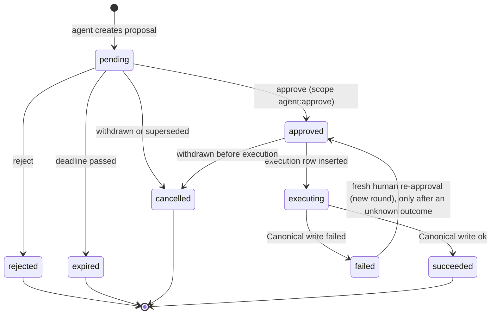

# ERP Brain - `brain_db` Design Specification

## Part 2 of 4 - Complete Table Specifications

Every table below is specified with the 17 required items, every column with type, nullability, default, key and description, every constraint and index, and an illustrative record. The column lists are generated from the same definition as `ddl/*.sql` and `models.py` (the definition and generator are in `tools/schema_gen/`). After handoff the team may keep generating or maintain the DDL and models by hand (OD-24); either way, if this document and the DDL disagree, one of them is wrong and CI should say which.

**Standard facts that apply to every table** (not repeated per table):

- `tenant_id UUID NOT NULL`, no default (D-34). Always set explicitly from the verified tenant context. Every table also has `FORCE ROW LEVEL SECURITY` with policy `pol_tenant_isolation` (N-02, migration 0007): a transaction without `app.tenant_id` sees no rows and cannot write.
- Grain (N-05): sales, features, forecasts, risk and recommendations are per organization (`tenant_id`) and product; no table has a branch or location key.
- All instants are `TIMESTAMPTZ` UTC; business dates are `DATE` in the tenant timezone.
- Example values are illustrative only. `...` in an id means "a UUID".
- Privileges: `brain_app` (brain-api) has the grants listed per table; `brain_worker` (brain-worker, D-45) has the worker grants listed per table; `brain_readonly` has `SELECT` everywhere; `brain_retention` has `SELECT, DELETE` only on tables marked purgeable; `brain_provisioner` (provisioning command, N-01) has `SELECT, INSERT, UPDATE` on `tenant_registry` and `SELECT, INSERT` on `rule_config` only. RLS applies to all of them.

---

## A. Ingestion, Normalised Data and Features

### A.1 Which ingestion tables are needed?

The source asks for event ingestion with de-duplication plus a scheduled `updated_since` backfill (G§3.9). The MVP keeps only the polling half (D-23): there are no events, and the Brain polls Canonical daily totals on a short fixed interval. Because every polled row is an absolute total, the upsert itself is the idempotency mechanism and no de-duplication ledger is needed.

| Table | Verdict | Reason |
|---|---|---|
| ~~`processed_event`~~ | **Removed (D-23)** | Existed only to de-duplicate Redis Stream deliveries. Absolute upserts of polled totals are idempotent by construction |
| `sync_checkpoint` | **Mandatory** | The poll watermark and the intelligence-window watermark need a persisted cursor; without it every poll is a full read |
| `ingest_failure` | **Mandatory (lightweight)** | A poll that keeps failing must be visible (pipeline status, alert) instead of silently leaving stale data |
| `canonical_cache` | **Mandatory** | Named in the source |
| `sales_fact` | **Mandatory** | Named in the source |
| `sales_day_coverage` | **Mandatory for correctness (RC-04)** | Separates a true zero day from a missing day |
| `calendar_day` | **Mandatory** | Holiday, Ramadan and flu-season features need a reproducible store; Ramadan moves every year |
| *Per-sale-line table* | **Unnecessary** | Would duplicate ERP data. Corrections are handled by absolute recompute from Canonical, and the line-level anomaly rule is dropped because daily totals carry no line detail |
| *Raw event payload store* | **Unnecessary** | A re-poll or backfill from Canonical recovers any failed read; storing payloads adds PII risk and size |
| *Recompute-request queue* | **Unnecessary** | Change detection on `sales_fact.updated_at` plus the nightly full recompute covers invalidation |

**Separation of concerns:** `sync_checkpoint` = where the poll got to; `canonical_cache` = canonical payload cache; `sales_fact` = daily totals copied from Canonical; `feature_daily` = derived. No payload is stored in two of these.

### A.2 `sales_fact` write semantics (RC-05, revised by D-25)

| Path | When | Operation | Guard |
|---|---|---|---|
| Poll (every `sales_poll_interval_seconds`, default 300 s) | Rows whose ERP `updated_at` > `high_watermark - poll_overlap_seconds` | Absolute upsert of `units_sold`, `units_returned`, `net_units`, `day_status`, `is_complete`; `source_mode='poll'`; insert `sales_day_coverage(open)` if missing | `WHERE EXCLUDED.source_updated_at >= sales_fact.source_updated_at`; watermark saved only after the last page |
| Reconcile (nightly, at `end_of_day_run_local_time`) | Last `reconcile_lookback_days` by date range, **without** `updated_since` | Same absolute upsert, `source_mode='reconcile'`; mark each closed day `complete`, or `gap` when the ERP says it is incomplete | Idempotent by construction |
| Backfill (manual) | Any date range | Same, `source_mode='backfill'` | Idempotent |

Nothing is ever incremented. A sale at 23:59 that is edited at 00:01 is handled correctly: the edit advances the row's `updated_at`, the next poll returns the new absolute total, and the upsert replaces the old one.

### A.3 Feature design (answers to the feature requirements)

**One table or several?** One is sufficient for the MVP. All feature columns share one grain (tenant, product, day), one producer, one lifecycle (fully rebuildable) and the same consumers. Splitting would add joins on the hot path (`get_features`) and a coordination problem between tables with no benefit. Split only if a different grain appears (hourly, per category) or a feature has a different refresh cycle. No feature registry: `feature_set_version` plus `FEATURE_COLUMNS` in code is enough.

**Columns and types:** see `feat.feature_daily` below (@@FEATURE_COLS@@ columns). Inputs are listed in `MODEL_INPUT_COLUMNS` (20, ordered); labels in `LABEL_COLUMNS` (`y_units`, `y_status`, `is_outlier`).

**Row semantics:** the row for day *d* describes the prediction of demand on *d* using only information from days before *d* plus calendar data that is known in advance. Example from the source: AMOX on 2026-09-24 has `lag_1 = 22` meaning sales on 2026-09-23.

**Missing observations:**

| Situation | `y_status` | Lag/rolling features |
|---|---|---|
| Day verified complete, a `sales_fact` row exists | `observed` | Use the value |
| Day verified complete, no row | `zero_filled` (`y_units = 0`) | Use 0 |
| Day not complete (outage, not yet reconciled, `gap`) | `missing` | Excluded from windows; a lag pointing at it is `NULL` |
| Current business day | `open` | Not used as a lag until the day is complete |
| After today | `future` | Only the next-day row is persisted |

Rolling features use only complete days and are `NULL` unless the window has enough observations (`n_obs_7 >= 5`, 14-day `>= 10`, `n_obs_28 >= 21`). `n_obs_7/28` are stored so a model or a quality check can see how complete the window was. Forward-filling short gaps (`max_gap_days_ffill`) is a *training-time* decision made by the forecasting code; the table never stores an imputed value as observed, and a forecast that relied on it records `quality_flags = {gap_filled}`.

**Invalidation after corrections:** a feature row is stale when any `sales_fact` row in its window has `updated_at > inputs_max_updated_at`. The incremental job selects `sales_fact` rows changed since its watermark (`sync_checkpoint.resource = 'feature_incremental'`, with a `feature_overlap_minutes` safety lag) and recomputes feature rows for that product from the changed date through `date + 28` days. The nightly full recompute rewrites everything and is the safety net for any missed invalidation. A change to `calendar_day` or to `feature_set_version` triggers a targeted or full recompute.

**Stable typed vector:** `FeatureVector` (Pydantic, `extra="forbid"`) is the only thing the engines see; `model_inputs()` returns values in the fixed `MODEL_INPUT_COLUMNS` order; booleans become 0/1; unknowns stay `NULL` (LightGBM handles missing). A model records `feature_set_version`; inference raises `FeatureNotAvailable` on a mismatch rather than predicting from the wrong layout.

**Training/inference consistency:** both read the same table through the same `FeatureStore`, and the multi-step future rows that are not persisted are built in memory by the *same pure function* that the nightly job uses (recursive forecasting appends the prediction as a pseudo-observation). There is no second implementation of any feature.

**Leakage prevention:**

1. Windows are trailing and exclude the current day.
2. The label side (`y_*`, `is_outlier`) is physically separate from `MODEL_INPUT_COLUMNS`; an import-time assertion fails if they overlap. `is_outlier` is computed from the same-day label, so it is never an input.
3. Training uses time-based splits and rolling-origin backtests; `get_training_frame` returns only `observed`/`zero_filled` rows and nothing at or after the cutoff.
4. Winsorisation bounds are computed from the training window only, at training time.
5. Calendar features contain only facts known in advance.
6. Known, accepted caveat: features are recomputed from the *corrected* history, so a backtest sees data as finally corrected, not as it looked at the time (documented; revisit if corrections are frequent).

---

### A.4 Table specifications

@@TABLES_INGEST@@

---

## B. Forecasting, Anomaly, Risk, Recommendation (schema `intel`)

### B.1 Forecast keys: is `(tenant_id, product_id, model_version)` enough?

No. The guide gives it as a design reference (G§14.2); it identifies *which model for which product* but not *which generation*. The same model version produces a new forecast every night and on demand, and each generation covers many target dates. The design therefore uses:

| Level | Identity | Why |
|---|---|---|
| Generation (`forecast`) | `id`; business uniqueness `(tenant_id, product_id, model_id, job_run_id)` | `model_id` is the exact model row (its `model_version` label is unique per tenant). `job_run_id` makes a retried nightly job idempotent while an on-demand request gets a new id |
| Origin | `origin_date` (last observed day) and `generated_at` | Evaluate accuracy by lead time; reproduce what was known when |
| Point (`forecast_point`) | `(forecast_id, target_date)` | One value per forecast day |

`horizon_days` is an attribute, not a key. Forecasts are never overwritten (append-only trigger), so a model can be evaluated against actuals and audited.

### B.2 Artifact vs training run vs forecast

| Concept | Table | Lifetime |
|---|---|---|
| Job execution | `training_run` | One nightly (end-of-day) or on-demand run; counts and config |
| Model artifact identity and status | `model_registry` | Created `candidate`; promoted to `validated`; later `degraded`/`retired`; losers `rejected` |
| Method without artifact (baselines, cold start) | `model_registry` with `artifact_path NULL` and `product_id NULL` (shared) | Registered once per tenant and version |
| Output | `forecast` + `forecast_point` | Append-only |
| Quality over time | `model_evaluation` | Append-only |

**Serving rule:** inference reads the latest `validated` model for the product (partial index `ix_model_registry__serving`); if none, it falls back to the shared validated method for the product's history length (cold start, `forecast_confidence = low`). A `degraded` model is skipped, which is the rollback the guide asks for ("go back to a good version", G§3.28).

**Latest forecast lookup** (Part 3 has the SQL): newest `forecast` for the product whose model is currently eligible.

### B.3 Anomaly deduplication

An anomalous product-day is re-detected as the day's total grows (open day), on nightly reruns and after corrections. Uncontrolled inserts are prevented by a natural key:

`UNIQUE (tenant_id, product_id, observation_date, anomaly_type, detection_method)`

Re-detection **upserts**: it updates `observed_value`, `expected_value`, `zscore`, `score`, `severity`, `reasons`, `rule_version`, `last_detected_at` and increments `detection_count`; `first_detected_at` never changes; a human-reviewed `status` is never reset. If a correction makes the observation normal, the row becomes `retracted` instead of being deleted.

**Not every anomaly is an incident.** `open` means "unreviewed statistical signal". Only a person moving it to `confirmed` makes it an incident; `dismissed` marks a false positive. Reviewed rows double as labels for precision/recall evaluation (G§8.4). The review endpoint is SHOULD (OD-15); the columns are present now because adding them later is cheap but not free.

### B.4 Risk assessment refresh

`risk_assessment` rows are versions, not a single mutable row, because a recommendation and an approved purchase order must keep pointing at the calculation they were based on.

| Trigger | Action |
|---|---|
| New `forecast` for the product | Recalculate |
| `InventoryUpdated` / `StockThresholdReached` event | Re-read inventory from Canonical (live), then recalculate |
| Supplier changed (cached supplier payload hash differs after backfill) | Recalculate products of that supplier |
| Anomaly created, escalated or retracted for the product | Recalculate |
| Active `rule_config` version changed | Nightly full re-evaluation |

**Recalculation outcome:** if the result is materially unchanged (same severity and risk type, same forecast, rule config and anomaly, supplier lead time unchanged, `days_of_cover` moved less than 10 percent), only `last_confirmed_at` is updated. Otherwise a new row is inserted, the old row gets `superseded_at`/`superseded_by_id`, and the partial unique index `uq_risk_assessment__current` guarantees a single current row. Inventory is **never copied as truth**: `input_available_quantity` and `inventory_as_of` are a snapshot of the input used, and the engine re-reads Canonical when `canonical_cache.synced_at` is older than the freshness threshold.

### B.5 Recommendation and Insight

`recommendation` is a structured suggestion tied to one risk assessment. Creating a new active one for the same product and type supersedes the previous one in the same transaction. A recommendation is never an ERP transaction; whether it was acted on is derived from `agent.action_proposal.recommendation_id` and `agent.action_execution`, not stored twice. `Insight` and `Alert` are views (RC-03): `v_insight_current` returns the current risk with its active recommendation (`insight_id = risk_assessment.id`), `v_alert_open` returns open anomaly signals and current medium/high risks.

---

### B.6 Table specifications

@@TABLES_INTEL@@

---

## C. Agent, Approval, Actions and Audit (schemas `agent`, `audit`)

### C.1 Lifecycle of a proposed action

The source lifecycle is `pending -> approved | rejected -> execution -> success | failed` (G§12.3, §3.23). Three states are added because a real system needs them: **`expired`** (a pending proposal must not be approvable days later), **`cancelled`** (withdrawn or superseded), and **`executing`** (the in-flight lock that prevents double execution).

**What the database guarantees (not only the application):**

| Guarantee | Mechanism |
|---|---|
| Approval is tied to an authenticated actor | `action_approval.decided_by_actor_id` (JWT `sub`), `decider_scopes` snapshot with CHECK `'agent:approve' = ANY(...)` |
| Approval is tied to the specific proposal and payload | Composite FK `(tenant_id, proposal_id, arguments_sha256)` to `action_proposal` |
| A modified payload cannot be approved or executed | `action_proposal.arguments` and `arguments_sha256` are immutable (guard trigger); `action_execution` FK to the approval carries the same hash |
| Only legal transitions | `trg_action_proposal_transition` |
| A decision record must exist before `approved`/`rejected` | Same trigger checks the latest `action_approval` |
| Approval after expiry is refused | Trigger and `guard_approval_insert` |
| No duplicate ERP write | `UNIQUE (tenant, idempotency_key)`; partial unique indexes allow one in-flight and one succeeded execution per proposal; every attempt carries the proposal's key (FK) |
| Execution only after an approved decision | `trg_action_execution_guard` |
| An approval authorises execution for 24 h from the server time of that human decision: valid while `now() <= decided_at + 24 h` (D-44) | `guard_approval_insert` sets `decided_at = now()`; `trg_action_proposal_transition` checks it for `-> approved` and `approved -> executing`; `trg_action_execution_guard` checks it for every attempt |
| Jobs cannot decide (D-45) | `brain_worker` has no `INSERT` on `action_approval` and may only expire proposals or complete executions; decisions with a `system:` actor are refused by CHECK |
| A failed proposal never reuses its old approval (D-43) | `failed -> approved` needs a decision round newer than the one the last attempt used (`trg_action_proposal_transition`); every attempt must use the latest round while the proposal is `executing` (`trg_action_execution_guard`) |
| History preserved | Approvals/executions cannot be deleted; executions are final once completed |
| Session write cap | `CHECK (write_proposals_count <= max_writes)` |

**Retry rule (the only exception to "no automatic retry", G§3.23):** a failed execution is classified `definitive` (the adapter rejected it; no ERP write happened) or `unknown` (timeout/5xx; the write may have happened). While the proposal is still `executing`, the worker may resend an `unknown` attempt with the same `Idempotency-Key` and body under the same approval (`BRAIN_CONTRACTS.md` §9, up to 3 attempts); this resend is the reconciliation, because the adapter returns the original purchase order if the first write landed. Once the proposal is `failed`, nothing retries automatically (D-43): a human may re-approve the *same* proposal only with a new decision (`approval_round = 2`, then 3, ...), recorded with actor, scopes and hash like the first one (immutable row) and audited as `proposal.approved` with `status_from: failed`. The previous approval never re-opens a failed proposal, and attempts after the re-approval must use the new round. After a `definitive` failure the agent must create a new proposal.

**Mapping to the source `AgentAction`:** the tool-call log is `agent_action`; the write decision and result are in proposal/approval/execution; `v_agent_action` returns the source shape (`tool_name, arguments, status, requires_approval, approved_by, result`).

**Data protection:** no raw conversation is stored beyond `agent_message` (PII-scrubbed, size-capped, expiring); no prompt or completion text is stored anywhere; the LLM never receives database access, only tool results.

---

### C.2 Table specifications

@@TABLES_AGENT@@

---

## D. Views (no storage)

Defined in `ddl/0003_intel.sql` and `ddl/0004_audit_agent.sql`; `SELECT` granted to `brain_app` and `brain_readonly`.

| View | Purpose | Definition summary |
|---|---|---|
| `intel.v_insight_current` | Insight projection (G§6.6) | Current (`superseded_at IS NULL`) `risk_assessment` left-joined to its `active` `recommendation`; `insight_id = risk_assessment.id` |
| `intel.v_alert_open` | Alert projection (AlertBadge) | Union of `anomaly_event` with `status='open'` and current medium/high `risk_assessment` |
| `agent.v_agent_action` | Source-shaped AgentAction | `action_proposal` + latest approved `action_approval` + latest `action_execution` |

Migration 0007 sets `security_invoker = true` on all three views (PostgreSQL 15+), so they read with the caller's rights and RLS applies; without it a view would read as its owner and skip the policies.

---

## D2. Tenant registry (N-01, migration 0007)

One row per tenant (ERP organization) the Brain serves. It is the worker's tenant list and the API's "is this tenant active" check, and it holds only a **reference** to the tenant's Canonical credential: the secret lives in the secret store (`CANONICAL_CREDENTIALS_DIR`, one file per tenant) and never in the database, source control or logs. A tenant is created `provisioning`; the trigger refuses activation until the credential has been validated (a Canonical read with it returned this tenant id) and an active `rule_config` row exists for every rule set. No migration inserts tenants.

@@TABLES_TENANCY@@

---

## E. Future-Only Table (not created by MVP migrations)

@@TABLES_FUTURE@@
