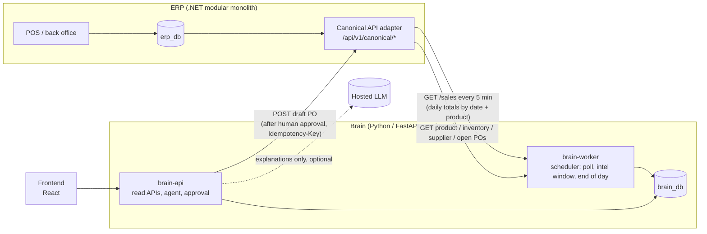
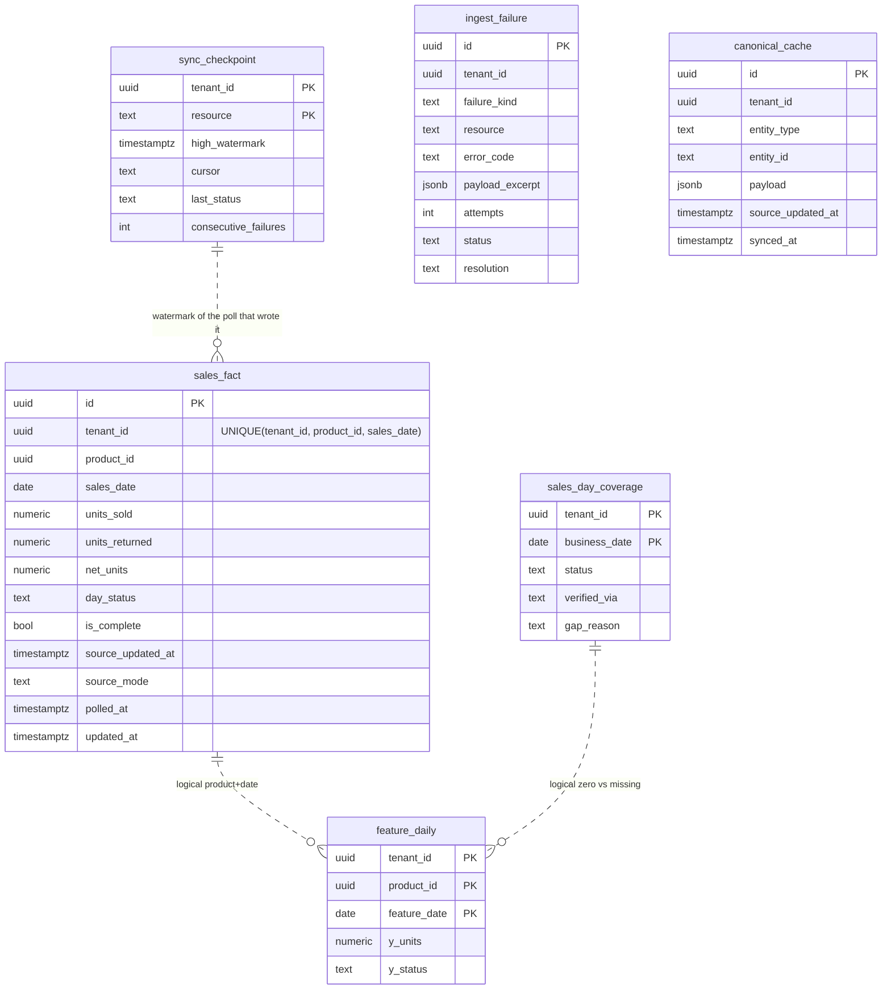

# ERP Brain: final MVP blueprint (v1.0, 21 Oct 2026)

**Status:** final MVP baseline. It folds `docs/decisions/DECISIONS_v1.md` (D-01 to D-22, all accepted by Ibrahim) together with the new decisions from 21 Oct (D-23 to D-28, and Ibrahim's ERD decisions D-29 to D-49 in `docs/decisions/DECISIONS_2026-10-21_ERD.md`) into one document. Brain-internal contracts: `contracts/internal/BRAIN_CONTRACTS.md`. Team tasks: `docs/TEAM_TASKS.md`. Remaining ERD/database questions: `docs/decisions/ERD_DB_APPROVAL_QUESTIONS.md`.
**Precedence:** this file comes first. Then `DECISIONS_v1.md`, then `brain_db/docs/MVP_DECISIONS_AND_CONTRACTS.md`, then `contracts/`, then `brain_db/docs/`, then `docs/architecture/`. Where an older document still talks about Redis Streams, ERP events, an event consumer or a `processed_event` ledger, this file replaces it.
**Rule for every choice:** take the simplest option that is safe by default and can be demoed on a graduation timeline. Anything clever goes after the MVP.

What changed on 21 Oct, in one paragraph: **there is no Redis and no event stream in the MVP.** The Brain gets sales by **polling** the Canonical API on a short fixed interval (default every 5 minutes). Each response row is an **absolute daily total for one product and one business date**, so the Brain just upserts it. **Models are trained only once a day, after the business day closes.** During the day the Brain refreshes facts and re-scores risk with the forecast it already has.

---

## 1. What we are building

A pharmacy ERP (.NET) and a separate AI "Brain" (Python/FastAPI). The Brain reads ERP data **only** through the Canonical API that the ERP adapter exposes. It stores its own derived data in `brain_db` and turns daily sales into forecasts, stock-out risk, reorder recommendations and explanations. Its only business write is a **draft** purchase order, and only after a human approves it.

The Brain never connects to `erp_db`. The ERP never reads `brain_db`.

## 2. Architecture at a glance



| Deployable | What it is | Notes |
|---|---|---|
| `erp-backend` | .NET modular monolith with the in-process Canonical adapter | Owns all business facts. Computes `business_date` (D-04) |
| `erp_db` | PostgreSQL 16 | Never reached by the Brain |
| `brain-api` | FastAPI: read APIs, insights, forecasts, agent, approval, execution | No training and no polling inside a request |
| `brain-worker` | Same Python image, different entry point. Runs the scheduler and the three jobs in section 3 | One process. Each job takes an advisory lock so two runs never overlap |
| `brain_db` | PostgreSQL 16, no extensions | 5 schemas, 24 mandatory tables + 1 optional (section 7) |
| `frontend` | React | Talks to the ERP and to `brain-api` |

There is no Redis container and no message broker (D-23). Training, forecasting, feature computation and polling are separate jobs with their own entry points, so they can be run and tested one at a time.

## 3. Cadence: what runs when

All times are in the tenant timezone (`Africa/Cairo`). All values live in `intel.rule_config(platform)`, so nothing is a hidden constant.

| Job | When | What it does | Trains a model? |
|---|---|---|---|
| **Sales poll** | Every `sales_poll_interval_seconds` (default **300 s**) | Reads changed daily totals from `GET /canonical/sales` and upserts them into `sales_fact`. Section 4 | No |
| **Intraday intelligence window** | Every `intel_window_minutes` (default **60**) | For products whose `sales_fact` rows changed since the last window ("dirty" products): incremental features, anomaly check, risk, recommendation. Uses **last night's forecast** and a fresh inventory read | No |
| **End-of-day run** | Once a day at `end_of_day_run_local_time` (default **02:00**) | (1) Reconcile the last `reconcile_lookback_days` (default 7) by date range. (2) Mark each closed day `complete` or `gap`. (3) Nightly full feature recompute. (4) **Train** (seasonal-naive baseline + global LightGBM, D-20). (5) Forecast inference for every product. (6) Intelligence window for every product. (7) Post-deployment evaluation | **Yes, only here** |
| **Run now** (admin) | On demand, for the demo | Runs any of the above immediately | Only if you ask for the end-of-day run |

Why training waits for the end of the day: the open day is a partial count. Training on it would teach the model that every "today" is a low-demand day. After the day closes and has been reconciled, its total is final and safe to learn from. During the day the forecast does not change, but risk and recommendations still react to new sales and stock levels within an hour.

## 4. Ingestion by polling

### 4.1 The contract (already in `contracts/`)

`GET /api/v1/canonical/sales?from=&to=&updated_since=&cursor=&limit=` returns a `canonical.SalesPage` of `canonical.DailySalesTotal` rows (`contracts/schemas/canonical/`). One row is one `(product_id, business_date)` with `units_sold`, `units_returned`, `net_units`, `day_status` (`open`/`closed`), `complete` and `updated_at`. `from`/`to` are inclusive business dates, `updated_since` is an exclusive UTC watermark, rows are ordered by `(updated_at, product_id, business_date)`, and each page carries the server's `high_watermark` (D-05). Nothing in this contract changes.

### 4.2 One poll, step by step

1. Read `ingest.sync_checkpoint` row `sales_poll`. If it has no watermark, this is the first poll: use `from = poll_history_start_date` and no `updated_since`.
2. Otherwise call with `from = poll_history_start_date`, `to = today`, `updated_since = high_watermark − poll_overlap_seconds` (default 120 s).
3. For each page, in one database transaction:
   - validate every row against `canonical.DailySalesTotal`. A bad row is skipped and recorded in `ingest_failure`; the rest of the page is applied;
   - upsert each row into `ingest.sales_fact` (4.3);
   - insert `sales_day_coverage(business_date, 'open')` if that day has no row yet.
4. Only in the transaction of the **last** page (`next_cursor = null`), save that page's `high_watermark` into `sync_checkpoint`. If the poll dies halfway, the watermark has not moved and the next poll simply reads the same rows again.
5. The upsert changes `sales_fact.updated_at` (Brain clock). The intraday window uses that to find dirty products. No separate "dirty" table or queue is needed.

### 4.3 Idempotency: one upsert keyed by tenant, date and product (D-25)

```sql
INSERT INTO ingest.sales_fact AS s
  (tenant_id, product_id, sales_date, units_sold, units_returned, net_units,
   day_status, is_complete, source_updated_at, source_mode, polled_at)
VALUES (:t, :product_id, :business_date, :sold, :returned, :net,
        :day_status, :complete, :updated_at, 'poll', now())
ON CONFLICT (tenant_id, product_id, sales_date) DO UPDATE SET
  units_sold = EXCLUDED.units_sold, units_returned = EXCLUDED.units_returned,
  net_units = EXCLUDED.net_units, day_status = EXCLUDED.day_status,
  is_complete = EXCLUDED.is_complete, source_updated_at = EXCLUDED.source_updated_at,
  source_mode = EXCLUDED.source_mode, polled_at = now()
WHERE EXCLUDED.source_updated_at >= s.source_updated_at;   -- an older row never wins
```

Why this is enough:

- **Duplicates are harmless.** The overlap window, a retried page and a re-run poll all write the same absolute numbers again.
- **Order does not matter.** An older `updated_at` that arrives late is ignored by the `WHERE`.
- **Corrections need no special path.** A return, void or edit changes that day's total and advances its `updated_at`, so the next poll overwrites it. Nothing is ever incremented or decremented (D-06).
- **No event ledger.** The old `processed_event` table existed only to de-duplicate Redis deliveries. It is gone.

### 4.4 Which days are safe to train on

`ingest.sales_day_coverage` keeps one row per business day, so the feature job can tell a true zero from missing data (RC-04):

| Status | Set by | Meaning |
|---|---|---|
| `open` | Poll | The ERP day is still running (`day_status = 'open'`), or it has not been reconciled yet |
| `complete` | End-of-day reconcile | Every row for that day is `closed` and `complete = true`, the date is not in `coverage.incomplete_dates`, and the date-range re-read succeeded. A product with no row on a complete day is a **true zero** |
| `gap` | End-of-day reconcile | The ERP said it cannot vouch for the day (`erp_incomplete`), Canonical was unreachable, or rows failed validation. **Excluded from training**, never zero-filled |

The demand label used for features and training is `GREATEST(net_units, 0)`. A day where returns exceed sales counts as zero demand, not negative demand (see open question 6).

### 4.5 Failures

- A Canonical read that keeps failing becomes **one** open `ingest_failure` row per `(resource, error_code)`. Each further failed poll only bumps `attempts`, so a 1-hour outage is one row, not twelve.
- `sync_checkpoint.consecutive_failures` drives the alert and the "data is stale since …" banner on `GET /brain/pipeline/status`.
- The next successful poll closes the row with `resolution = 'repolled'`.

### 4.6 Checkpoint caveat: `updated_since` versus an outbox `event_sequence`

The 21 Oct audit noted that the ERP backend blueprint wants a gap-free `OutboxEvent.event_sequence` cursor and treats `updated_since` as a convenience only. The consistency audit (F-04) says the same thing: a timestamp-only watermark can miss a row. That happens when the ERP stamps `updated_at` at the start of a transaction that commits **after** a poll has already moved the watermark past that time.

The MVP accepts the timestamp watermark, because the data is now polled **aggregates**, not individual events:

1. The 120-second overlap covers normal commit delays.
2. Every row is an absolute total, so reading it twice costs nothing and loses nothing.
3. **The end-of-day reconcile re-reads the last 7 days by date range with no watermark at all**, before training. That re-read, not the watermark, is the completeness guarantee for training data.

So the worst case is that one intraday total is stale until 02:00. Training data is never wrong because of it. An outbox sequence cursor would close the intraday gap, but it brings back per-event APIs and ordering logic, which D-23 removes. It is listed as post-MVP. If the ERP can compute the daily total as a view over committed rows, with `updated_at` taken at commit time, most of the caveat goes away (open question 3).

### 4.7 Other ERP data

There are no `InventoryChanged`, `ProductChanged` or `PurchaseOrderChanged` events any more, so other data is read when it is needed:

| Data | How the Brain gets it | Cached in `canonical_cache` for |
|---|---|---|
| Inventory (`available`, reorder point) | `GET /canonical/inventory/{product_id}` (`OrganizationInventory`, D-49) plus `GET /canonical/locations` during the intelligence window, for each product being scored; checked per BRAIN_CONTRACTS §7.13, never cached, never summed by the Brain; not read at all while `inventory_source = "none"` (Option D, the default) | `inventory_freshness_seconds` (900 s), for the record and for every included location |
| Product (preferred supplier, pack multiple, max order qty) | `GET /canonical/products/{id}` | `product_freshness_seconds` (1 day) |
| Supplier (lead time) | `GET /canonical/suppliers/{id}` | `supplier_freshness_seconds` (1 day) |
| Open purchase orders | **Live** `GET /canonical/purchase-orders?status=open&product_id=` at recommendation time (D-07) | not cached |

One known limit comes with this: a stock change with no sale behind it (for example a delivery being received) does not make a product dirty. It shows up at the next sale of that product or at the 02:00 run, whichever comes first (open question 5).

## 5. Intelligence pipeline (unchanged from D-19 to D-22)

- **Features:** one wide row per `(tenant, product, day)` in `feat.feature_daily`, using completed days only, with lags, rolling stats and calendar flags (Ramadan, holidays, flu season). A missing day is `missing`, never zero.
- **Forecast:** seasonal-naive baseline plus **one global LightGBM** model. For each product the model with the lower backtest WAPE wins, and seasonal-naive is the cold-start fallback (D-20). Training and inference call the same feature builder and refuse a feature-set version mismatch.
- **Anomaly:** z-score rules on daily net units. The old "single sale line > 5× average" rule is **dropped**, because daily totals carry no line detail.
- **Risk:** `high` if days of cover < lead time, `medium` if < lead time + 2, otherwise `low`. A high anomaly raises it one level (D-22).
- **Order quantity:** `target = ceil(forecast over (lead_time + review_period) + safety_stock)`, `raw = target − available − open_po_qty`, rounded up to `pack_multiple` and capped at `max_order_qty` (D-21). Missing supplier or open-PO data means no order recommendation, with reason code `NO_SUPPLIER` or `OPEN_PO_UNAVAILABLE` (D-07).
- **Insight:** a read-only view whose `id` is the `risk_assessment` UUID (D-03).

## 6. Agent, approval and security (unchanged from D-09 to D-16, D-18)

- A `create_purchase_order` proposal is built **deterministically** from a recommendation. The LLM is an optional conversational path that produces the same proposal shape, and the numbers never come from the LLM (D-18).
- The proposal is immutable. `arguments_sha256` is SHA-256 over RFC 8785 canonical JSON (D-13). The TTL is 24 h (D-10).
- A user with the `agent:approve` scope (Admin, Pharmacist) approves in the browser. The Brain then calls the adapter with a service token and an `approval` block. The adapter creates a **draft** PO only, keyed by `Idempotency-Key = proposal UUID`, and keeps keys at least 30 days (D-09, D-11, D-12).
- The Brain never stores prompt or completion text, only provider, model, tokens, latency and cost (D-14). There is no audit hash chain in the MVP (D-15).
- ~~There is one seeded tenant. Every row and request carries `tenant_id`, and the MVP makes no multi-tenant isolation claim (D-16).~~ **Superseded by D-34 (21 Oct): multi-tenancy is a core requirement.** Tenant = ERP organization, taken only from the verified token. Every row, query, job, cache entry, model artifact and agent action is tenant scoped; `tenant_id` has no column default; cross-tenant isolation is proven by automated tests (task BB-24). Tenants come from `ingest.tenant_registry`, each with its own Canonical credential (D-46). PostgreSQL RLS is an additional wall behind application scoping (D-47). The MVP grain is the organization (D-48). Rules: `contracts/internal/BRAIN_CONTRACTS.md` §7.
- Scopes (D-37): `brain:read`, `brain:admin` (job status only), `agent:approve`; issued by ERP Identity. Manual runs only via `brain-worker run <job>` (D-38). At most one live proposal per recommendation (D-30); rule-built proposals have no chat session (D-29).

## 7. Database (`brain_db`)

PostgreSQL 16, no extensions, generated from `brain_db/tools/schema_gen/spec_*.py` (never hand-edit the generated files, OD-24). **24 mandatory tables + 1 optional (`intel.briefing`) and 3 views**, in 5 schemas.

| Schema | Tables |
|---|---|
| `ingest` | `sync_checkpoint`, `ingest_failure`, `canonical_cache`, `sales_fact`, `sales_day_coverage` |
| `feat` | `calendar_day`, `feature_daily` |
| `intel` | `rule_config`, `training_run`, `model_registry`, `model_evaluation`, `forecast`, `forecast_point`, `anomaly_event`, `risk_assessment`, `recommendation`; views `v_insight_current`, `v_alert_open` |
| `agent` | `agent_session`, `agent_message`, `agent_action`, `action_proposal`, `action_approval`, `action_execution`; view `v_agent_action` |
| `audit` | `audit_log`, `llm_usage` |

**Changes on 21 Oct (all in the generator, then regenerated):**

| Table | Change | Why |
|---|---|---|
| `ingest.processed_event` | **Removed** | It only de-duplicated Redis deliveries (D-23) |
| `ingest.sales_fact` | Now mirrors `DailySalesTotal`: added `units_returned`, `net_units` (with `CHECK net_units = units_sold − units_returned`), `day_status`, `is_complete`, `source_updated_at`, `polled_at`. Removed `sales_line_count`, `max_line_units`, `revenue`, `currency_code`, `last_event_occurred_at`, `reconciled_at`. `source_mode` is now `poll / reconcile / backfill` | The polled aggregate has no line detail and no money. The upsert guard needs the ERP `updated_at` |
| `ingest.ingest_failure` | Removed `event_id`, `event_type`, `stream_entry_id`. Added `resource`. One open row per `(tenant, resource, error_code)`. Resolutions are `repolled / fixed / ignored_invalid` | Failures are now failed polls, not poison messages |
| `ingest.sync_checkpoint` | Same columns. Resources are now `sales_poll`, `sales_reconcile`, `intel_window`, `feature_nightly_full` | It is the poll checkpoint |
| `ingest.sales_day_coverage` | `gap_reason` values: `erp_incomplete / canonical_unavailable / validation_failures / unknown` (`consumer_outage` removed) | No consumer any more |
| `intel.anomaly_event` | `single_line_outlier` removed from `anomaly_type` | No line detail |
| `intel.forecast` | `trigger = 'event'` removed | Forecasts come only from the nightly run, on demand or backfill |
| `intel.rule_config` seed | `platform` gained `sales_poll_interval_seconds: 300`, `poll_overlap_seconds: 120`, `poll_history_start_date`, `intel_window_minutes: 60`, `end_of_day_run_local_time: "02:00"`. `anomaly` lost `single_line_multiple` | Cadence is configuration (OD-16) |

ERDs: `brain_db/erd/erd_logical_master.mmd` (all tables), `erd_ingestion_features.mmd`, `erd_forecast_risk.mmd`, `erd_agent_audit.mmd`, `erd_conceptual.mmd`. The ingestion part, which is what changed:



**Verified on 21 Oct:** the generator runs clean (24 + 1 tables, 417 columns, 26 FKs, 188 CHECKs, 37 triggers). On a scratch PostgreSQL 16, the full DDL loads, and so do the six migration files in order. Reading the same row twice leaves one row. An older row that arrives later is ignored. Two identical poll failures leave one row with `attempts = 2`. `models.py` compiles every table for PostgreSQL, and every `rule_config` seed validates against `contracts_jsonb.py`. One caveat: the DDL only loaded after a one-line fix to an **existing** bug that has nothing to do with these changes (open question 10). That fix is **not** saved in your folder.

## 8. Deployment and operations (D-17, amended)

- *Pending N-06 (21 Oct): with multi-tenancy core (D-34), the recommendation is one Brain next to the cloud ERP serving all tenants; the demo still runs on one machine.* Everything runs on one machine in the pharmacy with Docker Compose: `erp-backend`, `erp_db`, `brain-api`, `brain-worker`, `brain_db`, `frontend`. **No Redis container at all** (D-23, D-27: decided by Ibrahim on 21 Oct). If an LLM response cache is ever needed, it is in-process memory.
- It works offline. Only the LLM assistant and its explanations need the internet. When the internet is down, the UI shows "Assistant offline" and uses template explanations.
- Polling runs over the local Docker network, so a 5-minute poll is cheap.
- To see the pipeline, call `GET /brain/pipeline/status`. It reads `sync_checkpoint` (last poll, last end-of-day run, consecutive failures) and the open `ingest_failure` rows. There is no stream lag to watch any more.

## 9. Out of the MVP

Redis and Redis Streams; ERP events and the event consumer; an outbox `event_sequence` cursor; per-sale-line data in the Brain; revenue analytics (the sales contract has no money fields); intraday retraining; RAG/pgvector; multi-tenant administration UI (tenant isolation itself **is** in the MVP, D-34); external ERP connectors; on-behalf-of tokens; audit hash chain; anomaly review workflow; inventory writes by the agent; per-location forecasting.

## 10. Final decision register

| ID | Decision (short) | Status after 21 Oct |
|---|---|---|
| D-01 | `brain_db` = generated package; change only via `schema_gen` | **Kept.** Now 24 mandatory + 1 optional tables |
| D-02 | Ownership per execution blueprint §1.4 | Kept |
| D-03 | Insight = view, id = risk assessment UUID | Kept |
| D-04 | ERP computes `business_date` (Africa/Cairo) | **Amended.** The Brain can no longer compare it with an event's `occurred_at`. It only rejects a date after today (tenant time) or before `poll_history_start_date` |
| D-05 | Sales API returns daily totals; watermark + 120 s overlap | Kept. This is now the only sales path |
| D-06 | Corrections reload absolute totals; demand = net units; incomplete days excluded | **Amended.** No `SaleCorrected` event: a correction is seen because the row's `updated_at` advances. The demand label is `GREATEST(net_units, 0)` |
| D-07 | Preferred supplier only; live open-PO read | Kept |
| D-08 | Event envelope, versions, dedupe key | **Superseded by D-23** (events are post-MVP) |
| D-09 | Idempotency-Key = proposal UUID, ≥ 30 days | Kept |
| D-10 to D-15 | TTLs, approval identity, self-approval, JCS hash, LLM privacy, no hash chain | Kept |
| D-16 | One tenant, no isolation claim | **Superseded by D-34** (21 Oct) |
| D-17 | Local-first, offline-capable stack | **Amended.** No Redis in the stack |
| D-18 | Deterministic proposal without the LLM | Kept |
| D-19 | Cadence: hourly window, nightly inference, weekly retrain | **Amended by D-24, D-26 and D-28.** The poll (not events) marks products dirty. The hourly window is kept. Training is a full retrain every night in the end-of-day run; there is no weekly retrain |
| D-20 to D-22 | Model scope, order formula, risk severity | Kept (single-line anomaly rule dropped, section 5). D-20 clarified by D-31 and D-32 |
| **D-23** | **No Redis Streams and no ERP events in the MVP.** No event consumer, no dedupe ledger, no stream monitoring | **New** |
| **D-24** | **Sales arrive by polling** `GET /canonical/sales` every `sales_poll_interval_seconds` (default 300 s). Each row is a daily total aggregated by business date and product id | **New** |
| **D-25** | **Poll idempotency** = absolute upsert keyed `(tenant_id, product_id, sales_date)`, newest ERP `updated_at` wins. The watermark is saved only after the last page. The nightly date-range reconcile is the completeness guarantee | **New** |
| **D-26** | **No training during the business day.** Training runs once a day in the end-of-day run (02:00 Cairo), after the closed day is reconciled. Inference follows it. Intraday work only re-scores risk with the existing forecast | **New** |
| **D-27** | **The Redis container is removed completely** from the MVP compose file. No service depends on Redis. Any cache is in-process memory | **New, decided by Ibrahim 21 Oct** (was open question 2) |
| **D-28** | **Retrain every night** (full retrain in the 02:00 end-of-day run). The weekly retrain plan is dropped; `intel.training_run.trigger` no longer allows `weekly_full`. If training ever gets too slow, the fallback is a new decision, not a silent change | **New, decided by Ibrahim 21 Oct** (was open question 1) |

| **D-29** | `action_proposal.proposed_by IN ('rules','agent')`; rule proposals may have no session or requester; agent proposals must have both; every write still needs human approval | **New, Ibrahim 21 Oct** (Q-01) |
| **D-30** | At most one live proposal (`pending`, `approved`, `executing`) per recommendation (partial unique index); complements the ERP Idempotency-Key | **New** (Q-02) |
| **D-31** | Per-product model **selection**, not per-SKU training: `model_registry.scope` shared/product, `shared_model_id`; product-specific LightGBM only if it beats the shared one on the same time-based WAPE backtest | **New** (Q-03) |
| **D-32** | Forecast families: seasonal-naive and LightGBM only (`holt_winters` removed) | **New** (Q-04) |
| **D-33** | `artifact_format IN ('lightgbm_txt','json')`; local artifacts only, SHA-256 verified, never pickle/joblib | **New** (Q-05) |
| **D-34** | **Multi-tenancy is core**, tenant from the verified token only, no `tenant_id` default, cross-tenant tests mandatory; RLS a separate decision (N-02) | **New** (Q-11); supersedes D-16, amends OD-23 |
| **D-35** | Target `y_units = GREATEST(net_units, 0)`; raw sold/returned/net kept in `sales_fact`; returns > sales flagged (N-03); train on complete, validated days; target is recorded sales, not unconstrained demand | **New** (Q-06) |
| **D-36** | No revenue in the MVP | **New** (Q-07) |
| **D-37** | Scopes `brain:read`, `brain:admin`, `agent:approve`, from ERP Identity; exact scope per endpoint in `brain.openapi.yaml` | **New** (Q-08) |
| **D-38** | Manual runs only via `brain-worker run <job>`; no UI button, no job API | **New** (Q-09) |
| **D-39** | Ingestion, features, recommendations, read APIs and `brain_db`: Ibrahim (confirms D-02); not reassigned without his agreement | **New** (Q-10) |
| **D-40** | Intraday anomaly = spikes only; drops only on closed, complete days; missing is never zero | **New** (Q-12) |
| **D-41** | Synthetic pharmacy dataset for development, tests and demo; results labelled synthetic | **New** (Q-13) |
| **D-42** | Ibrahim fixes `guard_proposal_transition` himself, guided (BB-05G, `Answers/02`) | **New** (Q-14) |
| **D-43** | A failed proposal is re-opened only by a fresh human approval round; attempts use the latest round; worker same-key retries while executing stay | **New** (BB-05G review) |
| **D-44** | Every approval authorises execution for 24 h from its own server-time `decided_at`; checked on approve, start-executing and every attempt | **New** (BB-05G review) |
| **D-45** | Separate least-privilege `brain_worker` DB role and login; only brain-api's `brain_app` can record decisions | **New** (BB-05G review) |
| **D-46** | Tenant registry (`ingest.tenant_registry`); one Canonical credential per tenant, referenced not stored; `brain-provision` command on its own role; no activation before credential and rule sets are validated | **New** (N-01) |
| **D-47** | PostgreSQL RLS on every tenant table (FORCE, transaction-local `app.tenant_id`, no bypass for runtime roles) in addition to application scoping; isolation claimed only as far as the tests show | **New** (N-02); answers the RLS part of D-34 |
| **D-48** | Organization-level grain `(tenant_id, product_id, business_date)`; branch forecasting deferred; branch stock never summed without a defined, tested rule | **New** (N-05); amends OD-20 |
| **D-49** | Organization stock is its own Canonical record (`OrganizationInventory`, no `location_id`), checked for completeness against the location register; `InventoryItem.location_id` required and never null; Option D (no inventory-dependent recommendations) is the default and the fallback; draft-PO proposals for multi-branch tenants return `BRANCH_DECISION_REQUIRED` until N-10. Canonical contract unsigned | **New** (N-09, Brain side) |

## 11. Open questions (need a human)

**New open questions from 21 Oct (N-03, N-04, N-06 to N-08, N-10, N-11: returns > sales flag, scope to create a proposal, where the Brain runs, missing risk inputs, tenant provisioning defaults, ERP behaviour for branches, credential shape for D-46; N-09 is answered by D-49) are in `docs/decisions/ERD_DB_APPROVAL_QUESTIONS.md` §D. N-01, N-02 and N-05 are decided (D-46 to D-48).**

1. ~~**Retrain every night or once a week?**~~ **Decided 21 Oct (D-28): every night.** Original text kept for history: D-19 said weekly retraining. Your message says training waits for the end of the day. I read that as **nightly retraining** in the 02:00 run. With one global LightGBM on a single pharmacy's data this should take minutes. If it turns out slow, the fallback is to retrain weekly and still run inference every night. Ibrahim and Mostafa decide.
2. ~~**Remove the Redis container completely?**~~ **Decided 21 Oct (D-27): yes, removed.** Original text kept for history: Once Streams are gone, Redis would only be an optional LLM response cache. I recommend dropping it from the MVP compose file and caching in memory if needed. `audit.llm_usage.cache_status` now just says "response cache". Ali decides.
3. **For Yasin, about the watermark:** can the adapter take `updated_at` at commit time (for example a view over committed sales), and is there an index on it, so `updated_since` stays cheap when `from` is the history start date? The answer decides how big the intraday gap in 4.6 really is.
4. **For Yasin, about day close:** when does the ERP set `day_status = 'closed'`? If the pharmacy is open past midnight, or 24 hours, and a day is not closed by 02:00, that day stays `open` and is left out of that night's training. Move `end_of_day_run_local_time` later if needed.
5. **Inventory changes without a sale.** There is no inventory list endpoint, so a stock receipt shows up at the next sale or at 02:00. If that is too slow for the demo, ask Yasin for `GET /canonical/inventory?updated_since=` as a minor (1.1) contract addition. The same endpoint would also let the Brain learn about products that have never sold.
6. ~~**Negative net units.**~~ **Decided (D-35).** Original text: The contract allows `net_units < 0` when returns exceed sales. The label clamps that at 0. Confirm that is the behaviour you want.
7. ~~**Revenue.**~~ **Decided (D-36): no revenue.** Original text: `DailySalesTotal` has no money fields, so I removed `revenue`/`currency_code` from `sales_fact` (they could never be filled). If you want revenue charts, add an optional `net_revenue` + `currency_code` to the contract (minor 1.1) and add the columns back.
8. **Event contracts.** `contracts/schemas/events/` and its fixtures are kept untouched for after the MVP. Decide whether `validate.py` (plan task 6) should still check them. I would keep them in the check so they don't rot.
9. ~~**Contradiction I did not resolve:**~~ **Decided (D-32): `holt_winters` removed.** Original text: the `forecast` rule_config seed still lists `holt_winters` as a candidate, but D-20 says only seasonal-naive + LightGBM. Mostafa should trim the seed or D-20 should mention it.
10. **A bug I found while verifying, not fixed:** in `spec_agent.py` the trigger `guard_proposal_transition` does not compile on PostgreSQL 16, so the DDL fails to load. The bug was already there before 21 Oct. **Decided (D-42):** Ibrahim fixes it himself, guided step by step: task BB-05G, walkthrough `Answers/02_guided_fix_guard_proposal_transition.md`.
11. **ERP repository.** The ERP code has `OutboxEvent` and `OutboxEventCursor` entities, and its blueprint names `event_sequence` as the Brain's cursor. The Brain no longer needs either. Yasin should confirm the adapter serves `updated_since` as in D-05/D-24. The ERP team can keep the outbox for its own reasons.
12. ~~**Intraday anomaly on a partial day.**~~ **Decided (D-40).** Original text: In the hourly window, today's count is incomplete, so a "demand drop" check would fire falsely. I suggest running only the spike check intraday, and the full anomaly check for closed days in the end-of-day run. This is Fatma's call.

## 12. Check your understanding (mentorship)

Before you build the poller, try to predict these. Don't look at section 4 while you do.

1. The poller crashes after page 2 of 3. What does the next poll read, and why does `sales_fact` still end up correct?
2. At 10:00 a pharmacist voids a sale from three days ago. Which job notices, and roughly when? What happens to that day's `feature_daily` row and to tonight's training?
3. Why is the `WHERE EXCLUDED.source_updated_at >= s.source_updated_at` guard needed, if every row is already an absolute total? Describe the input that would break things without it.
