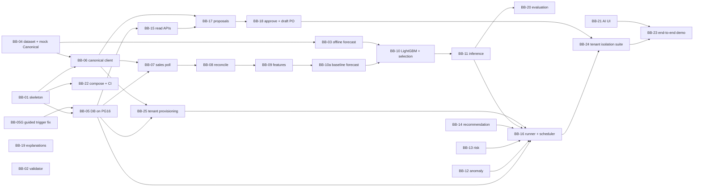

# AI Brain team task pack (v2, 21 Oct 2026)

**For:** the AI team (Ibrahim, Fatma, Mostafa, Ahmed Emad, Mahmoud) plus Ali (DevOps). Yasin and Ahmed Salah appear only as external dependencies.
**Read first, in this order (1 hour):** `docs/BLUEPRINT_FINAL.md` → `docs/decisions/DECISIONS_2026-10-21_ERD.md` → `contracts/internal/BRAIN_CONTRACTS.md` → `contracts/internal/brain_ports.py` → the schemas your task names.
**Rule:** if a task and a contract disagree, the contract wins. If two contracts disagree, follow the precedence in `README.md` and tell Ibrahim. Never change a contract inside a feature PR: open a contracts PR first.

**v2 (21 Oct, evening):** Ibrahim's decisions D-27 to D-42 are applied. The biggest change: **multi-tenancy is a core requirement** (D-34). Every task now has two-tenant tests, and BB-24 adds a cross-tenant isolation suite. Ingestion, features, recommendations and the Brain read APIs stay with Ibrahim (D-39). The trigger bug is Ibrahim's guided exercise (BB-05G). Items tagged **[pending N-xx]** wait for an answer in `docs/decisions/ERD_DB_APPROVAL_QUESTIONS.md` §D; build everything else now.

**v2.1 (21 Oct, night):** N-01, N-02 and N-05 are decided (D-46 tenant registry and per-tenant Canonical credentials, D-47 row-level security as a second wall, D-48 organization-level grain). The database side is in migration `0007` (generator, `brain_db/verification/tenancy_rls_checks.py`). Changed tasks: BB-01, BB-05, BB-06, BB-13, BB-15, BB-16, BB-18, BB-24, EXT-S1, EXT-Y1; new task **BB-25** (provisioning command).

**v2.2 (21 Oct, night):** N-09 is decided on the Brain side (D-49): organization stock is a separate `canonical.OrganizationInventory` record with no `location_id`; `InventoryItem.location_id` is required and never null; the Brain checks organization stock (BRAIN_CONTRACTS §7.13, V0–V8) and never sums branches; while `platform.inventory_source` is `"none"` (the default, Option D) no inventory-dependent recommendation is produced; a draft-PO proposal for a tenant with more than one active location returns `BRANCH_DECISION_REQUIRED` until N-10. The Canonical contract stays **unsigned** until the ERP owners approve it (EXT-Y1). Changed tasks: BB-02, BB-04, BB-06, BB-13, BB-14, BB-17, BB-21, EXT-Y1. No database change.

---

## 1. How the work is split

Each engine has a **pure core** (no database, no HTTP) and a thin **job step** that does the I/O. You build and test the pure core first, against the dataclasses in `brain_ports.py`, so nobody waits for the database, the ERP or anybody else. The job step is wired in later, when the runner (BB-16) and the database (BB-05) exist.

| Lane | Owner (D-02, D-39) | Tasks | Can start on day 1 with |
|---|---|---|---|
| A. Platform and data | Ibrahim | BB-01, 02, 05G, 05, 06, 07, 08, 09, 14, 15, 16, 23, 25 | BB-01, BB-05G |
| B. Forecasting | Mostafa | BB-03, 10, 11, 20 | BB-03 |
| C. Anomaly, risk and tenant isolation | Fatma | BB-12, 13, 24 (suggested owner) | BB-12, BB-13 (pure cores), BB-24 test plan |
| D. Agent and approval | Ahmed Emad | BB-17, 18, 19 | BB-17, BB-19 (pure cores) |
| E. Data and UI tooling | Mahmoud | BB-04, 21 (+ helps BB-20) | BB-04, BB-21 |
| F. Infrastructure | Ali | BB-22 | BB-22 |

**Keeping Lane A realistic.** Lane A is about 24 person-days and Ibrahim has midterms until 7 Nov. Ownership stays with Ibrahim (D-39). To make it fit: (1) build the **vertical slice first** (M1 below) and nothing else in Lane A until it runs; (2) other lanes never wait on Lane A, because they code against `brain_ports.py`, the fixtures and the mock server; (3) BB-24 (isolation suite) sits in Lane C, the lightest lane. If M1 slips past 21 Nov, cut scope in this order: BB-19 LLM part, product-specific LightGBM (D-31 makes it optional), BB-20 plots.

### Milestones and implementation order

| Milestone | Goal | Tasks (in order) | Done when | Target |
|---|---|---|---|---|
| **M0 Foundations** | Everyone can open PRs; data and DB exist | BB-01, BB-05G (guided fix), BB-02, BB-04 part 1 (dataset, two tenants), BB-22 (Redis removed); pure cores of BB-12, BB-13, BB-17, BB-19 start | `/health` runs in Docker; DDL loads on PG16 without any scratch fix; synthetic CSVs for two tenants exist | 31 Oct |
| — | Midterms | reviews only | — | 1–7 Nov |
| **M1 Vertical slice** | Canonical sales → `sales_fact` → coverage → `feature_daily` → baseline forecast, for two tenants | BB-05 → BB-04 part 2 (mock server) → BB-06 → BB-07 → BB-08 → BB-09 → **BB-10a** (seasonal-naive baseline only: registry rows, `training_run`, `forecast` + `forecast_point`) | **One command** against the mock (`brain-worker run sales_poll`, then `brain-worker run end_of_day`) produces, for each of two tenants: `sales_fact` rows, `sales_day_coverage` with `complete` and `gap` days, `feature_daily` rows with `missing` (never 0) on gap days, and a seasonal-naive forecast per product. Running both commands twice changes nothing. A void edited in the mock is corrected after the next reconcile. Tenant A's run never reads or writes tenant B's rows (BB-24 slice tests). Results labelled synthetic | 21 Nov |
| **M2 Learning** | Shared LightGBM with per-product selection | BB-03 (already in progress) → BB-10 (full) → BB-11 → BB-20 | Nightly run selects per product (D-31), forecasts via API, evaluation rows | 28 Nov |
| **M3 Intelligence** | Hourly window, risk, recommendations, read APIs | BB-12/13 wiring → BB-14 → BB-16 → BB-15 | Amoxicillin becomes high risk with recommendation 110 inside one window | 3 Dec |
| **M4 Action** | Proposal → approval → one draft PO | BB-17 → BB-18 → BB-19 → BB-21 | Approve twice → exactly one draft PO; works offline | 8 Dec |
| **M5 Proof** | Isolation and demo | BB-24 (full) → BB-23 | Cross-tenant suite green; e2e demo green | 12 Dec |

Dates are targets for planning, not commitments; adjust them in Personal OS.

### Dependency graph



### Task summary

| ID | Title | Owner | Effort | Depends on | Milestone |
|---|---|---|---|---|---|
| BB-01 | Brain service skeleton | Ibrahim | 1.5 d | — | M0 |
| BB-02 | Contracts validator in CI | Ibrahim (+Ali) | 1 d | — | M0 |
| BB-03 | Offline forecasting baseline and backtest | Mostafa | 4 d | BB-04 (dataset only) | M0–M2 |
| BB-04 | Synthetic pharmacy dataset (two tenants) + mock Canonical server | Mahmoud | 3.5 d | — | M0 (data), M1 (mock) |
| BB-05G | Guided fix of `guard_proposal_transition` | Ibrahim (Claude guides) | 0.5 d | — | M0 |
| BB-05 | `brain_db` on PostgreSQL 16 + test harness | Ibrahim | 1.5 d | BB-05G, BB-01 (harness) | M1 |
| BB-06 | Canonical client (HTTP), per tenant | Ibrahim | 2 d | BB-01, BB-04 | M1 |
| BB-07 | Sales poll job | Ibrahim | 2 d | BB-05, BB-06 | M1 |
| BB-08 | End-of-day reconcile and day coverage | Ibrahim | 1.5 d | BB-07 | M1 |
| BB-09 | Calendar and feature builder | Ibrahim | 3 d | pure: —; job: BB-05, BB-08 | M1 |
| BB-10a | Seasonal-naive baseline forecast (slice) | Mostafa | 1 d | BB-09 | M1 |
| BB-10 | Nightly training: shared LightGBM, per-product selection | Mostafa | 3 d | BB-03, BB-10a | M2 |
| BB-11 | Forecast inference + `GET /forecasts` | Mostafa | 2 d | BB-10, BB-15 (app) | M2 |
| BB-12 | Anomaly detector | Fatma | 2.5 d | pure: — | M0–M3 |
| BB-13 | Risk engine | Fatma | 2 d | pure: — | M0–M3 |
| BB-14 | Recommendation engine | Ibrahim | 2 d | pure: — | M3 |
| BB-15 | Read APIs, auth, scopes, health, pipeline status | Ibrahim | 3 d | BB-01, BB-05 | M3 |
| BB-16 | Job runner, per-tenant scheduler, intel window, end-of-day | Ibrahim | 3 d | BB-05, BB-07..BB-14 | M3 |
| BB-17 | Proposals: hashing, builder, endpoints, expiry | Ahmed Emad | 2.5 d | pure: —; endpoints: BB-05, BB-15; branch check: BB-06 (location register) | M0–M4 |
| BB-18 | Approval, draft-PO execution, audit | Ahmed Emad | 3 d | BB-17, BB-04 | M4 |
| BB-19 | Explanations, optional LLM, assistant | Ahmed Emad | 3 d | template: —; endpoint: BB-15 | M0–M4 |
| BB-20 | Nightly evaluation and degradation | Mostafa (+Mahmoud) | 2 d | BB-11 | M2 |
| BB-21 | AI UI components against the mock Brain API | Mahmoud | 4 d | — (fixtures) | M4 |
| BB-22 | Compose, Dockerfile, CI jobs; Redis removed | Ali | 2 d | BB-01 | M0 |
| BB-23 | End-to-end demo: Amoxicillin story | Ibrahim + all | 2 d | everything | M5 |
| BB-24 | Cross-tenant isolation suite | Fatma (suggested; Ibrahim reviews) | 3 d | slice part: BB-07..BB-10a; full: BB-16, BB-18 | M1 (slice), M5 (full) |
| BB-25 | Tenant provisioning command and per-tenant credentials (D-46) | Ibrahim | 1.5 d | BB-05, BB-06 | M3 |

External dependencies (not AI-team tasks):

| ID | Who | What | Blocks |
|---|---|---|---|
| EXT-Y1 | Yasin | ERP adapter serving `contracts/openapi/canonical.openapi.yaml` (5 reads + draft PO write with idempotency), tenant from the token. Answers BLUEPRINT §11 Q3, Q4, Q5, Q11, and answers the N-10 questions (`ERD_DB_APPROVAL_QUESTIONS.md` §D): whether `DailySalesTotal` is the organization total over all branches; when an organization's day is `closed` across branches; whether the ERP can serve `OrganizationInventory` with the D-49 guarantees (complete location list, ERP-side totals, per-location `stock_as_of`) and `GET /locations`; which branch receives a draft PO. Until the ERP owners approve, the D-49 Canonical changes stay unsigned and every tenant stays on `inventory_source = "none"` (Option D) | only BB-23 against the real ERP; the mock (BB-04) covers everything before |
| EXT-S1 | Ahmed Salah | JWT with `tenant_id` (= organization id), `sub`, `scopes`; scopes `brain:read`, `brain:admin`, `agent:approve` mapped from ERP permissions (D-37); one Canonical service credential **per organization** for the Brain (D-46): read scopes + `canonical:po:create_draft` only, rotatable, and the token's tenant = that organization. Shape (static token or client credentials) to agree | BB-15 against the real ERP; tests use locally signed tokens |

---

## 2. Definition of done (every task)

1. Code under `apps/brain/` follows the module map in `BRAIN_CONTRACTS.md` §1.
2. `ruff check`, `ruff format --check`, `mypy --strict brain` and `pytest` pass locally and in CI.
3. Tests named in the task exist and pass. Unit tests use no DB and no network.
4. **Two tenants.** Every integration test fixture has at least two tenants, and the task's tests show that tenant A's work never reads, changes or references tenant B's data (D-34). No code path uses a default tenant.
5. No new business constant: thresholds come from `rule_config` (OD-16).
6. No secret, token, row payload or prompt text in code, fixtures or logs.
7. Results computed on synthetic data are labelled "synthetic data" (D-41).
8. PR description: task ID, what changed, how you tested, which decisions (D-xx) or pending items (N-xx) you relied on.
9. One reviewer from the task's "Reviewer" line approves. Contracts changes also need CODEOWNERS.

---

## 3. Tasks

### BB-01 Brain service skeleton
- **Owner:** Ibrahim (AI lead). **Reviewer:** Ahmed Emad. **Effort:** 1.5 d. **Depends on:** nothing. **Parallel:** yes. **Milestone:** M0.
- **Objective:** a tested, runnable home for every other task, matching the module map, so people can open PRs into real folders. (Keeps the audit's BB-01 intent; the "pluggable data source" is now `CanonicalSource` from the contracts.)
- **Inputs:** `BRAIN_CONTRACTS.md` §1, §2, §10, §11; `brain_ports.py`; `brain.env.example`.
- **Contracts to follow:** module map §1; settings §10; logging §11; `health.schema.json`.
- **Deliverables:** `apps/brain/pyproject.toml` (Python 3.11, pinned: fastapi, uvicorn, pydantic v2, pydantic-settings, sqlalchemy 2 / sqlmodel, psycopg 3, httpx, jsonschema, rfc8785, structlog, pytest, ruff, mypy; lightgbm and numpy/pandas as an extra `ml`); the package tree from §1 with empty modules; `brain/ports.py` copied from `contracts/internal/brain_ports.py`; `settings.py`; JSON logging; `api/app.py` with `GET /api/v1/brain/health` (database check stubbed until BB-05); `worker.py` with `brain-worker run <job>` that prints "not implemented" for now; `Dockerfile` (one image, two commands); `apps/brain/README.md`.
- **Acceptance criteria:** `docker build` succeeds; `uvicorn brain.api.app:app` serves `/health` with a body that validates against `health.schema.json`; `brain-worker --help` lists the jobs from `JobName`; missing required env var → process exits 1 with a clear message naming the variable but not its value.
- **Tests:** health response validates against the schema; settings fail on a missing `BRAIN_DB_URL`; settings `repr` masks every secret, and a loaded `CanonicalCredential` never appears in `repr` or a log line; `ports.py` is byte-identical to the contracts copy (test compares files).
- **Think first:** why do we put the ports file in `contracts/` and copy it, instead of letting each module define its own interface?

### BB-02 Contracts validator in CI
- **Owner:** Ibrahim (plan task 6), Ali wires CI. **Reviewer:** Mostafa. **Effort:** 1 d. **Parallel:** yes.
- **Objective:** a contract change that breaks a fixture, a hash vector or an OpenAPI reference cannot be merged.
- **Inputs:** `contracts/` (33 schemas, 33 valid + 19 invalid fixtures, golden hash vectors, 2 OpenAPI files).
- **Deliverables:** `contracts/tools/validate.py`, a CI step running it.
- **Acceptance criteria:** (a) every schema passes the draft 2020-12 meta-schema; (b) every `fixtures/valid` file passes and every `fixtures/invalid` file fails against its `$schema_ref`; (c) golden vectors recompute exactly with `rfc8785`; (d) both OpenAPI files validate and every `../schemas/...` reference exists; (e) `contracts/internal/brain_ports.py` passes `mypy --strict`; (f) every `fixtures/semantic_invalid` file passes its schema and names `register_ref` and an `expect_reason` from `InventoryRejection` or `TENANT_MISMATCH` (the rejection itself is tested in BB-06); (g) exits non-zero on any failure; (h) runs offline in < 5 s. Keep the post-MVP event schemas in the check so they do not rot (BLUEPRINT §11 Q8).
- **Tests:** break one fixture on purpose in a throwaway branch and show CI red (screenshot in the PR).
- **Note:** a reference implementation of (a)–(d) was used on 21 Oct to verify this pack; write your own first, then compare.

### BB-03 Offline forecasting baseline and backtest
- **Owner:** Mostafa (forecasting). **Reviewer:** Ibrahim. **Effort:** 4 d. **Depends on:** BB-04 dataset file (day 1 slice is enough). **Parallel:** yes.
- **Objective:** a measured first result: seasonal-naive vs one global LightGBM, per-product WAPE, before any database exists. (Audit BB-03 intent.)
- **Inputs:** BB-04 `daily_sales.csv` + `coverage.csv`; `contracts_jsonb.py` (`FeatureVector`, `MODEL_INPUT_COLUMNS`, `ForecastRuleParams`); `brain_ports.py` §6.
- **Contracts to follow:** feature columns and order in `MODEL_INPUT_COLUMNS` (do not invent new ones without a contracts PR); `ForecastModel` protocol; label = `max(net_units, 0)` on complete days only (D-35); gap days are missing, never zero.
- **Deliverables:** `brain/forecasting/models/seasonal_naive.py`, `models/lightgbm.py` implementing `ForecastModel`; `brain/forecasting/backtest.py` (rolling origin, `backtest_weeks=4`, horizon 14); a short `docs/forecasting/BB-03_results.md` with the WAPE table and the winner count.
- **Acceptance criteria:** both models fit and predict through the `ForecastModel` protocol; LightGBM saves as native text and reloads with SHA-256 check (no pickle, OD-13); backtest never uses a row at or after the fold's cutoff; per-product winner chosen with `must_beat_baseline_margin`; intervals (`confidence_low/high`) from quantile models or backtest residuals at 80 %.
- **Tests:** leakage test (shuffle future values → features unchanged); seasonal-naive on a perfectly weekly series has WAPE 0; save → load round trip predicts identical values; a product with 3 weeks of history is routed to cold start; models of tenant A are fitted only on tenant A's rows.
- **Labelling (D-41):** `BB-03_results.md` says in its first line that every number comes from synthetic data and is not evidence of real-world accuracy.
- **Think first:** why can a global model beat per-product models when each product has only a few months of data?

### BB-04 Synthetic pharmacy dataset + mock Canonical server
- **Owner:** Mahmoud. **Reviewer:** Ibrahim. **Effort:** 3.5 d. **Parallel:** yes. **Unblocks:** BB-03, BB-06, BB-18, BB-23, BB-24.
- **Objective:** realistic synthetic data and a fake ERP adapter so every lane works without the real ERP (D-41). The data is for development, integration tests and the demo only.
- **Inputs:** `contracts/openapi/canonical.openapi.yaml`, `schemas/canonical/*`, fixtures (the Amoxicillin story: 40 available, 5-day lead time, order 110).
- **Deliverables:**
  1. `tools/synth/generate.py --products 200 --days 540 --seed 42`: writes `daily_sales.csv` (`product_id, business_date, units_sold, units_returned, net_units, day_status, complete, updated_at`), `products.json`, `suppliers.json`, `inventory.json`, `purchase_orders.json`, `coverage.csv`. Columns also include `tenant_id`. **Two tenants** (`--tenants 2`) with different products, sizes and seasonality, and one product UUID that exists in both tenants (to catch joins without tenant). Patterns: weekday effect, Ramadan and flu-season uplift, stock-outs (zero sales while stock is 0), returns, a few days where returns exceed sales (`net_units < 0`), corrections (a past day's total changes later), 2 gap days with `complete=false`, intermittent slow movers, and Amoxicillin exactly as in the fixtures for tenant 1. **Ship a first 30-product, two-tenant file on day 1** so BB-03 can start. A `README` states that the data is synthetic.
  2. `tools/mock_canonical/` FastAPI app serving every path in `canonical.openapi.yaml` from those files, choosing the tenant from the bearer token (one test token per tenant) and never returning another tenant's rows: date filters, `updated_since`, cursor pages ordered by `(updated_at, product_id, business_date)`, `high_watermark`, the draft-PO POST with in-memory idempotency (same key + same body → 200 replay; different body → 409 `IDEMPOTENCY_CONFLICT`). Inventory (D-49): `GET /inventory/{product_id}` returns `OrganizationInventory` computed by the mock from its per-location rows with the documented rule, `GET /inventory/{product_id}/locations` the per-location `InventoryItem`s (always a non-null `location_id`), `GET /locations` the register. Tenant 1 has two active and one inactive location; tenant 2 has one active location.
  3. Test controls (headers or an admin route on the mock only): fail the next N requests with 503, delay a response, edit a past day's total (simulates a void), open/close today, mark a location `unavailable` (organization record turns `complete: false`).
- **Acceptance criteria:** every response validates against its canonical schema; paging through all sales with `limit=50` returns each row exactly once; the controls work; runs as a Compose service; tenant 1's token never sees tenant 2's data; the same Idempotency-Key used by two tenants creates two independent POs; no response ever carries an `InventoryItem` with a null `location_id`.
- **Tests:** schema validation of every endpoint response; pagination completeness; idempotency replay and conflict; tenant separation.

### BB-05G Guided fix of `guard_proposal_transition` (D-42)
- **Owner:** Ibrahim, guided step by step by Claude (learning exercise). **Reviewer:** Claude reviews, then Ali. **Effort:** 0.5 d. **Depends on:** nothing.
- **Objective:** the generated DDL loads on PostgreSQL 16 because Ibrahim fixed the trigger in the schema source himself.
- **Inputs:** `Answers/02_guided_fix_guard_proposal_transition.md` (the walkthrough; it has no solution line on purpose), `brain_db/tools/schema_gen/spec_agent.py`, `brain_db/verification/decision_checks_2026-10-21.py`.
- **Steps:** follow Answers/02: find the failing line, predict why PL/pgSQL rejects it, change **only** `spec_agent.py`, run `build_all.py`, load `brain_db_mvp.sql` on an empty PostgreSQL 16, run the transition tests, then ask Claude for review.
- **Acceptance criteria:** generated `brain_db_mvp.sql` loads with no error and no manual edit of generated files; the 12 cases in Answers/02 §7 behave as expected; the 20 decision checks still pass.
- **Tests:** the 12 cases in Answers/02 §7 as SQL (later as pytest in BB-05). Success is claimed only with the test output pasted in the PR.

### BB-05 `brain_db` on PostgreSQL 16 + test harness
- **Owner:** Ibrahim (IBR-01, learning log). **Reviewer:** Ali. **Effort:** 1.5 d. **Depends on:** BB-05G; BB-01 for the harness only.
- **Objective:** the database really runs from migrations, models match the DDL, and every integration test gets a clean migrated database with two tenants.
- **Inputs:** `brain_db/` (generator, DDL, Alembic), `docs/decisions/DECISIONS_2026-10-21_ERD.md`, `IMPACT_2026-10-21_ERD_DECISIONS.md`.
- **Already done (21 Oct):** D-29 to D-34 are in the generator (`spec_*.py`, `gen_core.py`) and regenerated; `tenant_id` has no default. D-46/D-47 are in migration `0007` (`spec_tenancy.py`, `gen_core.tenancy_sql`): `ingest.tenant_registry`, role `brain_provisioner`, RLS on every tenant table, `security_invoker` views; `verification/tenancy_rls_checks.py` passes on PG16. Do not redo them; read the impact file to see what changed. Steps 1 (B6), 4 and 5 were drafted on 21 Oct under the readiness remediation: `brain/db/session.py`, `brain_db/tests/integration` (superuser-free harness: `session.py` tests and the four suites) and `verification/bbsetup.py`; review them rather than rewriting, and record what you change in IBR-01.
- **Steps:**
  1. `alembic upgrade head` on an empty PostgreSQL 16 container (after BB-05G), then `alembic check`. Today `check` reports 458 comment-only differences (444 before migration 0007; earlier notes said 888 by counting each twice) because `models.py` has no comments (C-12). Fix it **in the generator** (emit `comment=` in `models.py`, or make the env ignore comments; pick one and write down why).
  2. Fix the `action_proposal.tool_version` example in the generator to `"1.0"` (C-14), regenerate.
  3. Move the dev-tenant seed out of migration `0005` into a dev-only seed script **[pending N-08]**.
  4. `brain/db/session.py`: engine for `brain_app` in brain-api and for `brain_worker` in brain-worker (`BRAIN_WORKER_DB_URL`, D-45), a unit-of-work context manager that takes the tenant from `RunContext` and runs `SELECT set_config('app.tenant_id', :tenant, true)` as the first statement of every transaction (D-47; never a session-level `SET`), plus a pool `checkout` hook that discards a connection still carrying `app.tenant_id` and a startup check that refuses a login with `rolsuper` or `rolbypassrls` (pattern in `tenancy_rls_checks.py` §5). `tests/integration/conftest.py`: start PostgreSQL 16 (Testcontainers or the Compose service), migrate once per session, truncate between tests, seed **two tenants**.
  5. Port `decision_checks_2026-10-21.py`, `proposal_transition_checks.py`, `role_security_checks.py` and `tenancy_rls_checks.py` to pytest; the two-tenant fixture seeds both tenants in `ingest.tenant_registry` (status `active`).
- **Acceptance criteria:** upgrade passes and `check` reports no differences; the BLUEPRINT §7 checks still hold (same row twice → one row; older row ignored; two identical failures → one row with `attempts=2`); the 20 decision checks pass as pytest; an insert without `tenant_id` fails; a unit of work without a tenant context reads no rows; the RLS checks pass through `session.py` (not only through raw SQL).
- **Tests:** the decision checks; the BB-05G transition table; concurrent creation of two live proposals for one recommendation → one unique violation (D-30); tenant 2 cannot reference tenant 1's shared model (composite FK).

### BB-06 Canonical client (HTTP)
- **Owner:** Ibrahim. **Reviewer:** Ahmed Emad (he uses the writer). **Effort:** 2 d. **Depends on:** BB-01, BB-04.
- **Objective:** one place that talks to the ERP adapter, validates every response and maps it to the domain dataclasses.
- **Contracts to follow:** `CanonicalSource`, `CanonicalWriter`, `CachedCanonicalReader`, `CredentialProvider`, `CanonicalSourceFactory` (`brain_ports.py` §4); retry policy §6.2; tenant rules §7.5 and §7.13 (D-46, D-48); `canonical.openapi.yaml`.
- **Deliverables:** `brain/canonical/http_source.py`, `http_writer.py`, `cache.py` (read-through over `ingest.canonical_cache` with `*_freshness_seconds`), `fixture_source.py` (in-memory, for unit tests).
- **Acceptance criteria:** every method validates against the schema; a row-level sales error skips the row and counts it; `tenant_id` mismatch → `ValidationFailed(TENANT_MISMATCH)`; 5xx/timeout → 3 attempts then `DependencyUnavailable`; the writer sends `Idempotency-Key` and maps 409 `IDEMPOTENCY_CONFLICT` and timeouts to `IdempotencyConflict` / `OutcomeUncertain`; `get_open_po_qty` follows all pages and is never cached; `traceparent` header sent; clients are built per tenant from that tenant's credential (no shared client); a credential file whose SHA-256 differs from the registry → `ConfigInvalid` for that tenant only; the secret never appears in logs, errors or `repr`; `get_inventory` reads `OrganizationInventory` and `GET /locations` live in one unit of work, never caches them, and applies BRAIN_CONTRACTS §7.13 checks V0–V8, raising `InventoryRejected` with the exact reason; each `fixtures/semantic_invalid` file is rejected with its `expect_reason` and both valid organization fixtures behave as expected (accepted / `inventory_incomplete`); an `InventoryItem` with a null `location_id` fails validation; nothing sums location rows (D-48, D-49).
- **Tests:** against the mock server: happy paths; a client built for tenant A uses A's credentials and rejects a page carrying B's `tenant_id`; 503 ×2 then success, 503 ×5 → error, malformed row skipped, idempotent replay, timeout → `OutcomeUncertain`.

### BB-07 Sales poll job
- **Owner:** Ibrahim. **Reviewer:** Fatma. **Effort:** 2 d. **Depends on:** BB-05, BB-06.
- **Objective:** BLUEPRINT §4.2 exactly.
- **Contracts to follow:** BLUEPRINT §4.2–§4.5; `BRAIN_CONTRACTS.md` §5.2 row `sales_poll`, §6.3; `SalesRepository`, `CheckpointRepository`, `FailureRepository`.
- **Deliverables:** `brain/ingestion/poller.py` (a `Job`), `brain/db/repositories/sales.py`, `checkpoint.py`, `failures.py`.
- **Acceptance criteria:** one transaction per page; watermark saved only with the last page; first poll uses `poll_history_start_date`; next poll uses `high_watermark − poll_overlap_seconds`; dates after today or before history start rejected (D-04 amended); `sales_day_coverage` row `open` inserted for new days; open failure row resolved with `repolled` on the next success; checkpoint, failures and coverage are per tenant; raw `units_sold`, `units_returned`, `net_units` stored as received (negative `net_units` allowed, D-35); polling only, no events (D-27).
- **Tests:** T-POLL-01..08 from `brain_db/docs/03_lifecycle_security_performance_testing.md`, and: crash after page 2 of 3 then re-run → same final state; out-of-order older row ignored; run twice → identical tables; two tenants polled → each has its own watermark and rows.

### BB-08 End-of-day reconcile and day coverage
- **Owner:** Ibrahim. **Reviewer:** Mostafa (he trains on its output). **Effort:** 1.5 d. **Depends on:** BB-07.
- **Objective:** decide which days are safe to train on (BLUEPRINT §4.4).
- **Deliverables:** `brain/ingestion/reconcile.py` (`sales_reconcile` job step).
- **Acceptance criteria:** re-reads `today − reconcile_lookback_days … yesterday` with no `updated_since`; upserts with `source_mode='reconcile'`; sets each day `complete` or `gap` with `gap_reason` per §4.4; a day still `open` stays `open` (BLUEPRINT Q4); idempotent.
- **Tests:** all-closed day → complete; one `complete=false` row → gap `erp_incomplete`; mock down → gap `canonical_unavailable`; a void edited at 10:00 for 3 days ago is corrected by the reconcile (BLUEPRINT §12 Q2); tenant A's ERP down → only A's days become `gap`.

### BB-09 Calendar and feature builder
- **Owner:** Ibrahim (Mostafa reviews; he consumes it). **Effort:** 3 d. **Depends on:** pure builder none; job steps BB-05, BB-08.
- **Objective:** one feature builder shared by training and inference (MVP §3.6).
- **Contracts to follow:** `FeatureBuilder` protocol; `FeatureVector`, `MODEL_INPUT_COLUMNS`, `FEATURE_SET_VERSION` in `contracts_jsonb.py`; OD-14 calendar rules.
- **Deliverables:** `brain/features/calendar.py` (seed `feat.calendar_day` for 2024–2027 from a pinned holiday library plus curated Ramadan and flu-season dates, `source='seed'`); `builder.py` (pure); `job.py` (`incremental` for dirty products in the window, `nightly_full` in end-of-day).
- **Acceptance criteria:** inputs use only days strictly before `feature_date`; `n_obs_*` count only observed/zero-filled days; `y_status` follows coverage (observed, zero_filled, missing, open, future); the same inputs give byte-identical rows; `y_units = GREATEST(net_units, 0)` and days with returns > sales flagged per **[pending N-03]** (D-35).
- **Tests:** leakage; gap day is `missing` and is not counted in rolling means; a complete day with no sales row is `zero_filled` with `y_units=0`; incremental and full recompute agree for the same day; a day with `net_units = -3` → `y_units = 0` and the raw value is unchanged in `sales_fact`.

### BB-10a Seasonal-naive baseline forecast (vertical slice)
- **Owner:** Mostafa. **Reviewer:** Ibrahim. **Effort:** 1 d. **Depends on:** BB-09 (and BB-05 for the tables).
- **Objective:** the last step of M1: every product of every tenant gets a baseline forecast from complete days only, with no LightGBM yet.
- **Contracts to follow:** `BRAIN_CONTRACTS.md` §8; `Trainer`, `Forecaster`; `forecast.schema.json`; D-31 (product rows with `scope='product'`, `family='seasonal_naive'`, no artifact), D-35, D-41.
- **Deliverables:** `brain/forecasting/seasonal_naive.py` (pure), the `training` step limited to seasonal-naive (one `training_run`, one registry row per product, backtest WAPE), the `forecast_inference` step writing `forecast` + `forecast_point`.
- **Acceptance criteria:** uses only `y_status in (observed, zero_filled)` rows; target is `y_units` (clamped, D-35); run twice with the same run id → no duplicates; two tenants → each tenant's rows reference only its own products and models; WAPE reported and labelled "synthetic data".
- **Tests:** weekly pattern reproduced exactly; gap day not treated as 0; idempotent re-run; tenant separation.

### BB-10 Nightly training: shared LightGBM, per-product selection
- **Owner:** Mostafa. **Reviewer:** Ibrahim. **Effort:** 3 d. **Depends on:** BB-03, BB-10a.
- **Objective:** turn BB-03 into the full `training` job step (D-20, D-26, D-28, D-31 to D-33).
- **Contracts to follow:** `BRAIN_CONTRACTS.md` §8 (registry scope, selection, artifacts); `Trainer` protocol; `ModelScope`; `TrainingConfigSnapshot`, `ModelMetrics`.
- **Deliverables:** `brain/forecasting/trainer.py`, `artifacts.py` (path `{MODEL_ARTIFACT_ROOT}/{tenant_id}/{model_id}.txt`, SHA-256, formats `lightgbm_txt`/`json` only), `repositories/models.py`.
- **How selection works (D-31):** fit **one shared LightGBM per tenant** (registry row `scope='shared'`, `product_id` NULL, has the artifact). For each product, backtest seasonal-naive and the shared model with the **same rolling-origin, time-based backtest** and WAPE. The winner becomes the product's row (`scope='product'`): seasonal-naive (no artifact) or a pointer to the shared row (`shared_model_id`, no own artifact). A product-specific LightGBM is **optional** and allowed only when it beats the shared model on that same backtest. Do not describe or build this as "one model per SKU".
- **Acceptance criteria:** reads only `observed`/`zero_filled` rows up to the cutoff; target `y_units`; days flagged returns > sales handled per **[pending N-03]**; writes one `training_run` (`trigger='nightly'`), the shared row, per-product rows, backtest `model_evaluation` rows; validates/retires in one transaction; a failed run leaves yesterday's validated models in place; never loads pickle/joblib; finishes in < 10 min for 200 products × 540 days on a laptop.
- **Tests:** run twice → no duplicate validated rows per product; corrupted artifact → load refuses (SHA mismatch); short history → seasonal-naive, `cold_start` flag; tenant B's product row cannot point at tenant A's shared row; tenant A's artifacts live only under `models/{tenant_A}/`.

### BB-11 Forecast inference + `GET /forecasts/{product_id}`
- **Owner:** Mostafa. **Reviewer:** Ibrahim. **Effort:** 2 d. **Depends on:** BB-10, BB-15 (API app and auth).
- **Contracts to follow:** `Forecaster`; `forecast.schema.json`; §5.2 row `forecast_inference`; quality flags enum.
- **Acceptance criteria:** horizon from `forecast.horizon_days`; `job_run_id` = end-of-day `run_id`; feature-set mismatch → `FeatureSetMismatch`, fallback seasonal-naive with `fallback_model`; `confidence_low ≤ predicted ≤ confidence_high`; endpoint returns the latest generation, 404 before the first run.
- **Tests:** re-run with the same run id → no duplicates; response validates against `forecast.schema.json` and matches `fixtures/valid/brain/forecast/amoxicillin_3d.json` shape.

### BB-12 Anomaly detector
- **Owner:** Fatma. **Reviewer:** Ibrahim. **Effort:** 2.5 d. **Depends on:** nothing for the pure core.
- **Objective:** z-score anomalies on daily net units (BLUEPRINT §5; the single-line rule is dropped).
- **Contracts to follow:** `AnomalyDetector`, `AnomalyInput`, `AnomalyFinding`; `AnomalyRuleParams`; `AnomalyReason`; `anomaly_event` columns; mode rule D-40 (intraday = spikes only; drops only on closed, complete days; missing is never 0).
- **Deliverables:** `brain/anomaly/detector.py` (pure), `brain/anomaly/step.py` (upsert by natural key; called by BB-16).
- **Acceptance criteria:** spike = z > `zscore_threshold` on completed-day history (or observed far above the forecast point when a forecast exists); intraday checks spikes only; closed-day checks spikes and drops; fewer than `min_history_days` → no finding; severity from `severity_high_score`/`severity_medium_score`; reasons list the rule and values.
- **Tests:** flat series + one 5× day → high spike; partial day at 10:00 never yields a drop; a `gap` day yields no finding; short history → []; detector is deterministic; step test with two tenants.

### BB-13 Risk engine
- **Owner:** Fatma. **Reviewer:** Ibrahim. **Effort:** 2 d. **Depends on:** nothing for the pure core.
- **Objective:** D-22 stock-out risk with every input traced.
- **Contracts to follow:** `RiskEngine`, `RiskInputs`, `RiskResult`; `RiskRuleParams`; `RiskCalculation`/`RuleTrace`; `insight.schema.json` (`unavailable_reasons`, `factors`).
- **Acceptance criteria:** risk uses only an `InventorySnapshot` that passed §7.13; a rejected or disabled inventory (`InventoryRejected`, `inventory_source = "none"`) makes the product not assessable (`INVENTORY_UNAVAILABLE`, counted by reason); per-location stock is never used or summed (D-48, D-49);  `days_of_cover = available / demand_per_day`; high if `< lead_time`, medium if `< lead_time + margin_days`, else low; a high anomaly raises one level when enabled; missing inventory / lead time / forecast → no `stockout_risk` row, product counted in `products_not_assessable` with its reason code, never an exception **[pending N-07]**; `confidence` from `confidence_by_forecast`.
- **Tests:** a location-scoped inventory item → no `stockout_risk` row; Amoxicillin (40 available, 24/day, lead 5 → 1.7 days → high); boundary values exactly at the thresholds; anomaly upgrade; each missing input → its reason code.

### BB-14 Recommendation engine
- **Owner:** Ibrahim (D-39). **Reviewer:** Ahmed Emad (he consumes it). **Effort:** 2 d. **Depends on:** nothing for the pure core.
- **Objective:** D-21 order quantity, deterministic, every input stored.
- **Contracts to follow:** `RecommendationEngine`; `recommendation.schema.json` `calculation` (wins over `contracts_jsonb.RecommendationCalculation`, conflict C-2: update the Pydantic model to the schema fields in this task); D-07 reason codes.
- **Acceptance criteria:** `target = ceil(forecast over (lead_time + review_period) + safety_stock)`, `safety_stock = ceil(z · σ · √lead_time)` (or 1 day of mean demand when σ is missing), `raw = target − available − open_po_qty`, round up to `pack_multiple` (default 1), cap at `max_order_qty` (`cap_applied`); `raw ≤ 0` → no order (`COVERED_BY_OPEN_PO` if open POs made it ≤ 0); missing supplier → `NO_SUPPLIER`; open-PO read failed → `OPEN_PO_UNAVAILABLE`; no checked organization stock (Option D or any §7.13 rejection) → no `create_purchase_order` recommendation, reason `INVENTORY_UNAVAILABLE` (D-49).
- **Tests:** reproduces the fixture exactly (forecast 120, safety 24, target 144, available 40 → raw 104 → 110 with pack 10); cap; open PO covers need; no supplier.

### BB-15 Read APIs, auth, health, pipeline status
- **Owner:** Ibrahim (D-39). **Reviewer:** Mahmoud (frontend consumer). **Effort:** 3 d. **Depends on:** BB-01, BB-05.
- **Objective:** the brain-api surface the frontend reads.
- **Contracts to follow:** `brain.openapi.yaml` (health, insights, recommendations, pipeline/status, admin/jobs); `BRAIN_CONTRACTS.md` §4 auth and scopes (D-37), §6.1 error mapping, §7 tenancy (D-34).
- **Deliverables:** `brain/api/auth.py` (JWT verify, scopes, tenant from token), `errors.py` (exception → envelope with `trace_id`), routers.
- **Acceptance criteria:** every response validates against its schema; each operation checks exactly its `x-required-scope` (`brain:read`, `brain:admin`, `agent:approve`), and `brain:admin` grants no job execution; the tenant comes only from the verified token, no request field carries it; a token whose tenant is not `active` in `ingest.tenant_registry` → 403 `TENANT_NOT_ACTIVE` (D-46); every request's unit of work sets the transaction-local `app.tenant_id` from the token (D-47); another tenant's id → 404 (not 403, so existence does not leak); unknown exception → 500 `INTERNAL_ERROR` without stack trace; insights read `intel.v_insight_current`; pipeline status computed from checkpoints, failures, coverage and registry as described in the schema.
- **Tests:** contract tests per endpoint against the fixtures; auth matrix (no token, wrong scope, token without tenant, token of a `provisioning` or `suspended` tenant) per endpoint; with two tenants, every list and detail endpoint returns only the caller's rows.

### BB-16 Job runner, scheduler, intelligence window, end-of-day
- **Owner:** Ibrahim. **Reviewers:** Fatma (window), Mostafa (end-of-day). **Effort:** 3 d. **Depends on:** BB-05, BB-07…BB-14 (wires them).
- **Objective:** run everything on time, never twice at once, and never crash the loop.
- **Contracts to follow:** `BRAIN_CONTRACTS.md` §5 (runner steps, advisory lock per tenant and job, per-job table), `Job` protocol, `job_run.schema.json`, `job_status_list.schema.json`.
- **Deliverables:** `brain/jobs/runner.py`, `scheduler.py`, `intel_window.py`, `end_of_day.py`, the `brain-worker run <job>` CLI (the only manual path, D-38: no UI button, no job API).
- **Acceptance criteria:** at every tick the scheduler reads the active tenants from `ingest.tenant_registry` (`TenantRegistry`, D-46) and runs each job once per tenant with its own `RunContext`, its own Canonical client built from that tenant's credential, and one transaction per tenant with the tenant context set (D-47); a `provisioning` or `suspended` tenant is never processed; one tenant's failure is recorded and does not stop the others; a manual CLI run is recorded like a scheduled one; schedule from `rule_config(platform)`; advisory lock per tenant and job, `skipped_locked` when held; checkpoint bookkeeping; window processes dirty products one transaction each and advances its watermark to what it processed; end-of-day runs the steps in order and stops before training if reconcile or features failed (old models stay); every run prints a valid `JobRun` line.
- **Tests:** a suspended tenant gets no job runs; a tenant whose credential file does not match the registry hash fails alone (`ConfigInvalid`) and the others run; the HTTP mock records that each tenant's calls carried that tenant's credential; two runners at once → one `skipped_locked`; same job for two tenants at once → both run; tenant A's ERP failing → tenant B still completes; a failing step → `failed`, loop continues; window run twice → no change; end-of-day on the mock data produces forecasts, risks and the Amoxicillin recommendation.

### BB-17 Proposals: hashing, builder, endpoints, expiry
- **Owner:** Ahmed Emad. **Reviewer:** Ibrahim. **Effort:** 2.5 d. **Depends on:** pure core nothing; endpoints BB-05, BB-15.
- **Objective:** deterministic proposals bound to an RFC 8785 hash (D-13, D-18).
- **Contracts to follow:** `ArgumentsHasher`, `ProposalBuilder`; `action_proposal.schema.json`, `create_purchase_order_args.schema.json`, `proposal_list.schema.json`; `BRAIN_CONTRACTS.md` §9; one live proposal per recommendation (D-30) plus the ERP `Idempotency-Key` (D-09).
- **Deliverables:** `brain/agent/hashing.py` using `rfc8785`; fix `contracts_jsonb.canonical_json`/`sha256_hex` to call it (conflict C-1: today it hashes `110` as the string `"110"` and does not match the golden vectors); `proposal_builder.py`; `proposals.py`; `POST /recommendations/{id}/proposal`, `GET /proposals`, `GET /proposals/{id}`; `proposal_expiry` step.
- **Acceptance criteria:** golden vectors reproduce byte for byte; key order and `110` vs `110.0` do not change the hash; proposal `expires_at = created_at + 24 h` (D-10); second POST for the same recommendation returns the same live proposal (200); two concurrent POSTs → the loser catches the unique violation of `uq_action_proposal__live_per_recommendation` and returns the existing proposal; after reject/expire a new proposal may be created; inactive or expired recommendation → 409; `proposed_by='rules'` with NULL session (D-29); creating needs `agent:approve` **[pending N-04]**; a tenant with more than one active location in the register → 409 `CONFLICT`, detail `BRANCH_DECISION_REQUIRED`, nothing created; exactly one active location → proceeds; register unreadable → 503 `DEPENDENCY_UNAVAILABLE` (D-49, until N-10).
- **Tests:** golden vectors; idempotent create; concurrent create (two connections) → one proposal; expiry sweep moves only pending, past-due proposals; tenant B cannot read or create a proposal for tenant A's recommendation (404).

### BB-18 Approval, draft-PO execution, audit
- **Owner:** Ahmed Emad. **Reviewer:** Ibrahim; Yasin reviews the adapter call. **Effort:** 3 d. **Depends on:** BB-17, BB-04 (mock POST), BB-06 writer.
- **Objective:** the only business write, safe under retries and timeouts (D-09, D-11, D-12).
- **Contracts to follow:** `BRAIN_CONTRACTS.md` §9 state machine; `approval_request.schema.json`, `action_result.schema.json` (wins over `contracts_jsonb.ActionResult`, conflict C-3); `create_draft_po_request.schema.json`, `approval_block.schema.json`; `AuditDetails` allow-list.
- **Acceptance criteria:** scope `agent:approve` required; approver = JWT `sub`, never the body; the approver's token tenant must equal the proposal's tenant (otherwise 404); hash mismatch / expired / conflicting decision → 409; reject never calls the adapter; approve sends the exact arguments with `Idempotency-Key = proposal id`; timeout → `uncertain`, retried with the same key (D-11); a `failed` proposal is re-opened only by a new human approval round (D-43); at most one succeeded execution per proposal (DB partial unique); one `audit_log` row per transition, no prompt text.
- **Tests:** approve → exactly one PO in the mock; double-click approve → one PO; timeout then retry → one PO, same key; failed then re-approval → one PO, same key; failed then approve without a new round → refused (D-43); 409 idempotency conflict → failed + alert log; expired → 409; reject → 204 and no adapter call; the draft-PO request uses tenant A's ERP credentials for tenant A's proposal.

### BB-19 Explanations, optional LLM, assistant
- **Owner:** Ahmed Emad. **Reviewer:** Fatma (insight wording). **Effort:** 3 d. **Depends on:** template part nothing; endpoint BB-15.
- **Objective:** every insight has a readable explanation offline; the LLM is an optional extra (D-14, D-17, D-18).
- **Contracts to follow:** `Explainer`, `LlmClient`; `insight.schema.json` `explanation`; `assistant_request/assistant_reply.schema.json`; `llm_usage` columns; D-14 (never store prompt or completion text).
- **Deliverables:** `brain/agent/explainer.py` (templates, English first; Arabic keys if time allows), `llm_client.py` (`NullLlmClient` + one provider adapter behind `LLM_PROVIDER`), `assistant.py`, `POST /assistant/messages`.
- **Acceptance criteria:** with `LLM_PROVIDER=none` everything works and replies have `source='offline'`/`'template'`; with an LLM, numbers in the text equal the inputs (checked); every LLM call writes one `llm_usage` row; no prompt or completion text in logs or DB except `agent_message.content` (30-day expiry).
- **Tests:** template for the Amoxicillin insight; LLM timeout → template fallback; number-mismatch guard rejects an LLM answer that changes 110 to 100.

### BB-20 Nightly evaluation and degradation
- **Owner:** Mostafa, Mahmoud builds the report/plot tooling. **Reviewer:** Ibrahim. **Effort:** 2 d. **Depends on:** BB-11.
- **Objective:** know when a model gets worse (BRAIN_CONTRACTS §8).
- **Acceptance criteria:** nightly `evaluation` step writes WAPE for yesterday per validated model; 7-day WAPE > `degradation_wape_factor` × backtest WAPE → `degraded` with `status_reason`; a degraded model is not used the next night; a small report script (CSV/plot) for the thesis.
- **Tests:** synthetic drift (double demand for 7 days) → degraded; append-only (re-run adds nothing).

### BB-21 AI UI components against the mock Brain API
- **Owner:** Mahmoud (UI/UX). **Reviewer:** Omar (frontend) and Ahmed Emad (approval flow). **Effort:** 4 d. **Parallel:** fully.
- **Objective:** InsightCard, ForecastChart, RecommendationList, ApprovalModal, PipelineStatusBanner, AssistantPanel (optional) built before the Brain exists.
- **Inputs:** `brain.openapi.yaml`, `fixtures/valid/brain/*`. Serve a mock with Prism (`prism mock contracts/openapi/brain.openapi.yaml`) or MSW handlers built from the fixtures.
- **Acceptance criteria:** TypeScript types generated from the schemas (not hand-written); ApprovalModal shows the exact arguments and sends `seen_arguments_sha256` from the proposal; `uncertain` result shows "checking with the ERP", not success; stale banner when `sales_poll.stale_since` is set; "Assistant offline" when `llm.available=false`; a 409 with detail `BRANCH_DECISION_REQUIRED` on "Create proposal" shows "A branch must be chosen before a purchase order can be drafted" and keeps the recommendation visible (D-49).
- **Tests:** component tests with each fixture; approval sends the hash it displayed.

### BB-22 Compose, Dockerfile, CI jobs; Redis removed
- **Owner:** Ali (DevOps). **Reviewer:** Ibrahim. **Effort:** 2 d. **Depends on:** BB-01.
- **Objective:** one-command local stack matching BLUEPRINT §8 (D-17, D-23, D-27).
- **Deliverables (in the team repo, `infrastructure/`):** services `brain-api`, `brain-worker` (same image, different command), `brain_db` (PostgreSQL 16, healthcheck, volume), `mock-canonical` (BB-04, profile `dev`), model artifacts volume (write access for brain-worker only); **remove the `redis` service and every reference to it**; `.env.example` from `contracts/internal/brain.env.example`; CI jobs: brain lint + type + unit, integration (PostgreSQL 16 service container), contracts validator (BB-02).
- **Acceptance criteria:** `docker compose up` starts the Brain against the mock with no internet; no Redis anywhere in compose or CI; secrets only via env/secrets; brain-api healthcheck uses `/api/v1/brain/health`.
- **Tests:** CI is red on a broken fixture and on a failing unit test (show both).

### BB-23 End-to-end demo: the Amoxicillin story
- **Owner:** Ibrahim, with every lane owner. **Effort:** 2 d. **Depends on:** everything above.
- **Objective:** prove the full lifecycle in one automated test and one live demo.
- **Story:** mock ERP with 540 days of history → poll → end-of-day (reconcile, features, train, forecast) → sales during the day push Amoxicillin to 1.7 days of cover → hourly window: risk high, recommendation 110 → UI shows the insight with an explanation → pharmacist creates and approves the proposal → exactly one draft PO in the ERP mock with the approval block → pipeline status green. Then: unplug the internet (LLM offline) and repeat; kill the worker mid-poll and show it recovers.
- **Acceptance criteria:** `tests/e2e/test_amoxicillin.py` passes in CI with two tenants, and tenant B's data is unchanged by tenant A's story; a 5-minute demo script in `docs/DEMO_SCRIPT.md`; demo numbers are labelled synthetic (D-41); the same run against Yasin's real adapter once EXT-Y1 is ready.

### BB-24 Cross-tenant isolation suite (D-34)
- **Owner:** Fatma (suggested). **Reviewer:** Ibrahim. **Effort:** 3 d. **Depends on:** slice part: BB-07…BB-10a; full: BB-15, BB-16, BB-18.
- **Objective:** demonstrate, with automated tests, that one tenant can never read, change or reference another tenant's data. Application-level filtering is not assumed sufficient; this suite is the evidence.
- **Contracts to follow:** `BRAIN_CONTRACTS.md` §7 (14 rules); D-34, D-46, D-47.
- **Deliverables:** `tests/isolation/` with a two-tenant fixture (same product codes and same dates in both tenants, so a missing filter shows up), and:
  1. **API:** every endpoint called with tenant A's token for tenant B's ids → 404; list endpoints return only A's rows.
  2. **DB query lint:** a test that scans repository SQL for every tenant-owned table access without `tenant_id` (or with it only in a SELECT list) and fails.
  3. **Worker:** run each job for tenant A only; a row-count snapshot of tenant B is identical before and after.
  4. **Cache:** `canonical_cache` entries are keyed by tenant; tenant A never gets B's cached product/inventory.
  5. **Forecast and artifacts:** A's forecasts reference only A's models; an artifact path outside `models/{tenant_id}/` is refused; the composite FK rejects cross-tenant `shared_model_id`.
  6. **Agent action:** proposal, approval and execution for A cannot touch B's recommendation; the ERP call uses A's credentials.
  7. **Pooled connections:** two tenants alternating on one connection pool, through the real `session.py`, leave no tenant state behind; a connection without `app.tenant_id` sees zero rows (D-47).
  8. **RLS through the application:** with the repository tenant filter deliberately removed, brain-api and brain-worker still return only the caller's rows (RLS is the second wall), and the runtime logins have no `SUPERUSER`/`BYPASSRLS` (startup check). The database-only checks are in `brain_db/verification/tenancy_rls_checks.py`; this group proves the application uses them correctly.
- **Acceptance criteria:** all eight groups run in CI on PostgreSQL 16; a deliberately removed `tenant_id` filter makes the suite fail (show it once in the PR).
- **Started 21 Oct (readiness remediation):** `brain_db/tests/isolation/` holds the parts provable without application code (fixture with identical products, dates and keys in both tenants; group 7 complete; database halves of groups 4, 5, 6). `tests/isolation/README.md` lists what each group still waits for.

### BB-25 Tenant provisioning command and per-tenant credentials (D-46)
- **Owner:** Ibrahim. **Reviewer:** Ali (secrets and deployment). **Effort:** 1.5 d. **Depends on:** BB-05, BB-06. **Milestone:** M3 (the M1 slice seeds the registry in its test fixture).
- **Objective:** add, validate, activate, rotate and suspend a tenant safely. A tenant is never active before its credential and rule sets are validated.
- **Contracts to follow:** `ingest.tenant_registry` (Part 2 §D2); `BRAIN_CONTRACTS.md` §7.4, §7.5, §7.9, §7.12; `TenantRegistry`, `CredentialProvider`, `CanonicalSourceFactory`; `brain.env.example` (`BRAIN_PROVISION_DB_URL`, `CANONICAL_CREDENTIALS_DIR`).
- **Deliverables:** `brain-provision` CLI (separate entry point, runs with the `brain_provisioner` login only): `create <organization_id> --label`, `set-credential <organization_id> <credential_ref>` (reads the secret file, calls a Canonical read with it, checks the response `tenant_id`, then stores `credential_ref`, `credential_sha256` and the validation in one UPDATE), `activate`, `suspend --reason`, `rotate-credential`, `rule-set add` and `rule-set activate <set> <version>` (one transaction that deactivates the old and activates the new version, with `app.actor_id` set to the operator, D-51); `brain/tenancy/registry.py` and `credentials.py` implementing the ports. Rule-set seeding uses the N-08 answer **[pending N-08]**; until then the command copies the reviewed defaults from a versioned file and says so.
- **Acceptance criteria:** the secret never appears in the database, logs, CLI output or exceptions; validation fails if Canonical returns another tenant's id, a 401/403, or any error, and the tenant stays `provisioning`; activation fails without validation or rule sets (database guard, shown in the test); rotation of an active tenant validates the new credential before switching; every command is idempotent and writes one `audit_log` row (`tenant.created`, `tenant.credential_validated`, `tenant.activated`, `tenant.suspended`).
- **Tests:** against the mock: happy path for two tenants; tenant A's credential presented for tenant B → refused; wrong secret → refused, nothing changes; rotate without validation → refused; suspended tenant disappears from `active_tenants()`; grep of captured logs finds no secret.
- **Think first:** why is the credential's SHA-256 stored at all, and what attack or mistake does the worker's hash comparison catch?

---

## 4. Report template (each owner, end of each task)

```
Task: BB-xx <title>        Status: completed | partial | blocked
Work performed:
Files created/modified:
Evidence (tests, CI link, screenshots):
Decisions relied on: [D-..]   Pending items touched: [N-..]
Blockers / remaining work:
Time spent:
```
